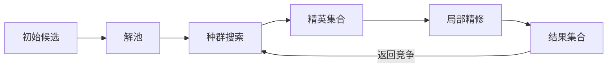

# NSGABlack

**面向优化算法设计、组合与应用的 Python 框架。**

定义问题，装配搜索组件，再用解池与执行计划组织种群搜索、局部精修、共享档案和嵌套求解。
NSGABlack 将候选解的管理、算法结构与搜索决策分开，让算法代码集中描述“怎样搜索”，
并由公共运行机制维护候选身份、反馈对齐、预算和恢复。
通过 MLBlack，模型参数搜索、梯度精修与外层配置优化也可以使用同一套搜索与运行基础设施。

[快速开始](#快速开始) · [核心设计](#核心设计) · [算法与组件](#算法与组件) · [搜索编排](#搜索编排)

[装配示例](#装配示例) · [与 MLBlack 联动](#与-mlblack-联动) · [资源与执行](#资源与执行) · [完整案例](#完整案例) · [文档](#组件发现与文档)

> 本页介绍[当前开发分支](https://github.com/sorrowoMan/nsgablack/tree/codex/framework-review-20261112)的能力，
> 查看实现与运行示例请使用该分支。

## 可以用它做什么

- **修改算法的一部分**：替换初始化、变化或选择规则，扩展成员年龄等状态，保留其余算法流程。
- **组合多种搜索方法**：全局搜索后局部精修，多个种群协作，按阶段、停滞条件或局部额度切换算法。
- **组织候选解的流动**：从池中选择、分组、聚合，维护精英或参考集合，再交给下一段算法。
- **构建完整优化应用**：把问题、算法、运行资源、检查点与结果组织为独立的 Project / Case。
- **将优化与 ML 结合**：搜索模型参数、组合黑盒搜索与梯度更新，或让外层优化 Case 调用内层训练 Case。

例如，一段混合搜索可以这样组织：



种群算法决定哪些成员留下，局部算法按自己的规则精修。
两者通过候选引用和池任务交接，各自维护自己的算法状态。
[GA → VNS → GA 的完整装配](https://github.com/sorrowoMan/nsgablack/blob/codex/framework-review-20261112/examples/cases/assembled_ga_vns/README.md)已经提供对应的标准 Project。

## 快速开始

### 准备匹配的开发环境

当前开发版本为 **0.4.1**，要求 **Python ≥ 3.10**。
当前源码与 `blackbase` 的开发接口协同演进；运行下面的示例，需要先准备与本快照匹配的
[BlackBase 源码](https://github.com/sorrowoMan/blackbase)。配套共享接口还有未发布的开发改动，
下面的安装步骤面向已有匹配源码的开发环境；目前尚未提供可公开复现全部新功能的依赖版本组合。

假设 `blackbase/` 与 `nsgablack/` 并排放置，在 `nsgablack` 根目录执行：

```powershell
python -m pip install -e ../blackbase
python -m pip install -e .
```

算法对照实验按需安装：

```powershell
python -m pip install -e ".[benchmark]"
```

### 创建并运行自己的项目

```powershell
python -m nsgablack project new my_project
cd my_project
python -m nsgablack project add-case search --type solver --framework nsgablack
python run_project.py --check --build-check
python run_project.py
```

生成的 Case 包含可运行的二维平方和问题、候选管线和 NSGA-II，默认执行两次逻辑提交。
`--check --build-check` 用于核对实际装配与生效的资源配置。
下一步可依次替换问题、搜索组件和项目编排，见[从第一个 Project 开始](https://github.com/sorrowoMan/nsgablack/blob/codex/framework-review-20261112/docs/standard_scaffold_tutorial/01_create_and_run.md)。

### 先跑一个现成组合

在仓库根目录执行：

```powershell
# 两个 GA 各自维护种群，Router 统一维护共享精英档案
python examples/cases/pool_workflow_pilot/run_project.py --group parallel_archive

# 两轮 GA → VNS → GA，按阶段计划交接精英与精修结果
python examples/cases/assembled_ga_vns/run_project.py --group plan
```

第一个例子是同一 Solver 内的逻辑并行协作；Project 级并行与跨 Case 调用另有独立示例。

## 核心设计

框架按 **Problem → Pipeline → Unit → Adapter → Bias → Plugin** 分工，Pool 贯穿候选管理与交接。
这是职责关系，不是固定的六阶段执行顺序。

- **Problem**：定义原始目标、约束和评估含义。
- **Pipeline**：提供候选初始化、表示变换与问题侧修复等数据处理能力。
- **Pool**：组织候选版本和引用集合，提供选择、分组、合并及入池操作。
- **Unit**：保存算法需要的结构、成员属性与关系，例如种群、搜索节点或局部区域。
- **Adapter**：拥有搜索决策，按需创建 Unit，提出候选并消费反馈。
- **Bias**：表达选择偏好，同时保留 Problem 的原始求值与约束证据。
- **Plugin**：参与日志、评估后端、检查点、观察和结果发布等生命周期能力。

Solver 将这些组件装配起来，安排评估、接纳、更新和提交。
初始化、变化、选择、修复是可装配的行为类别，各算法按自己的流程使用它们。

### Pool 管候选，Unit 管算法中的关系

同一个候选可以被多个算法引用，但它在不同算法中的排名、年龄或方向关系可能不同。
Pool 保存精确的候选版本；Unit 保存“这个候选在本算法中是什么成员”。

因此，一个种群淘汰某个成员，不会顺带删除其它算法仍在使用的候选。
同一候选占据多个槽位时，也可以保留各槽位自己的属性。
读取已有解保留身份，变化产生新提案；候选数值相等不代表它们是同一个解。

普通变化规则可以直接复用基础 Unit。
需要增加算法状态时，再通过 `UnitBinding` 扩展结构及成员维护规则；未启用的算法无需提前构造 Unit。

### Unit 扩展维护的是状态语义

例如给种群成员增加年龄：原成员为 `[A, B, C]`，年龄为 `[10, 4, 7]`。
若一次环境选择留下 `[C, D, A]`，约定旧成员存活一次年龄加一，新成员从零开始，
那么新年龄应为 `[8, 0, 11]`。

Adapter 负责“留下谁”；Unit 通过 `member_fields` 与 `on_members_changed` 定义年龄怎样更新。
候选、目标、约束、token 与扩展字段的来源对齐继续复用共同的成员操作；
回滚和 checkpoint 走该 Unit 的原状态协议，无需为 age 再造一个恢复管理器。

选择器可以读取 `pool.member_field("age", default=0)`；
父代选择的 `request.members` 和完整变化的 `request.parent_pool` 保留具体槽位。
同一个候选重复占槽时，各自属性仍可区分。路径代价、信赖域几何等结构另按对应 Unit 契约维护。
具体实现见 [成员扩展与维护](https://github.com/sorrowoMan/nsgablack/blob/codex/framework-review-20261112/docs/architecture/UNIT_MEMBER_OPERATIONS_CN.md)。

### Pool、context 与持久数据

Pool 组织“哪些候选、哪一版、属于哪个集合”；context 传递当前阶段、局部任务和轻量运行信息。
完整种群、模型、历史和大数组使用 Snapshot 或 Artifact 引用，不长期塞进共享 context。
同一 Case 中的子池通常只是引用集合，不为每个方向再复制一份完整候选值。
跨 Case 的模型或结果交接则使用正式 Artifact，不能把一个运行中的池直接别名到另一个运行。

## 搜索编排

### 算法内部：选择、变化和交付

Pool 操作可以按算法含义组合：从两个来源各取父代、先交叉后扰动、从最终成员选精英、
或将部分结果交给后续任务。普通数值算子使用局部草稿；新候选后续仍需正式评估和接纳。

### Case 内：多算法、角色和局部阶段

Pool 操作描述“取哪些解、如何分组、送到哪个区域”；
Router、Chain 与 SearchPlan 描述“哪个算法何时执行、运行多久、何时等待或交还结果”。

例如，有限循环可以用已有计划表达，而无需手算全局代数：

```python
from nsgablack.adapters import repeat, serial, stage

plan = repeat(times=2, body=serial(
    stage("ga", steps=2, label="ga"),
    stage("vns", label="vns"),
    stage("ga", label="return"),
))
```

这是执行计划片段；算法实例、池输入和结果返回仍需显式装配。
完整代码见 [GA / VNS 的阶段组合](https://github.com/sorrowoMan/nsgablack/blob/codex/framework-review-20261112/examples/cases/assembled_ga_vns/cases/hybrid_search/adapter/composition.py)。

Router 可分配角色与实例，Chain 可连接阶段，SearchPlan 可表达有限 serial / multi / repeat。
局部步数、停滞条件和本轮任务完成由各自声明决定；暂停继续保留算法实例与状态，
重复一个阶段不等于重新构造算法或重放 setup。

`stage.steps` 表示阶段推进次数；`PoolTaskSpec.steps` 表示每个起点的局部搜索额度。
精修阶段需要等待任务完成，再把本轮结果交回原算法竞争。
`multi` 表示同一 Solver 的多分支协作，不自行创建 CPU 线程。

### Project 层：多 Case、DAG 与真正的嵌套

独立 Solver / Trainer 放在不同 Case 中，由 Project 声明串行、并行或 Artifact 依赖 DAG。
一个 Case 的评估还可以动态调用另一个 Case，形成运行时的内层任务树。
静态依赖与动态嵌套可以同时存在，资源、预算和结果仍由共享底座管理。

同一问题中的 GA + VNS 通常属于 Case 内的算法组合；
“外层搜索模型配置、内层训练模型”则是不同问题的 Case 嵌套，两层保持独立候选含义。
示例见 [并行 Case](https://github.com/sorrowoMan/nsgablack/blob/codex/framework-review-20261112/examples/cases/assembled_parallel_cases/README.md)与
[优化 → ML → 优化三级 Project](https://github.com/sorrowoMan/nsgablack/blob/codex/framework-review-20261112/examples/cases/super_topology_orchestration/README.md)。


## 算法与组件

### 按搜索需求选择算法

- **种群与多目标搜索**：NSGA-II、NSGA-III、SPEA2、DE 等维护各自成员及选择规则。
  可组合变化、生存选择、精英档案和后续精修，不要求所有种群算法共享同一套排名状态。
- **分解与方向搜索**：MOEA/D 维护方向、邻域与替换规则，按方向发布带创建者身份的投影子池。
  支持投影任务的局部算法可按对应方向精修，原始多目标反馈仍保留在候选记录中。
- **邻域与单轨迹搜索**：VNS、SA、PatternSearch、SingleTrajectory 等保留当前位置及各自接受规则。
  可从指定池取得起点，搜索后交付本任务的最终选择。
- **局部几何与梯度方法**：多类信赖域、有限差分梯度及 Provider 优化器。
  采样区域、探针配对、步长、梯度或优化器状态由对应结构维护。
- **路径与标签搜索**：A*、MOA* 保留父路径、边代价与标签关系；候选修复不能静默破坏这些关系。
- **模型、分布与档案驱动方法**：同步 BO、CMA-ES、MAP-Elites 分别保留观测/模型、整批分布更新和格子档案语义。
  它们不能只靠一个通用种群矩阵表达全部状态。

算法存在与算法的所有组合已完成验证是两件事。
各族实际消费哪些初始化、变化、选择或修复入口，见
[操作装配边界](https://github.com/sorrowoMan/nsgablack/blob/codex/framework-review-20261112/docs/architecture/ADAPTER_OPERATION_BOUNDARIES_CN.md)与
[算法语义验收](https://github.com/sorrowoMan/nsgablack/blob/codex/framework-review-20261112/docs/architecture/ALGORITHM_SEMANTIC_ACCEPTANCE_CN.md)。

### Bias：表达偏好，保留原始测量

Bias 可以表达对单个候选的偏好，也可以显式参考某个 Unit 的成员关系、分布或历史。
例如“相对当前种群更有多样性”需要绑定具体种群；两个种群不能共用一份可写的全局多样性排名。

原始目标与违反量属于 Problem，偏好形成的是选择视图。
软化选择评分不会把不可行候选的原始违反量改成零；硬可行性接纳仍依据原始约束。
整体结构或变化偏好是否影响算法行为，由实际 Adapter 决定。
详见 [Unit 偏好契约](https://github.com/sorrowoMan/nsgablack/blob/codex/framework-review-20261112/docs/architecture/UNIT_PREFERENCE_CONTRACT_CN.md)。

### Plugin / Provider：接入运行能力与后端

Plugin 参与日志、结果报告、checkpoint、运行观察和发布等生命周期。
Evaluation Provider 可在声明的接口上接入模型、数值求解器、仿真器或外部评估服务。
MLBlack 的能力组件也参与同一生命周期。

组件按职责声明观察、建议、决定或否决的范围。
评估后端必须满足数量、形状、身份和错误传播契约；
声明为原始评估的值与代理预测、偏好分数应在使用方式和结果解释中区分。
后端接入不需要把日志、数据库连接或活模型对象复制进算法 Unit。

## 装配示例

下面是 Case 的 Adapter 工厂片段：定义一条完整变化规则，
沿用 NSGA-II 的生存选择，再从本轮最终成员中维护一个精英集合。

```python
from nsgablack.adapters import NSGA2Adapter, Pool


def change(request, *, rng):
    center = request.parents.mean(axis=0)
    return center + rng.normal(0., 0.1, center.shape)


def maintain_elite(request, *, rng):
    elite = request.members.top(
        20, key=lambda pool: pool.raw_feedback()[0][:, 0]
    )
    Pool(parent=request.members, name="elite").inject(
        elite, replace=True
    )


ga = NSGA2Adapter(
    population_size=100, offspring_size=80, change=change
)
ga.set_pool_maintenance(maintain_elite)
```

这里的变化是“父代均值＋高斯扰动”，精英规则明确采用原始第一目标；
多目标 Pareto 留存需要选择相应规则。自定义 `change` 接管完整变化，不额外叠加默认交叉与变异。

将 `ga` 交给本 Case 的 Solver 后，候选继续经过正式预算、评估和接纳流程。
具名池的变更随原步骤一起提交；失败时回滚工作状态，已发生的求值成本保留。
该片段不包含 Problem / Pipeline 的定义，完整工程入口见 [Pool 工作流 Project](https://github.com/sorrowoMan/nsgablack/blob/codex/framework-review-20261112/examples/cases/pool_workflow_pilot/README.md)。

同样的维护入口也可以绑定到 Router，在子更新完成后统一归并共享档案。
需要分别读取不同算法的成员属性时，使用 `request.members_by_owner`。
更多真实接口与支持边界见 [Pool 手册](https://github.com/sorrowoMan/nsgablack/blob/codex/framework-review-20261112/docs/architecture/POOL_API_REFERENCE_CN.md)。

## 与 MLBlack 联动

NSGABlack 提供优化搜索与运行控制；MLBlack 提供模型和学习任务的语义。
两者可以使用同一套候选、Adapter、Unit、Pool、预算、步骤事务和结果发布机制，
也可以作为独立 Case 进行内外层调用。

### 一、让搜索算法直接服务于 ML 问题

一个 ML 任务可以拆为：

```text
DataView / Spec              数据、特征、任务与模型规格
        ↓
ModelRepresentation / Codec  参数怎样解释成模型
        ↓
LearningProblem / Provider   损失、指标、约束与可用梯度
        ↓
NSGABlack Adapter / Unit     怎样搜索与更新候选
        ↓
模型、指标、Artifact、报告
```

MLBlack 的 `LearningSolver.fit()` 使用共享的 `ComposableSolver` 运行循环。
`fit` 是 ML 任务入口；初始化、评估、接纳、更新、取消、恢复和最终发布沿用公共控制机制。
ML 层通过语义扩展投影模型结果，并通过正式发布接口交付 Artifact。

下面是一个小型 NumPy 回归示例：数据来自 `y = 1 + 2.5x`，模型参数由 NSGA-II 搜索。
在安装匹配的三仓开发源码后，可以直接执行这个 Python 片段：

```python
import numpy as np

from mlblack.integrations import build_learning_solver
from mlblack.pipeline.data_views import NumericDataView
from mlblack.problems import SupervisedRegressionProblem
from mlblack.representations import LinearPointRepresentation
from nsgablack.adapters import NSGA2Adapter

X = np.linspace(-1.0, 1.0, 12).reshape(-1, 1)
data = NumericDataView(X_train=X, y_train=1.0 + 2.5 * X[:, 0])
problem = SupervisedRegressionProblem(data)
representation = LinearPointRepresentation.from_data(data.X_train)

trainer = build_learning_solver(
    problem=problem,
    representation=representation,
    adapter=NSGA2Adapter(population_size=16, offspring_size=16),
)
trainer.set_random_seed(37)
result = trainer.fit(max_steps=4)
print(result.best_objectives)
```

这里输出本次小预算搜索的最佳原始目标，不代表模型已经收敛。
正式 Project 中，将数据和问题移入对应目录，在 `build_solver()` 装配并传入 Project 提供的 `resource_context`；
本节末尾提供创建训练 Case 的命令。
Problem 决定损失、指标及多目标含义，Representation / Codec 决定模型参数与布局；
Adapter 决定搜索方法。黑盒搜索不要求梯度；使用梯度算法时，学习问题或 Provider 必须提供正确的梯度。
闭式拟合与第三方 `fit` 也可放在声明的 Problem / Provider 路径中，通过统一生命周期执行。

### 二、同一模型：种群搜索后逐成员梯度精修

当两个算法面对同一模型解释、同一候选坐标和同一学习问题时，可以共用运行内的候选池。
GA 的种群状态和梯度算法的参数/优化器状态分别保存在各自 Unit 中。

沿用上例的 `problem` 和 `representation`，将单个 GA 换成以下执行计划：

```python
from blackbase.orchestration import ExecutionPlan
from mlblack.integrations import build_learning_solver
from nsgablack.adapters import (
    GradientOptimizerAdapter, MultiStrategyConfig, NSGA2Adapter,
    PoolTaskSpec, SearchPlanAdapter, StrategySpec, subpools,
)

ga = NSGA2Adapter(name="model_population", population_size=2, offspring_size=2)
sgd = GradientOptimizerAdapter(
    name="model_refinement", optimizer="sgd", learning_rate=0.1
)
search = SearchPlanAdapter(
    ExecutionPlan.serial(
        ExecutionPlan.leaf("ga", steps=2),
        ExecutionPlan.leaf("sgd"),
    ),
    strategies=[
        StrategySpec(ga, "ga"),
        StrategySpec(sgd, "sgd", pool_task=PoolTaskSpec(
            subpools.all(ga), count="all", steps=2, shuffle=False,
        )),
    ],
    config=MultiStrategyConfig(total_batch_size=2, adapt_weights=False),
)
trainer = build_learning_solver(
    problem=problem, representation=representation, adapter=search,
)
trainer.set_random_seed(37)
trainer.fit(max_steps=6)

refined_refs = search.get_pool_task_results(trainer, "sgd")
refined_candidates = trainer.read_solutions(refined_refs)
print(refined_candidates.numeric_matrix)
```

GA 先发布自己准确的 population 成员视图，池任务再将每个成员交给 SGD 建立基准并精修。
这个小配置共运行 6 次逻辑提交：GA 两次，以及两个成员各自的基准评估与梯度更新。
`refined_refs` 是精修结果的准确候选引用，`refined_candidates` 同时保留数值和模型语义。

这个组合**独立交付精修结果，不自动替换 GA 成员**。
若需要返回竞争，须再装配相应接收阶段。
现有固定模型布局专项覆盖了连续执行、GA 后恢复、旧成员版本保留、结果新身份和原始反馈；
它不代表任意神经网络布局、Adam 后端或 Provider 的排列都已验证。

### 三、外层优化配置，内层训练模型

外层候选可以是模型容量、正则化强度等配置；内层候选则是模型参数或训练规格。
每次外层评估调用一个正式 ML Case，并把验证损失、复杂度、耗时等明确的结果投影为外层目标。

```text
外层 Solver Case
    配置候选 x
        → 内层 ML Case
            数据与模型解释 → 训练/评估 → 模型与指标
        ← 指标、结果和 Artifact 引用
    按外层目标选择下一个配置
```

不同 Case 拥有独立的运行身份、Pool 和局部算法状态。
交接通过标准请求、输入参数与权威 Artifact，不把外层配置池当成内层参数种群。
外层与内层预算分别计量，并沿授权链结算。

### 四、训练过程也可以调用优化 Case

方向还可以反过来：学习任务需要校准参数、求解一个内部优化子问题，或使用外部求解器。
ML Problem / Provider 通过标准内层 Case 接口调用 Solver，再消费实际返回的解与反馈。

已有 [三级跨框架 Project](https://github.com/sorrowoMan/nsgablack/blob/codex/framework-review-20261112/examples/cases/super_topology_orchestration/README.md) 将两种方向放在一起：

```text
baseline_solver ──┐
                 ├─ 外层搜索配置 → 嵌套 Trainer → 内层 Solver
baseline_trainer ┘
```

两个基线是 Project DAG 的就绪节点；发布 Artifact 后，外层搜索开始。
外层每个候选动态调用 Trainer，Trainer 再调用内层 Solver 求校准参数。
该例为有界合成任务，用于说明跨框架求值、资源与结果交接，不用于证明大型模型训练吞吐。

在已安装匹配三仓开发源码的环境中运行：

```powershell
python examples/cases/super_topology_orchestration/run_project.py --check --build-check
python examples/cases/super_topology_orchestration/run_project.py
```

可以直接查看 [Project DAG 与资源配置](https://github.com/sorrowoMan/nsgablack/blob/codex/framework-review-20261112/examples/cases/super_topology_orchestration/project_config.py)、
[外层调用 Trainer](https://github.com/sorrowoMan/nsgablack/blob/codex/framework-review-20261112/examples/cases/super_topology_orchestration/cases/outer_search/problem/nested_training_problem.py)和
[Trainer 内层求解](https://github.com/sorrowoMan/nsgablack/blob/codex/framework-review-20261112/examples/cases/super_topology_orchestration/cases/nested_trainer/evaluation/fit_method.py)。

### Codec 与 Unit 各自维护什么

- 模型 Codec 解释参数含义、张量布局和模型构造；搜索结构的 Unit 维护成员、方向、当前位置或优化器状态。
- 同一模型布局可以被多个算法使用，但其搜索排名、动量等可写运行状态不共享。
- 一个模型配置的训练产物不是原配置候选本身；模型 Artifact、活后端状态与可传输参数应分别处理。
- 目标投影不等于梯度变换。当前 `GradientOptimizerAdapter` 不接受目标投影池任务；只变换目标值不会同步变换梯度。
- 恢复已评估模型不应隐式重新拟合、初始化候选或重跑内层 Case；具有拟合副作用的 Problem 需要显式恢复规则。

### 可发现的 ML 组件

MLBlack 的组件面覆盖不同数据、模型与执行方式：

- **数据**：数值、时序、图像、图与偏好对 DataView；列选择、标准化和时序窗口等管线处理。
- **模型表示**：线性模型、NeuralGraph、符号表达式与符号基函数；sklearn 树／MLP 和 XGBoost 的 EstimatorSpec 工厂。
- **输出 Head**：点预测、区间、分类概率，以及正态、泊松和负二项分布参数。
- **执行后端**：Provider-backed 学习问题、Torch Evaluation Provider，以及按能力选择的 NumPy、PyTorch、JAX、TensorFlow 接口。
- **结果交付**：模型与训练状态 Artifact、Torch／树集成／XGBoost 类型产物、ArtifactBundle 和 RunReport。

数据表示、模型、Head、Provider 和 Adapter 各自承担不同职责，
具体组合须匹配可选依赖与能力契约。例如 NumPy 后端不声明 autograd / optimizer 能力，
不能把“后端存在”理解为所有训练路径都可互换。
上面的专项验收也不代表这些组件的全部排列都已验证。

### 创建一个 ML Case

在仓库根目录按需安装匹配的 MLBlack 开发源码：

```powershell
python -m pip install -e ../mlblack
```

然后在前面生成的 `my_project/` 内添加训练 Case：

```powershell
python -m nsgablack project add-case train --type trainer --framework mlblack
python run_project.py --check --build-check
python run_project.py
```

生成的训练 Case 从可运行的 NumPy 线性回归基线开始。
Solver 与 Trainer 使用同一种 Project / Case 脚手架；数据、模型解释、评估和 Artifact 语义由 MLBlack 承担。
更多模型与后端能力见 [MLBlack 仓库](https://github.com/sorrowoMan/mlblack)。

## 完整案例

按想实现的事情选择入口：

- **选择、变化、精英分流与共享档案**：[Pool 工作流](https://github.com/sorrowoMan/nsgablack/blob/codex/framework-review-20261112/examples/cases/pool_workflow_pilot/README.md)。
- **种群搜索与局部精修**：[GA + VNS](https://github.com/sorrowoMan/nsgablack/blob/codex/framework-review-20261112/examples/cases/assembled_ga_vns/README.md)。
- **方向子问题与递归精修**：[MOEA/D 嵌套投影](https://github.com/sorrowoMan/nsgablack/blob/codex/framework-review-20261112/examples/cases/assembled_moead_nested/README.md)。
- **模型观测、整批更新与格子档案**：[同步 BO、CMA-ES、MAP-Elites](https://github.com/sorrowoMan/nsgablack/blob/codex/framework-review-20261112/examples/cases/algorithm_semantics/README.md)。
- **生产排程及供料调整**：[生产排程](https://github.com/sorrowoMan/nsgablack/blob/codex/framework-review-20261112/examples/cases/production_scheduling/README.md)、[嵌套到料调整](https://github.com/sorrowoMan/nsgablack/blob/codex/framework-review-20261112/examples/cases/supply_adjustment_nested/README.md)。
- **优化与 ML 双向嵌套**：[三级 Solver → Trainer → Solver](https://github.com/sorrowoMan/nsgablack/blob/codex/framework-review-20261112/examples/cases/super_topology_orchestration/README.md)。
- **多 Case、资源与组合装配**：[综合装配工作台](https://github.com/sorrowoMan/nsgablack/blob/codex/framework-review-20261112/examples/cases/assembly_workbench/README.md)。
- **效果、语义和额外开销的对照**：[算法透明性实验](https://github.com/sorrowoMan/nsgablack/blob/codex/framework-review-20261112/examples/cases/algorithm_transparency/README.md)。

已有 Adapter 涵盖 NSGA-II/III、SPEA2、MOEA/D、DE、VNS、SA、A*、信赖域、梯度及模型驱动搜索等。
各算法保留自己的状态与比较规则，支持的操作和组合方式以各组件说明为准。

## 一次运行怎样保持一致

一次搜索尝试通常包含：

1. Adapter 从自有结构或声明的池来源提出候选。
2. 控制面按预算限制送评数量；已装配的问题修复执行后，结构所有者对修复结果完成对账。
3. Problem 或声明的 Provider 求值，Bias 形成选择视图，原始反馈保留。
4. 接纳策略给出最终处置，未接纳行不混入 Adapter 更新。
5. Adapter 决策与 Unit 成员维护完成，具名池修改形成提交计划。
6. 状态、池引用与权威快照在原事务中发布，只有提交才推进逻辑步数。

修复是显式装配的能力；问题修复和算法结构修复有不同职责。
同一提案在评估前被修改，与评估后部分接纳，是两个不同的对齐问题，不能相互替代。

### 预算、取消与恢复

- **预算区分层次**：逻辑步数、物理尝试、实际评估及内层 Case 消耗分别记录。
  一次失败的评估已经消耗算力，不能因算法状态回滚而把预算清零。
- **失败不发布半成品**：未提交的集合修改与 Unit 更新一起回滚，已发生的评估证据保留。
- **取消与等待不制造进度**：空执行、拒绝或取消不计为成功的一代；内层取消沿正式控制链传递。
- **恢复沿用原状态**：候选身份、池内容、算法状态、进度、RNG 与所需模型投影共同恢复，
  不通过数值匹配猜身份，也不隐式重跑 Problem 来补造结果。

公开 checkpoint 入口的生产应用示例见
[生产排程的保存、恢复与大预算运行](https://github.com/sorrowoMan/nsgablack/blob/codex/framework-review-20261112/docs/user_guide/PRODUCTION_CHECKPOINT_AND_LARGE_RUN_CN.md)。
组件实现细节、发布边界和契约见 [运行语义](https://github.com/sorrowoMan/nsgablack/blob/codex/framework-review-20261112/docs/architecture/RUNTIME_CONTRACTS_CN.md)。

## 资源与执行

Project 统一发放 `ResourceContext`，Case 声明线程、worker、CPU/GPU 或后端需求，
算法和 Provider 消费实际授权。嵌套调用使用派生授权，避免每层都按“机器全部资源”启动计算。
资源授权本身不等同于操作系统的硬限制。

需要区分三个层次：

- **同一 Solver 的算法协作**：Router 组织多个提案所有者，不自动创建线程。
- **本机并发执行**：Project 可并行运行独立 Case；支持的批量内层评估也可并行派发完整子 Case。
  批次结果按原候选顺序对齐，不因结果先后到达就自动改变算法更新方式。
- **跨主机 Case 分发**：需要匹配的执行 transport、代码与数据版本、持久资源/预算账本及可信 Artifact 存储。
  本机文件路径或 Snapshot key 不能直接当作远端可读地址。

现有实现与测试覆盖完整内层 Case 的批量派发、结果顺序、取消、预算和 Artifact 交付。
文档也记录过本机与两台节点的短程正式验收；该记录不代表任意云集群或全规模生产预算都已验收。
接入条件及剩余限制见 [状态成本与内层执行](https://github.com/sorrowoMan/nsgablack/blob/codex/framework-review-20261112/docs/architecture/STATE_COST_AND_NESTED_EXECUTION_CN.md)。

## 项目组织与框架栈

```text
my_project/
  project_config.py          # 跨 Case 编排与资源需求
  run_project.py             # Project 运行入口
  cases/
    search/
      build_solver.py       # Case 装配入口
      run_solver.py
      config.py
      problem/
      pipeline/
      adapter/
      bias/
      plugins/
      evaluation/
      runtime/
      solver/
```

每个 Case 是独立运行和被外层调用的组合单元；Project 负责跨 Case 的执行与资源授权。
同一套脚手架也用于内外层嵌套，输入、结果和 Artifact 通过正式边界传递。

NSGABlack 与两个独立项目协作：

- [BlackBase](https://github.com/sorrowoMan/blackbase)：共享项目编排、资源授权、Context / Snapshot / Artifact 与公共运行协议。
- **NSGABlack**：优化问题、候选搜索、算法结构、多目标选择和求解结果。
- [MLBlack](https://github.com/sorrowoMan/mlblack)：ML 数据、模型语义、训练、评估和模型 Artifact。

使用优化搜索无需先引入 MLBlack。需要将模型训练或推理接入优化任务时，再通过正式 Case / Provider 能力组合。

## 组件发现与文档

查找现有组件及其装配说明：

```powershell
python -m nsgablack catalog search vns --profile framework-core --limit 5
python -m nsgablack catalog show adapter.nsga2 --profile framework-core
```

### Catalog：从用途找到组件

Catalog 可查询组件职责、装配参数、必要依赖、使用示例、来源与关系。
`framework-core` 只看框架主干；`default` 同时包含示例与文档。
跨框架索引可用于发现 ML 组件，实际能力仍由其所属仓库声明。

### 工作区与 AI 引导

辅助界面围绕正式 Project 工作流提供：

- 从自然语言起草受支持的问题定义，查看并编辑变量、目标和约束。
- 在支持的组件与操作范围内自由装配，调整局部参数、输入池和阶段计划。
- 导出正式 Project，查看、修改组件代码，执行构建检查与受控试跑。
- 读取可信已有 Project 的代码与数据结构，起草修改，再核对差异与正式运行结果。

网页公式入口、自由装配表单与 Project 代码工作区支持的范围有所区别，
并非所有算法、模型和领域 Problem 都已经进入同一个网页入口。
AI 生成的说明不是运行收据；组件应按实际来源与执行状态解释。
详细入口见 [实验台](https://github.com/sorrowoMan/nsgablack/blob/codex/framework-review-20261112/docs/architecture/CATALOG_LAB_CN.md)与
[已有 Project 的 AI 协作](https://github.com/sorrowoMan/nsgablack/blob/codex/framework-review-20261112/docs/user_guide/PROJECT_AI_COLLABORATION_CN.md)。

- [文档入口](https://github.com/sorrowoMan/nsgablack/blob/codex/framework-review-20261112/docs/README.md)与[标准脚手架教程](https://github.com/sorrowoMan/nsgablack/blob/codex/framework-review-20261112/docs/standard_scaffold_tutorial/README.md)
- [算法操作装配边界](https://github.com/sorrowoMan/nsgablack/blob/codex/framework-review-20261112/docs/architecture/ADAPTER_OPERATION_BOUNDARIES_CN.md)
- [Pool 接口与实例](https://github.com/sorrowoMan/nsgablack/blob/codex/framework-review-20261112/docs/architecture/POOL_API_REFERENCE_CN.md)
- [自然搜索编排](https://github.com/sorrowoMan/nsgablack/blob/codex/framework-review-20261112/docs/architecture/NATURAL_SEARCH_PLANS_CN.md)
- [Unit 构建与扩展](https://github.com/sorrowoMan/nsgablack/blob/codex/framework-review-20261112/docs/guides/ALGORITHM_UNITS_CN.md)
- [运行契约与恢复](https://github.com/sorrowoMan/nsgablack/blob/codex/framework-review-20261112/docs/architecture/RUNTIME_CONTRACTS_CN.md)
- [Catalog 使用](https://github.com/sorrowoMan/nsgablack/blob/codex/framework-review-20261112/docs/architecture/CATALOG_USAGE_CN.md)
- [全部示例](https://github.com/sorrowoMan/nsgablack/blob/codex/framework-review-20261112/examples/cases/README.md)

## 基准与验证

验证分开回答三个问题：

1. **抽象是否透明**：相同输入、随机条件和求值预算下，装进框架后是否保持参考算法轨迹。
2. **算法实现是否符合定义**：与独立参考实现、问题参考集和算法数学性质核对。
3. **额外成本有多少**：分别测量正常迭代、评估、修复、池操作、状态保存、证据与持久化开销。

多目标效果度量使用 pymoo 的 HV / IGD 等测量器；
廉价函数、不同评估成本和生产排程提供不同负载场景。
修改任务则观察增加状态、让状态参与选择、重复槽位、部分接纳和恢复时的额外维护工作。

某条路径轨迹一致，不代表全部算法已达到文献水平；
一个小规模并发案例成功，也不能替代长期吞吐与资源隔离测试。
实验入口见 [透明性基准](https://github.com/sorrowoMan/nsgablack/blob/codex/framework-review-20261112/docs/architecture/ALGORITHM_TRANSPARENCY_BENCHMARK_CN.md)、
[算法对齐](https://github.com/sorrowoMan/nsgablack/blob/codex/framework-review-20261112/docs/architecture/CLASSICAL_ALGORITHM_ALIGNMENT_CN.md)和
[修改任务对照](https://github.com/sorrowoMan/nsgablack/blob/codex/framework-review-20261112/docs/architecture/MODIFICATION_TASK_COMPARISON_CN.md)。

## 开发状态

当前为开发快照。仓库已提供可运行的核心框架、标准案例和专项测试；
不同算法与组合的支持程度有所区别，测试结果只对应具体版本、路径和配置。

当前验证基于匹配的本机开发依赖，尚未完成全部组件的干净环境安装与全仓验收。
最近一次提交的检查结果和已知问题见 [开发快照验证说明](https://github.com/sorrowoMan/nsgablack/blob/codex/framework-review-20261112/docs/research/VALIDATION_STATUS_20261112.md)。
跨独立 Case 的异步归并、部分高级组合的使用体验和更多性能对照仍在完善。

## License

[MIT](https://github.com/sorrowoMan/nsgablack/blob/codex/framework-review-20261112/LICENSE)
