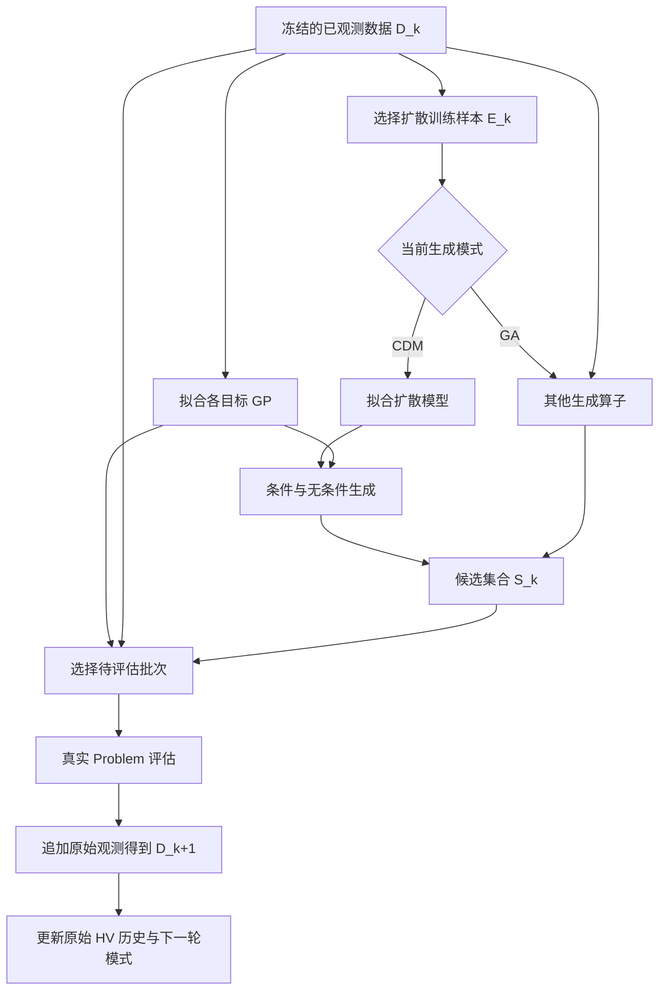

# 前沿算法拆解试验：CDM-PSL

日期：2026-10-18。

本文记录“初始化、变化、选择、修复”四类能力的第一轮具体试验。对象是 AAAI 2025 的 CDM-PSL，依据原论文的外层依赖图建立测试专用行为重放。它不是新的公共 Adapter API，也不是 CDM-PSL 的完整实现或性能复现。

当前运行规范仍以 [RUNTIME_CONTRACTS_CN.md](RUNTIME_CONTRACTS_CN.md) 和实际 `propose/update` 接口为准。本文中的能力划分属于待验证设计；测试中的值和接口不替代正式 SolutionRef、UnitBinding、Provider 或步骤事务。

2026-10-19 补充：后续已在 NSGA-II/III、SPEA2 上完成独立父代选择和 mutator 的局部生产试验，见 [Adapter 算子装配](ADAPTER_OPERATOR_BINDINGS_CN.md)。该试验连接实际 Solver、解池与步骤事务；它不把本文的 CDM-PSL 测试重放升级成真实模型或性能复现。

## 1. 这次检验什么

检验的问题是：把论文的一轮搜索拆成边界明确的能力后，是否仍然保留相同的数据来源、模型依赖、评估请求和后继状态。

允许同一能力族有多个调用位置、多个具体组件，也允许没有独立 repair。不能把完整算法循环放进一个 `change(solver, context)`，然后声称已经拆解。

本轮分开报告三种证据：

- 原论文分析：确认算法的操作和依赖。
- 测试专用重放：以固定模型输出检验所实现控制骨架的组合和数据语义。
- 当前源码检查：判断未来正式 Adapter 可以接在哪些现有接口上。

没有运行真实 GP 或扩散训练，没有复现论文候选分布和搜索指标，也没有用测试替身证明正式 Solver 的事务或资源处理。

## 2. 参考版本与复现边界

主要参考是 [CDM-PSL 原论文](https://ojs.aaai.org/index.php/AAAI/article/view/34913/37068) 的 Algorithm 1、Algorithm 2、Algorithm 3、Figure 1 及 Selection Strategy 小节。

原论文公开于 2025-04-11，见 [AAAI 论文入口](https://ojs.aaai.org/index.php/AAAI/article/view/34913)。本次以论文的依赖关系为流程基线，不声称逐指令复刻作者代码。

特别区分以下事实：

- Algorithm 2 描述使用 SDE 选择扩散训练样本；作者公开代码中的训练样本筛选还有不同的实现细节。
- Algorithm 3 接收已训练的扩散模型，不能把它的调用名误读成“不需要训练”，也不能把训练和生成作为一个不透明大操作。
- 论文描述按 HV 进展窗口切换生成算子，但没有完整规定所有边界情形的切换公式。重放中的窗口判据是显式命名的试验策略，不是对论文精确公式的复现。
- 作者代码的模型、采集与切换实现不完全由论文伪代码展开。因此，流程重放通过，不等于原代码复现通过。

作者项目为 [ilog-ecnu/CDM-PSL](https://github.com/ilog-ecnu/CDM-PSL)。如后续复现代码，应另行固定 commit、依赖和配置，不能把移动分支的行号作为可复现版本。

## 3. 原论文的一轮依赖图

设 D_k 为第 k 轮开始时的已观测候选及其原始目标，mode_k 为当前生成模式。

初始化是 LHS 产生初始设计，再由真实 Problem 评估，得到 D_0。初始化操作本身不偷偷调用 Problem。



图的拓扑来自论文；重放实现使用一个确定的串行顺序对账，不验证并行调度。论文 Algorithm 1 在生成分支判断前选择训练样本；GA 分支不拟合扩散模型。条件生成还依赖 GP 引导，不能只传一个扩散模型就宣称保留了原机制。

## 4. 四类能力的具体归属

### 4.1 初始化

负责初始候选、随机状态及搜索状态的建立。真实求值由外部评估边界执行。

本轮重放从固定的初始观测开始，只检验后续初始化状态如何传入能力组合，不检验 LHS 的统计性质或真实初始化评估链。

### 4.2 变化

至少应拆成下列有明确输入输出的操作，而不是一个通用 `change`：

```text
fit_gp(完整 raw 数据版本, 配置, 随机状态) -> GP 版本
fit_diffusion(选定训练引用, 对应数据版本, 配置) -> 扩散模型版本
generate_diffusion(扩散模型版本, GP 版本, 条件, 随机状态) -> 新提案
generate_ga(父代来源, 算子参数, 随机状态) -> 新提案
append_observations(原数据版本, 实际候选, raw 反馈) -> 新数据版本
```

这里“变化”包括候选生成与明确限定的模型或数据状态更新，但具体组件不能读写整个 Solver。拟合、采样和追加观测有不同的输入、结果和允许效果，应分别装配和记录。

真正的训练后端属于 mlblack、正式 ML Case 或外部 Provider。优化 Unit 可以保留模型版本与 Artifact/StateRef 等正式引用，不能把活模型、锁、executor 或设备会话当作普通字段复制进 codec。引用类型和持久化收据必须服从现有协议。

### 4.3 选择

候选选择至少有两个不同位置：

- 从已观测 D_k 选择扩散训练样本 E_k。
- 从生成的 S_k 中选择本轮真正送评的 B 个候选。

GP 训练消费完整 D_k，扩散模型训练消费 E_k。即使两个输入都是“候选集合”，也不能接成同一个列表。

下一轮选择哪个生成算子是组合控制决策。它不能冒充上述两个候选选择器，也不能藏在 UnitFeature 或日志 Plugin 内。将其是否纳入更广义的“选择能力族”作为设计选择显式记录；本轮保留为 Adapter 组合流程中的具名策略，不用它证明四种候选接口已经覆盖全部编排逻辑。

### 4.4 修复

原论文没有要求每个算法都执行一个独立通用 repair。没有修复需求时应允许缺省。

域处理与预测/批选的顺序必须明确：

1. 若要求根据最终可评估候选选择批次，应先得到域内候选，再预测和批选。
2. 若最后的控制面 repair 又改变了候选，之前的预测只能作为旧版本预筛选的历史理由。需要继续使用该预测比较新版本时，必须重新预测或给出不变性依据。
3. 实际训练样本总是“送评的最终候选版本 + 它的原始反馈”。

语法/域校验和拒绝不是修复；扩散模型的去噪生成也不会仅因名字相似而自动归为 repair。

## 5. Pool、Unit、Problem、Bias、Plugin 分别保存什么

Pool 保存候选版本、来源与评估关联；不把代理预测登记为真实评估。新生成候选获得新身份；数值相等的不同候选仍保留各自身份。

Unit 保存算法实际需要的观测引用、训练子集、模型版本引用、生成模式、HV 窗口及 pending 提案关联。观测历史与 Pareto 结果是两个集合：被支配的已评估候选仍然可以是有效训练样本，不能因为没有进入最终 Pareto 集就被从历史删除。

Problem 定义真实原始目标和约束。训练 raw 目标分布时应显式取 `OptimizationFeedbackBatch.raw_objectives/raw_violations`；归一化等训练转换须单独声明，不能把 Bias 选择视图冒充原始标签。

Bias 在需要时提供明确的软评分。本轮不把扩散引导、采集函数、批次选择、硬可行性或算子切换统称为 Bias，也不添加论文没有要求的 Bias。

Plugin/Provider 承接已有的模型调用、观察、检查点和资源能力。搜索决定仍由 Adapter 的显式组合承担；全局资源授权仍由 BlackBase L0 发放。

## 6. 一个能发现语义错误的手算片段

以下仅是采集与数据合并的说明性例子，不是论文训练规模、采集函数或候选分布的复现。

两个目标均最小化，HV 参考点固定为 (5, 5)。既有非支配观测为 A=(1,4)、B=(4,1)，HV 为 7。

假设代理给出三个新候选的预测目标：U=(2,2)、V=(3,3)、W=(0.5,4.5)。若用这个说明性预测视图贪心选择两个点，会先选 U，再选 W；相对于原集合，预测 HV 达到 11.25。

真实评估却得到 U=(4.5,4.5)、W=(0.5,4.5)。此时真实 HV 只有 7.25，不能把预测的 11.25 写回原始历史或用它更新真实进展。

U 虽然被支配，也仍是一条真实观测。下一轮 GP 训练可以利用它纠正预测。如果把“本轮送评后没有胜出”误解成“从未获得这个样本”，拆解改变了算法。

这里至少区分四组对象：生成的候选、选中送评的候选、真实观测历史、最终 Pareto 结果。它们有关系，但不是同一个集合。

## 7. 当前仓库可以复用的接入点

源码检查显示，正式试验可先使用标准 Case 内的独立 Adapter，而不预先修改 Solver 内核：

- [UnitBinding](../../units/contracts.py) 与 [UnitBackedAdapter](../../adapters/unit_backed.py) 可承接自定义 Unit、数据 codec、步骤快照和恢复。
- [Symbolic Beam 示例](../../examples/cases/algorithm_units/cases/symbolic_beam/pipeline/beam_units.py) 展示了自定义结构与构建器的现有目录形态。
- [OptimizationFeedbackBatch](../../core/evaluation_feedback.py) 提供原始反馈视图；[控制面](../../core/composable_solver.py) 在 update 前提供接纳候选的精确池引用。
- [ProposalRepair](../../adapters/proposal_repair.py) 和最终 BatchDisposition 分别处理候选修改和行筛选，pending 条件和来源不得重复裁剪。
- [保留根接口](../../adapters/algorithm_adapter.py) 应保护训练历史、当前结果和未完成任务仍需读取的精确候选版本。

当前并没有已经覆盖上述全部操作的统一“四能力装配 API”。存在接入点只说明可以做局部实现，不说明能力已经全部独立可替换。

### 7.1 训练历史的准入边界

论文外层数据集追加实际送评获得的观测。当前 Adapter.update 默认只收到框架接纳的候选，两者不能无条件等同。

在无额外拒绝策略且评估均成功时，可以让实际送评集合全部进入正常 update，再由算法自己区分训练历史与最终选择。若启用硬准入、预算裁剪或失败恢复，应明确记录生成集合 P、已评估集合 E、框架接纳集合 A 和算法结果集合 S。

若要训练被框架拒绝但已有合法 raw 反馈的 E 中样本，需要显式的事件消费、身份去重和恢复契约；本轮没有实现此入口。不能用共享 context 或私读最新一批来补一个隐式旁路。

### 7.2 零接纳不是自动撤销整个 propose

当前 `ComposableSolver.step()` 的普通未提交路径撤回权威 Snapshot 与池发布；异常路径才执行完整 Adapter rollback，随后正常路径仍会结束 Adapter 事务。

因此，不可在 propose 中训练并替换活模型，然后假定“零接纳”一定会撤销训练。应事先规定模型的准备、激活和放弃时机；可以在接纳反馈更新阶段准备下一轮模型，也可以使用显式暂存的不可变模型结果，但必须说明与论文训练时点的等价范围。不能凭通用 Mapping 快照推断任意 Provider 副作用可回滚。

### 7.3 恢复不得靠重新训练

UnitBackedAdapter 先处理策略恢复数据，再安装 Unit codec 的恢复结果。依赖 Unit 的重建应使用 `_after_unit_restore`，避免读取尚未安装的旧训练历史。

正式恢复须保存实际所需的模型/优化器状态、数据与训练版本、归一化状态、随机状态、生成模式和 HV 窗口。恢复时重训会改变状态、耗时和随机轨迹，不能冒充“只恢复”。

## 8. 测试专用重放的验收范围

重放文件：

- [测试专用能力与数据记录](../../tests/cdm_psl_replay_support.py)。
- [拆解与参考流程对账](../../tests/test_cdm_psl_decomposition.py)。

模型训练、生成和选择结果由按完整请求内容查找的录制服务提供。请求包含数据内容、候选身份与版本、模型版本及需要的条件；未知请求必须失败，不能只按调用次数返回第几条输出。

单体参考流程和能力拆解流程分别表达调用关系，并与手写预期结果对账。二者一致只能支持已覆盖观察面的等价性，不能代替预期结果检查。

测试专用的 `ReplayCapabilities` 将拟合、生成、训练样本选择、送评选择、观测追加和可选修复逐项绑定；`decomposed_step` 仍显式表达操作依赖。实际替换试验只改送评选择器，让它选择第二个候选，检查训练、生成和预测请求保持一致，而真实评估对象及新增 raw 观测随选择变化。这证明本轮覆盖流程中的这个选择组件可以独立替换，不扩大成所有能力都已验证复用。

重点观察模型与训练数据依赖、CDM/GA 分支、评估批次、原始标签、身份版本、观测增长和下一轮生成模式。采集数学、训练算法和真实 Problem 由录制替身代替，因此这些部分的正确性不在结论中。

试验中的 HV 窗口判据必须标明为测试策略。它可以检验阈值、更新顺序和分支依赖，但不能证明论文未完全展开的切换实现被复现。

此重放没有连接实际 Solver、SolutionPool、Provider 或步骤事务，不证明预算、取消、部分准入、物理资源清理与恢复组合已经通过。

### 8.1 本次执行结果

2026-10-18 在 Windows、Python 3.13.2、pytest 8.3.5 下执行：

```powershell
python -m pytest tests/test_cdm_psl_decomposition.py -q
```

结果：**16 passed**。这是 10 个测试函数展开参数化后的实例数，覆盖：

1. CDM 和 GA 分支的单体参考、能力拆解及手写请求轨迹对账。
2. 连续两轮从 CDM 切到 GA，保留旧扩散模型版本，下一轮 GP 消费完整新增 raw 历史。
3. 单独替换送评选择器时，训练、生成及预测请求不变，评估对象正确改变。
4. 被支配观测和原始违反量保留，选择软评分不进入训练历史。
5. 同值不同身份/版本不合并，同一精确身份的冲突观测拒绝。
6. 按输入内容而非调用顺序录制，模型或候选版本改变后未知请求拒绝。
7. 修复前后预测的版本校验，以及两种明确限定的预筛选/修复顺序。
8. 命名试验策略的 HV 窗口边界和更新时点。

录制中的固定最小化参考点为 (5,5)：初始 raw=(1,3)、(3,1) 的 HV 为 12；追加被支配点后仍为 12；追加可行 raw=(1,1) 后为 16。固定这些值是为了避免控制重放使用数学上不可能的样本，并不构成 HV 实现的测试。

未运行真实模型、性能 benchmark、完整测试集或 Doctor；本轮没有新增正式组件、公共协议或可运行 Case，因此也不把上述结果标成框架装配检查通过。

## 9. 何时可以扩大结论

下一层证据应来自标准 Project/Case 中的真实模型实现，并先固定参考论文或作者代码版本。至少还要验证：

1. 同样初始设计、模型配置和随机条件下的提案、评估与关键状态对账。
2. ProblemRepair 改值、预算裁剪、非连续接纳和零接纳时的实际 pending 与候选版本。
3. 评估后失败保留费用与 durable evidence，未提交模型和成员不成为权威结果。
4. 正式 checkpoint 恢复不重放 Problem、不重新训练、不重复追加事件。
5. 同一能力被另一种 Adapter 复用时的实际修改范围，以及训练外的框架额外开销。

只有完成这些实测，才可以声称正式接入、行为保真或工程收益。模型搜索性能仍需独立 benchmark。

本轮支持的设计方向是：四类能力可以组织搜索操作，但每个具体操作仍需明确契约，算法依赖和分支仍需显式组合。它不支持“所有算法都是四个无差别纯函数”或“列举前沿算法就证明数学完备性”。
