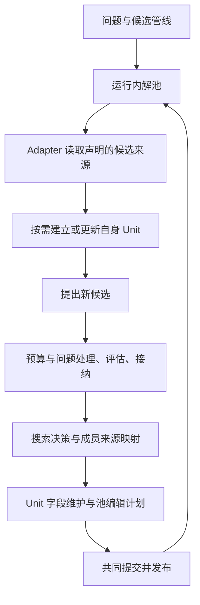

# 基于解池与算法单元解耦的可组合优化框架设计与实现

开题报告草案，2026 年 11 月 12 日。本文为选题内容稿，章节格式和时间安排可按学校要求调整。研究假设、预期贡献与拟开展的实验不作为已完成的研究结论。

## 摘要

优化算法的开发与应用经常需要增加成员属性、修改选择规则，以及组合种群搜索、局部搜索和方向分解等方法。已有优化框架通过自定义算子、算法模板和组件装配支持这些工作。在进一步涉及候选重排、重复槽位、部分接纳和中断恢复时，候选身份、算法成员关系与局部状态之间的维护仍需要明确的规则。本课题以已有 NSGABlack 框架为基础，研究将候选身份和版本管理归入解池、将成员属性和算法关系归入算法单元的解耦方法，明确算法行为、候选流转和状态维护的职责边界，并实现对应的可组合接口。研究将通过相同算法修改任务、异构算法组合、轨迹与恢复对照以及不同评估成本的性能实验，检验维护规则的复用范围、算法语义保持条件和运行代价。生产排程作为完整应用验证，优化与机器学习协同作为扩展场景，形成可复现的软件实现、实验记录与适用边界。

关键词：优化框架；解池；算法单元；算法组合；状态维护；可复现性

## 1. 研究背景与意义

### 1.1 算法开发中的实际修改需求

优化算法投入实际应用后，开发者经常需要改变算法的一部分。例如，为种群成员增加年龄，用年龄参与生存选择；将搜索得到的精英交给局部搜索，再把精修结果交回原算法竞争；让同一个候选服务于不同方向或不同种群。这些修改同时涉及算法规则与软件状态维护。

以年龄为例，算法规则可以很简单：新成员年龄为零，原成员经过一次环境选择且存活后年龄增加一。然而，当成员被重排、同一候选占据多个槽位、部分提案被拒绝，或运行中途恢复时，年龄仍必须跟随正确的成员。如何选择是算法作者必须决定的；怎样保持候选、反馈、成员字段和恢复状态相互对应，则是可以由公共机制承担的工作。

本课题关心后者能否被统一表达和复用，以及这种统一是否值得其声明和运行成本。

### 1.2 候选解与算法成员具有不同含义

候选解描述问题空间中的一个取值及其语义信息；算法成员描述这个候选在某个算法结构中承担的角色。一个候选可以同时属于两个种群，在其中具有不同年龄、排名或参考关系。同一候选也可能出现在一个算法的多个槽位中，各槽位仍有独立属性。

因此，以下三个概念需要区分：

- 候选的身份与版本：正在引用哪一个候选的哪一次取值。
- 候选的评估记录：在什么问题、数据和调用条件下获得了什么原始反馈。
- 算法中的成员状态：候选位于哪个算法、哪个槽位，关联哪些局部属性和关系。

本课题以这种区分为出发点，考察它是否有助于算法扩展与组合。

### 1.3 研究意义

在方法层面，给出候选、集合、成员及算法状态的显式模型，说明成员变化时应保持哪些关系，避免将框架规则只写成分散的特殊情况。

在软件层面，将可复用的成员维护和候选交接机制落到实际接口中，使算法作者能够围绕选择、变化和更新规则实现修改。

在实验层面，把表达能力、维护工作、算法行为和运行代价分别测量，形成适用范围明确的评价，而不是仅以组件数量或示例数量说明框架价值。

## 2. 相关研究与课题定位

### 2.1 优化框架与自定义算子

pymoo 提供多目标优化问题、算法和自定义算子接口，并包含并行评估、测试问题和效果指标等功能。[pymoo 论文](https://arxiv.org/abs/2002.04504)已经明确讨论算法修改与扩展，说明成熟框架具有较好的定制能力。本课题选择其作为主要可执行对照，具体比较相同任务中的额外维护工作。

### 2.2 算法模板与组件化装配

jMetal 的原始框架与后续重设计研究了问题、算法和算子的职责分离及模板复用，相关工作见 [2011 年框架论文](https://doi.org/10.1016/j.advengsoft.2011.05.014)与 [2015 年重设计论文](https://doi.org/10.1145/2739482.2768462)。当前 [jMetal 组件架构文档](https://jmetal.readthedocs.io/en/latest/component.html)进一步将创建、评估、选择、变化和替换表示为可装配组件，并指出紧密关联的算法组件会增加装配复杂度。

这说明组件化本身已有充分基础。本课题需要进一步考察候选版本与成员状态分开后，对成员变化及组合交接的维护有何具体影响。

### 2.3 模块化数值优化与概念统一

[modOpt](https://arxiv.org/abs/2410.12942)研究模块化优化算法开发，通过局部替换模块支持算法定制，并提供记录与基准等能力。[ParadisEO-MOEO](https://doi.org/10.1016/j.ejor.2010.07.023)围绕适应度赋值、多样性保持和精英策略建立统一模型，为多目标进化算法的软件表达提供了研究基础。

这些工作表明，算法拆分方式需要对应实际算法族和使用需求。本文拟用统一的候选与成员管理契约支持多种算法结构，具体算法仍保留自己的决策和状态转移，不将所有算法规定为同一种固定循环。

### 2.4 问题与搜索模块的接口解耦

[PISA](https://link.springer.com/chapter/10.1007/3-540-36970-8_35)已通过接口协议将问题表示及变化与选择模块分开，并报告协议正确性与效率测量。这是本课题需要直接讨论的前人工作。

PISA 的 variator／selector 分界与本文拟研究的 Pool／Unit／Adapter 分界不同。后续文献分析将围绕各自承担的身份、成员状态、交接和恢复职责展开，不能仅凭名称不同认定存在创新，也不能由文献未讨论某项能力就推断相应软件不支持它。

### 2.5 本课题的研究定位

本课题在已有模块化框架基础上，集中研究以下问题：

> 当候选身份与版本由解池管理、成员属性和算法关系由算法单元管理时，复杂成员变化与算法交接能否复用同一套维护规则；在保持规定语义的条件下，需要付出多少声明、实现与运行成本？

目前的相关工作核对用于确定研究起点。正式论文仍需补充与候选管理、组合式元启发式和状态恢复有关的文献，并逐项分析其与本课题的联系。

## 3. 研究目标、问题与范围

### 3.1 总体目标

形成候选解管理与算法状态维护的显式模型，在 NSGABlack 中实现相应的可组合接口，并通过公平对照确定其收益、代价和适用边界。

### 3.2 研究问题与可检验假设

**RQ1：复杂成员变化能否复用同一维护规则？**

H1：在声明字段的状态语义后，成员重排、重复槽位、部分接纳与恢复可以复用同一个字段维护规则。若每增加一种场景仍需新增对应的字段修补分支，则其复用范围应相应缩小。

同一规则可以依据已声明的初始化、选择和替换操作分支；需要检验的是新增使用场景是否要求再次修补，而非要求所有操作具有相同状态含义。

这里同时统计所有声明、builder、binding、codec 与帮助函数，检查维护工作是否只是从 Adapter 移到了其他文件。

**RQ2：解耦后能否保持规定的算法与状态语义？**

H2：同一候选被多个 Unit 引用、同一引用占据多个槽位，以及不同身份具有相同数值时，不会导致成员状态混用。在相同任务规则下，各次提交的有序成员、反馈和字段与独立任务规格一致。

恢复时成员属性多增长一次、拒绝候选混入种群、引用追读到错误版本等，均视为可反驳该假设的结果。

**RQ3：统一交接能否支持算法组合和局部替换？**

H3：在兼容的候选空间和明确的比较规则下，保持池任务与接收方式不变，可以替换局部精修算法。需要变化的算法参数、必要规则和额外交接代码分别记录。

该假设不要求任意两个 Adapter 可互换；梯度方法、路径搜索等具有额外前提的情况必须声明能力边界。

**RQ4：这些机制具有怎样的运行成本？**

RQ4 是描述性的成本研究问题。分项测量额外时间、内存与持久化成本，并按预先确定的应用需求判断适用区间；“可以测量”本身不作为研究假设或贡献。研究不预设开销可忽略，也不预设其比成熟框架更快。

### 3.3 核心研究范围

核心实现与实验以种群成员维护为主，采用 NSGA-II 作为主要算法，选取另一种成员替换方式进行迁移验证；以 GA 与局部搜索的交接，以及 MOEA/D 方向投影精修作为组合场景。

生产排程用于完整应用验证。MLBlack 联动用于说明模型语义与算法状态可以分别维护，作为有界扩展场景，不要求覆盖全部模型与后端组合。

Catalog、网页工作区、AI 引导和跨机器部署属于已有工程背景。论文重点评价解耦模型及其实现，相关界面和部署能力按与研究问题的实际关联程度介绍。

## 4. 解耦模型与拟研究方法

### 4.1 候选、版本与评估记录

将候选引用抽象为：

`r = (run_scope, candidate_token, version)`。

`run_scope` 区分运行中的寻址范围，`candidate_token` 区分候选身份，`version` 区分同一身份下的取值版本。该表达用于论文建模，不要求直接等同于实现中的序列化字段布局。

读取已有候选保留身份；变化生成新提案并保留来源；问题修复可以在同一提案身份下形成修复后的版本。已经发布的候选版本不被其他算法原位改写。

评估记录同时关联候选版本和评估含义。相同候选在不同问题配置、数据或随机评估条件下可能具有不同记录，不能把一个候选引用理解为只对应一个永久有效的通用分数。原始反馈与算法任务的比较投影分别保存和解释。

### 4.2 解池与算法单元

解池组织可寻址的候选版本和已发布的引用集合；子池描述普通集合、算法最终成员视图或目标投影视图。引用的顺序、重数和去重规则由具体操作契约确定。

在本文重点研究的种群场景中，将算法单元抽象为：

`U_a = (owner_a, ordered_members, member_fields, relations, local_state)`。

其中 `owner_a` 表示具体算法实例，`ordered_members` 表示当前结构中的有序成员出现位置。成员位置属于本次冻结结构，不能作为跨步骤的候选身份。同一个引用可以对应多个成员位置，也可以被不同所有者引用。

种群、单轨迹、路径图和信赖域可以具有不同的 Unit 结构。构建 Unit 是建立算法结构，不等同于把候选编码成另一种问题表示。

### 4.3 成员变化的来源映射

对于一次种群更新，设旧成员序列为 `M`，本次输入序列为 `I`，输出每一行的来源由映射 `sigma` 指定。每个输出位置恰好来自一个旧成员位置或一个输入位置，不能通过数值相等反推来源。

这里的来源描述成员保留或加入。交叉生成的新候选作为一个输入行加入，其多个遗传父候选另由 provenance 表达；单个结构来源不意味着只能有一个遗传父来源。

对“存活的环境选择次数”这一年龄字段，按成员操作采用以下规则：

```text
increment = 1 if operation == "selection" else 0
输出来自旧成员位置 i：age_new = age_old[i] + increment
输出来自输入位置 j：  age_new = 0
```

由此，旧成员 `[A, B, C]`、年龄 `[10, 4, 7]` 经选择变为 `[C, D, A]` 时，新年龄为 `[8, 0, 11]`。

局部 replacement 只使新成员年龄归零，其他旧成员年龄不增长；反馈刷新不构成一次成员选择。该字段不等同于所有算法的全局代龄。迁移到 DE 等逐槽替换算法时，保留这些操作含义，不为增长年龄而伪造环境选择。

重复槽位使用出现位置保持含义：若成员为 `[a, a, b]`，年龄分别为 `[1, 5, 2]`，按位置 `[1, 0]` 选择，则结果为 `[a, a]`、年龄 `[6, 2]`。引用相同不会使两个槽位合并。

实现中由 `PopulationChange` 表达来源，Unit 的 `member_fields` 和 `on_members_changed` 描述字段维护。算法决定留下哪些位置，公共成员操作维护基础候选、反馈与字段的对齐。

### 4.4 拟整理的不变量

拟将与研究主线相关的规则整理为以下八条，并检查现有特殊规则能否由这些约束和操作能力推导：

1. **身份明确**：候选数值相等不代替引用相等，引用读取不得静默追到其他版本。
2. **反馈可解释**：原始评估记录关联明确的候选版本与评估条件，选择投影不覆盖原始证据。
3. **状态有所有者**：排名、年龄、动量及方向关系归具体算法结构，跨 Unit 不共享可写成员状态。
4. **成员有来源**：重排、替换和重复槽位通过本次结构位置映射维护，不猜测未知字段语义。
5. **变化显式传播**：候选或成员改变后，相关字段按声明更新、失效或拒绝，禁止使用过期反馈。
6. **修复与接纳分开**：提案被修改和提案被筛除具有不同含义，均按原始提案坐标完成对账。
7. **发布具有边界**：对正式下游消费者，Unit 对应权威状态、具名集合修改和权威快照以共同提交边界为准。事务内的 Unit 工作草稿可能已变化，不声称任意 Python 观察者都具有隔离性。
8. **恢复区分状态与消耗**：算法工作状态可回滚，已发生的评估与预算消耗保留；恢复不隐式重放评估或成员增长。

这八条是研究整理的起点，后续需要逐项对应接口、反例和测试，不能仅通过条目数量认定抽象已经充分。

### 4.5 性质说明与验证方式

拟建立两类有条件的性质说明。

第一类是成员对齐性质。映射的合法条件至少包括：下标在输入范围内、每个输出位置恰有一个结构来源、输出引用及版本等于对应来源、候选与反馈记录匹配。在这些可单独检查的条件下，分析字段更新是否保持与候选相同的结构来源。可按输出行来自旧成员或输入成员两种情况展开，并通过重复槽位和重排反例检验遗漏条件。

第二类是控制抽象透明性：设 `pi` 将框架状态投影为参考算法状态，研究在评估输入、算子、随机调用顺序、比较规则和接纳策略一致时，是否满足 `pi(T_framework(S)) = T_reference(pi(S))`。该关系用于组织证明条件与逐步对照，不作为任意 Python 插件和任意算法组合的自动正确性保证。

其中 `T` 限定为给定输入和随机带下的逻辑提交转移；等待、失败和物理尝试按各自规格另行验收。

发生失败并实际消耗预算后，不要求继续搜索与无故障路径具有相同轨迹。此时应验证已提交状态恢复、实际消耗保留和后续决策符合剩余预算。

## 5. 框架设计与技术路线

### 5.1 职责划分

- Problem 定义问题目标、约束和原始评估含义。
- Pipeline 提供候选初始化、表示与问题侧处理能力；修复是否启用由实际装配决定。
- SolutionPool 管理候选版本、集合和交接引用；公开 `Pool` 则是调用期间用于选择、分组和生成编辑计划的操作面，两者不是同一个存储对象。
- Unit 保存具体算法结构与字段维护规则。
- Adapter 拥有搜索决策、提出候选并消费反馈，按需建立所属 Unit。
- Bias 表达选择偏好并保留原始评估；Plugin 接入生命周期能力。
- Solver 组织评估、接纳和提交，Project / Case 组织应用、资源与跨任务调用。

初始化、变化、选择、修复是行为类别；算法按其数学含义决定调用次序和适用接口。

### 5.2 核心操作路径



该图概括一次候选更新中的职责关系，不规定所有算法在每次调用中都执行完整路径。

### 5.3 组合与交接

普通精修通过显式池任务选择已发布候选，接收算法创建自己的结构并运行。精修结果以准确候选引用交付，是否进入原种群由原算法的接收阶段决定。

MOEA/D 按方向发布投影视图。任务开始时冻结候选、权重与参考点，局部搜索使用相同解释比较起点和新候选；结果交回后，由 MOEA/D 按当前规则竞争。方向标量不写回原始多目标记录。

同一 Solver 内的串行、逻辑多分支与重复计划，和 Project 层的独立 Case 并发分开处理。跨 Case 使用正式结果与 Artifact；不同问题的运行不直接共享一个可写候选池。

### 5.4 实现归属与复现

研究主线的优化语义在 NSGABlack 中实现。共享事务、存储、Project / Case 和资源机制复用 BlackBase；模型和学习问题语义由 MLBlack 承担。

正式实验前冻结三仓版本、未提交差异、依赖版本、数据摘要和配置。存在本机未发布依赖的实验先补齐可获取的源码快照，再作为公开复现实验发布。

## 6. 实验设计与评价方法

### 6.1 对照分为三个层次

**成熟框架修改任务对照。** 以固定版本的 pymoo 为主要对象，双方使用自然、公开的扩展方式完成相同任务，允许使用合理的可复用帮助层。jMetal、PISA、ParadisEO 和 modOpt 主要用于架构与相关工作分析，初期不要求全部形成可执行基线。

**独立参考路径对照。** 使用不调用本框架 Adapter、Unit 或池状态实现的参考循环检验轨迹与开销。披露共享的无状态数学原语，避免把同一实现包装两次作为独立证据。

**本框架集成验收。** 验证池任务、组合、预算与恢复机制是否满足其契约。若对照框架没有实现同等完整范围，只报告自身结果，不据此计算相对优势。

### 6.2 成员维护最小任务集

**T0：无扩展基线。** 使用原选择规则，记录基础行为和路径成本，为增加字段后的增量测量提供参照。

**T1：只记录年龄。** 固定新旧成员的年龄规则，在相同输入序列下逐轮核对成员与年龄，统计状态语义、声明与维护代码。

**T2：年龄参与选择。** 使用相同的可执行选择规格，验证年龄确实改变留下的成员，而非仅记录无效字段。比较选择之外的额外工作。

**T3：重排与部分接纳。** 对固定候选流执行非前缀接纳，再选择和重排成员。核对原提案坐标、最终成员坐标、原始反馈和求值计数，拒绝行不得混入成员。

**T4：重复槽位与多所有者。** 在 `[a,a,b]` 中为两个 `a` 设置不同成员属性，同时让另一个 Unit 引用 `a`。验证槽位未合并、所有者状态未串用，另加同值不同身份的用例。

**T5：回滚与恢复。** 复用 T3、T4 的规则，分成两条验收路径。干净文件 checkpoint 在新进程恢复后，要求与不中断运行具有相同后缀。进程内在评估后、提交前注入异常，要求已提交成员不变、实际评估和预算消耗保留，后续按剩余预算运行，不要求等于无故障后缀。两条路径均核对随机状态、成员属性和进度；进程强杀、数据库掉电及远端不确定执行需要另立故障模型。

上述任务先在 NSGA-II 上完成。再选择另一种成员更新方式，例如 DE 的逐槽替换，迁移一个代表性字段规则，检查替换重置和其他成员保留，不将局部替换计为环境选择。若入口尚未接通，新增适配和共享实现成本计入结果。

### 6.3 算法组合任务

组合实验以一条“精英交接—精修—返回竞争”的完整闭环为主，以下为其不同检查点；MOEA/D 使用已有小型实例补充接口迁移验证，不另扩展为多套算法效果竞赛。

**C1：GA → 局部搜索 → GA。** 从最终成员选精英，交给局部搜索，取得最终结果，再进入 GA 竞争。验证精修结果确实返回，而非仅运行局部算法。

**C2：MOEA/D 方向精修。** 固定方向、起点、标量化与参考点，检验原始反馈保留、任务投影一致和返回替换正确。

**C3：替换精修器。** 对相同交接任务替换两个兼容精修算法，分别统计算法专属参数和公共交接的变化。比较效果或速度时，双方必须采用相同算法、起点、终止与预算。

若某算法在对照库中没有原生实现，应公开说明，并通过其正式扩展面实现相同规则或采用独立直接组合参考。不同精修器的原生换装示例只能说明换装局部性，不能直接用于效果排名。

### 6.4 维护与修改成本

逐任务将代码和声明分为：

1. 必需的算法选择规则与新增状态语义。
2. 框架要求的声明、装配、所有者与能力绑定。
3. 额外的引用对齐、字段修补、恢复和补偿逻辑。
4. 可复用帮助层的首次实现与后续任务增量。
5. 为支持实验而新增的框架核心实现。

报告非空代码行、修改的职责位置、场景专用分支和可变状态副本，并提供对应补丁供审查。代码行数受格式影响，因此不单独作为可维护性结论。

分类口径在统计前固定。兼具算法语义和框架适配职责的函数标为混合项，公开分类依据，不强行归入某一侧，也不合成单一维护性得分。

没有受控参与者实验时，只评价实现结构和任务结果，不据此推断新手学习时间或主观易用性。

### 6.5 语义、质量与恢复

语义实验使用相同候选流、原始反馈、接纳结果与选择规格，比较有序成员、成员字段、方向或轨迹状态。完整随机搜索还需匹配随机调用与算子，只有相同种子不足以保证公平。

跨实现的内部 token 和运行身份不要求字面相等。由固定输入的外部对照标签及出生事件建立映射，比较保序对应、版本关系、重复出现和父来源关系；外部标签只用于对照，不进入算法选择，也不按候选数值反推身份。

优化效果实验独立报告。多目标问题采用 pymoo 的 HV / IGD 测量器和固定来源的参考集，使用相同真实求值预算与种群规模；不手写另一套指标。候选全部历史与算法最终输出分开统计。

恢复对照要求双方保存同等必要状态：候选与成员属性、算法状态、随机状态、进度和预算。只有 Population 数据恢复的基线不能与完整 Solver 恢复比较成本或可靠性。

干净 checkpoint 的后缀可与不中断运行比较。故障后已经发生真实评估时，另按保留消耗的规格验收，不能通过擦除预算取得表面轨迹相等。

### 6.6 时间、内存与持久化成本

选择廉价函数、经过校准的 CPU 计算目标和生产排程求值三个成本档。单列装配与初始化，重点测量进入正常迭代后的开销。

在等价顺序执行路径中报告总墙钟、CPU、真实求值、算法操作、池与字段维护、步骤状态保存、证据及持久化成本；记录峰值内存、保留候选数量和写入量。组件耗时可能嵌套，归因时使用不重复的统计口径。

checkpoint 写入和恢复单独测量，明确存储后端、检查频率与保存范围。trace 的诊断成本单独披露。并发实验同时记录墙钟和各任务消耗，不把相互重叠的耗时直接相加。

定义等价路径的时间增量为 `DeltaT = T_framework - T_reference`，同时报告绝对值和相对值；参考时间接近零时不依赖倍率解释。各应用在正式测量前登记吞吐、延迟、内存和 checkpoint 周期要求，再判断当前实现是否满足需求。

### 6.7 样本、配置与结果处理

小型身份与槽位反例采用固定输入，要求逐项满足规格。廉价随机搜索计划使用预先固定的 20 个种子；性能测试在独立进程重复，明确预热与正式测量范围，报告分布而非单次时间。

排程应用先测吞吐，再在正式结果产生前冻结预算、实例、种子数量和终止条件。小样本结果按其范围解释，增加重复运行后再讨论稳定性。

所有结果记录源码版本、配置、输入摘要、实际求值数、失败和超时。以任务或独立运行作为分析单位，不把同一次运行的每代当作独立样本扩大样本量。多问题比较采用配对统计并报告效应量与不确定性，具体检验按数据结构预先确定。

### 6.8 信息必要性反例

构造三类故意删去必要信息的实验：将成员字段放入共享候选属性、按数值匹配身份、按引用去重重复槽位。观察它们在多所有者、同值不同身份和多槽位任务中的错误。

这些反例说明对应信息需要被保留，不证明 Pool＋Unit 是唯一实现方式。对照框架通过合理封装保留这些信息后同样正确，应据实报告其成本与结果。

## 7. 已有基础与待完成工作

### 7.1 已有实现基础

当前框架已包含运行内 SolutionPool、候选版本与来源、PopulationUnit 成员操作、字段维护钩子、调用期 Pool 选择、池任务、执行计划、步骤事务及 checkpoint 接口。相关代码和文档可用于开题后的模型整理与实验实现：

- [候选池实现](../../core/state/solution_pool.py)与[解池契约](../architecture/SOLUTION_POOL_CN.md)。
- [成员来源映射](../../units/population_operations.py)、[成员结构](../../units/collections.py)及[成员维护说明](../architecture/UNIT_MEMBER_OPERATIONS_CN.md)。
- [调用期 Pool 操作](../../adapters/change_pool.py)与[Pool 接口手册](../architecture/POOL_API_REFERENCE_CN.md)。
- [算法修改任务及其修正记录](../architecture/MODIFICATION_TASK_COMPARISON_CN.md)。
- [透明性基准契约](../architecture/ALGORITHM_TRANSPARENCY_BENCHMARK_CN.md)。
- [成员操作测试](../../tests/test_population_member_operations.py)、[父代槽位交接测试](../../tests/test_parent_member_handoff.py)与[共享档案测试](../../tests/test_composite_pool_maintenance.py)。

这些是现有机制与用例的证据入口，仍需按本文统一规格冻结版本、整理正式实验。

### 7.2 已有对照结果对课题的约束

当前修改任务记录已经表明：简单年龄选择中，双方用户级额外对齐代码均为零；不能预设本框架在简单字段扩展上更省代码。

原恢复对照涉及完整 Solver 与 Population 两种不同范围，不能直接比较恢复成本。早期精修换装实验采用不同算法与预算，只支持双方换装可局部完成的结论。

现有小型测试为复杂维护的可行性提供基础，但代码更少、学习更快和运行更快仍需独立证据。完整开发快照的已执行检查与已知问题见[验证说明](VALIDATION_STATUS_20261112.md)。

### 7.3 仍需完成的闭环

冻结研究范围和配套依赖；将最新 Pool＋Unit 接口与公平 pymoo 实现整理为同一任务集；补齐同范围的新进程恢复对照；确定并完成第二种更新方式与精修器替换；按正常迭代重新测成本；将排程实例整理为可公开或可复核的应用材料。

本草案编写阶段进行文献与源码核对，不新增运行结果。既有通过记录保留各自的版本、范围和配置，不累计成全仓覆盖率。

## 8. 应用验证与扩展安排

### 8.1 生产排程主应用

采用现有[生产排程 Project](../../examples/cases/production_scheduling/README.md)作为端到端应用。固定原有产品、机器、物料和时间规则，对比普通搜索与带精修或精英交接的装配，记录实际目标、违反量、求值预算和恢复结果。

核心验收使用一个冻结实例配置和一种完整组合流程，完整记录基础路径与组合路径；扩大实例和参数范围作为后续安排。

到料调整作为已有嵌套应用时，沿用每笔到料独立决定调整量的模型，今日库存和第 0 天既定状态按原问题规定固定。统一建模口径后再比较，不为框架实验改变业务可行域或削弱修复规则。

应用效果用于验证装配能否承接真实问题。算法组合带来的效果变化与候选管理抽象的透明性分别报告。

### 8.2 ML 可选扩展验证

在模型解释、参数坐标和学习目标兼容，且提供对应正确梯度的固定布局小型模型上，采用 GA → SGD 展示候选共享与算法状态隔离；模型 Codec 解释参数，两个 Adapter 的 Unit 分别维护种群与优化器状态。精修结果独立交付，是否替换原成员通过接收规则决定。

外层优化、内层 Trainer 的 Case 嵌套可使用已有[三级跨框架示例](../../examples/cases/super_topology_orchestration/README.md)说明正式任务与结果边界。内外层通常不是同一问题，使用独立 Pool，通过正式 Case 请求、结果和 Artifact 交接。

该扩展以表达与交接验证为主；任意目标投影到梯度、活 Provider 状态跨后端恢复和大模型训练性能需单独研究。

## 9. 预期成果与可能贡献

### 9.1 可交付成果

1. 候选、评估记录、算法成员与所有者的模型，以及成员变化和组合交接的约束说明。
2. 依托现有框架完善的可组合接口与标准 Project 示例。
3. 可复现的相同修改任务、独立参考路径和恢复实验，附配置、代码差异及失败记录。
4. 维护成本、语义和运行成本的实验报告，以及生产排程应用结果。
5. 完整论文、使用说明和演示材料。

### 9.2 拟验证的贡献

**模型贡献。** 将候选身份与版本、算法成员及局部状态的不同生命周期明确表达，给出重复槽位和多所有者情况下的维护规则。

**机制贡献。** 在该模型下复用成员来源映射、字段更新与池任务交接，使规定范围内的复杂修改不必逐场景另写修补逻辑。

**实证贡献。** 通过自然的成熟框架实现、独立参考和实际应用，量化统一机制带来的收益与代价，识别适合与不适合的场景。

这些表述为开题阶段的贡献方向。最终论文应依据相关工作和实验收缩或加强具体主张；功能数量、代码规模和接口命名不直接作为创新证据。

## 10. 研究计划

以下采用 10 周相对安排，实际起止日期按学校要求确定。

- 第 1—2 周：补充文献、明确模型与术语、冻结任务规格和版本，完成开题内容修订。
- 第 3—4 周：整理 T0—T5 两侧实现，补齐相同恢复范围，审查代码分类与正确性。
- 第 5—6 周：完成代表性第二算法与组合任务，核对返回竞争、投影解释和算法参数。
- 第 7 周：测量正常迭代、checkpoint、恢复、内存与写入量，分析不同评估成本。
- 第 8 周：完成生产排程应用；核心实验完成后进行小型 ML 扩展验证。
- 第 9—10 周：汇总数据与边界、完成论文和复现材料，准备演示与答辩。

每阶段以可审查产物结束：规格、配对实现、实验报告或论文稿。若时间受限，优先完成核心成员任务、一个完整组合与成本测量，再安排扩展场景。

## 11. 论文结构与风险控制

### 11.1 拟定章节

第一章：绪论，说明实际修改问题、研究目标和范围。

第二章：相关工作，分析优化框架、模块化和接口解耦方法。

第三章：解池与算法单元解耦模型，给出身份、成员、来源映射、不变量与性质条件。

第四章：框架设计与实现，说明候选操作、字段维护、组合、提交和恢复的对应接口。

第五章：实验设计与结果，回答维护复用、语义与成本问题，保留对照中的平局和负结果。

第六章：生产排程应用及有界扩展，验证真实任务与 ML 交接。

第七章：结论，归纳实际成立的贡献、适用条件和后续工作。

### 11.2 主要风险及处理

**与前人重叠。** 通过 PISA、jMetal、pymoo、ParadisEO 和 modOpt 明确已有能力，按具体生命周期与任务行为比较，收紧原创性主张。

**优势不成立。** 保留对照框架同样简洁或更快的结果。若只在复杂状态维护中体现收益，结论限定到相应场景；若没有明显收益，分析统一机制的适用条件与代价。

**对照范围不等。** 统一任务规格，恢复同等必要状态，披露帮助层和框架新增代码，禁止用局部组件时间与完整运行时间作倍率。

**范围持续扩大。** 以 T0—T5、代表性组合和生产应用为主要完成条件，新算法与前端能力按与研究问题的关系安排。

**依赖和结果难以复现。** 固定源码和依赖、处理数据使用权限、保存机器可读报告。外部服务和活状态引用具有寻址限制时，提供相应条件与可复核替代场景。

## 12. 初步参考文献

以下为已核对的一手论文与官方资料，正式提交时按学校引用格式整理。

1. Blank J, Deb K. pymoo: Multi-Objective Optimization in Python. IEEE Access, 2020, 8: 89497–89509. DOI: [10.1109/ACCESS.2020.2990567](https://doi.org/10.1109/ACCESS.2020.2990567). [作者公开稿](https://arxiv.org/abs/2002.04504)。
2. Durillo J J, Nebro A J. jMetal: A Java framework for multi-objective optimization. Advances in Engineering Software, 2011, 42(10): 760–771. DOI: [10.1016/j.advengsoft.2011.05.014](https://doi.org/10.1016/j.advengsoft.2011.05.014)。
3. Nebro A J, Durillo J J, Vergne M. Redesigning the jMetal Multi-Objective Optimization Framework. Proceedings of the Companion Publication of the 2015 Annual Conference on Genetic and Evolutionary Computation, 2015. DOI: [10.1145/2739482.2768462](https://doi.org/10.1145/2739482.2768462)。
4. Nebro A J. Component-based algorithms. jMetal 官方技术文档，页面标注版本 1.2、日期 2026-06-12，检索日期 2026-11-12。[官方页面](https://jmetal.readthedocs.io/en/latest/component.html)。
5. Joshy A J, Hwang J T. modOpt: A modular development environment and library for optimization algorithms. arXiv preprint arXiv:2410.12942, 2024. DOI: [10.48550/arXiv.2410.12942](https://doi.org/10.48550/arXiv.2410.12942)。本文引用的是 2024 年预印本版本。
6. Liefooghe A, Jourdan L, Talbi E G. A software framework based on a conceptual unified model for evolutionary multiobjective optimization: ParadisEO-MOEO. European Journal of Operational Research, 2011, 209(2): 104–112. DOI: [10.1016/j.ejor.2010.07.023](https://doi.org/10.1016/j.ejor.2010.07.023)。
7. Bleuler S, Laumanns M, Thiele L, Zitzler E. PISA — A Platform and Programming Language Independent Interface for Search Algorithms. Evolutionary Multi-Criterion Optimization, LNCS 2632, 2003: 494–508. DOI: [10.1007/3-540-36970-8_35](https://doi.org/10.1007/3-540-36970-8_35)。

## 附：向老师介绍课题的简短表述

本课题以已有优化框架为基础，研究解池与算法单元之间的职责分离：解池管理候选身份和版本，算法单元维护候选在具体算法中的成员属性与关系，算法适配器负责搜索决策。重点考察增加状态、重排成员、部分接纳和组合精修时，同一维护规则能否复用，以及为此付出的声明和运行成本。计划与成熟框架完成相同修改任务，通过独立参考检验算法轨迹与恢复，并以生产排程验证完整应用。预期形成解耦模型、可运行框架和可复现实验，而具体优势将由对照结果确定。
