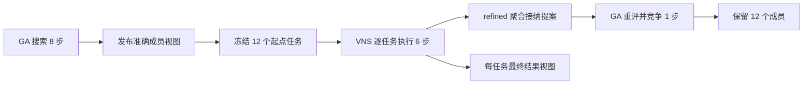
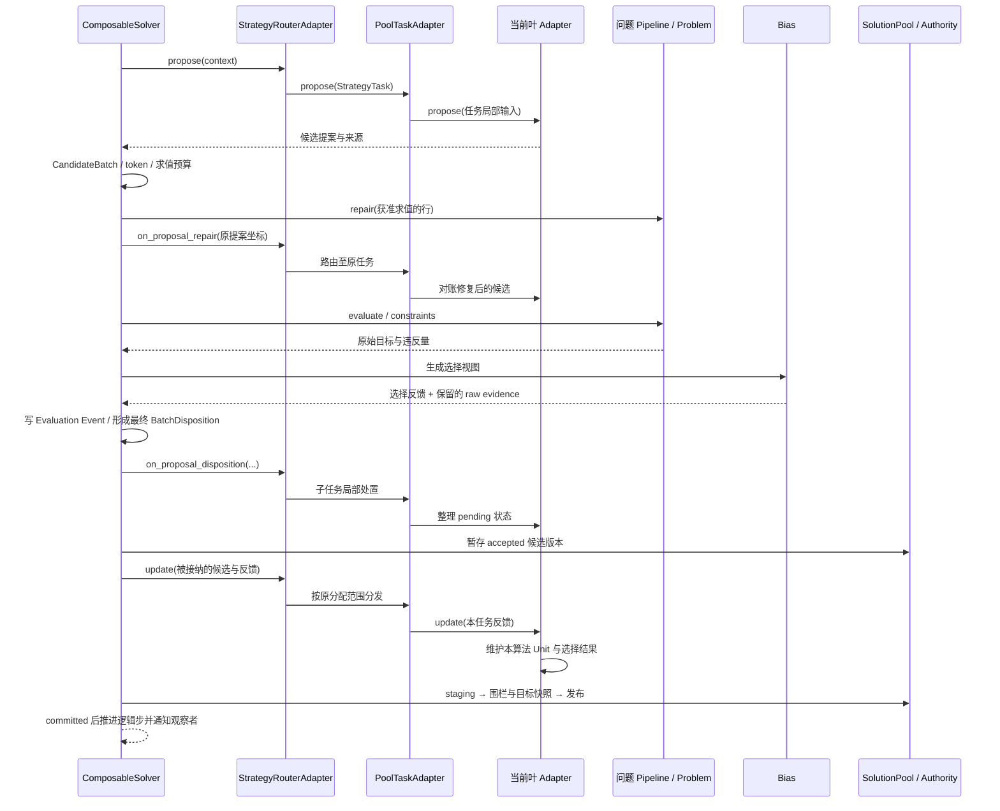

# 把一个优化 Project 从装配讲到每次提交：GA → VNS → GA 全过程详解

> 核对日期：2026-10-19。本文针对本目录当前源码和已经保存的运行记录。
> 本次编写只整理文档、读取源码和既有 JSON/CSV，没有重新执行求解或故障注入。
> 代码片段分为“当前实际代码”和“教学示意／修改示意”；未标为当前代码的示意不代表新增了框架 API。

这份文档要回答的不是“怎样调用两个算法名称”，而是：**一份候选从哪里来，怎样成为某个算法的成员，怎样被另一个算法精修，谁决定接纳和保留，失败时哪些状态能够撤回，最后怎样核对结果。**

本例的原始问题只有两个变量。简单的数学问题让装配、身份和状态交接本身变得可观察。框架能够承接复杂问题，不意味着解释框架时必须先引入仿真器、数据库或模型训练。

阅读过程中请始终保留这四个区分：

1. **候选值与候选身份是两件事。** 两个坐标相同的解，不因此成为同一个提案；同一个 token 的不同已登记版本，也不能随便互换。
2. **解池与 Unit 是两种职责。** 解池存放和寻址候选版本，Unit 维护某个算法使用这些候选时的工作结构。
3. **评估接纳与算法选择是两次决定。** 一个提案可以被控制面接纳、留在历史池里，却没有成为 VNS 当前点或 GA 下一代成员。
4. **本例已执行的行为与框架可扩展的能力需要分开。** 默认例子没有并行运行多个 Case，没有自定义 UnitRepair，没有给 MOEA/D 建方向池，也没有做性能对照实验。

## 阅读导航

- [1. 先看完整故事与实际结果](#story)
- [2. 一个 Project 中有哪些层，谁负责什么](#layers)
- [3. 逐个目录和文件找到运行入口](#files)
- [4. 把 build_solver 与算法组合逐句拆开](#assembly)
- [5. 参数、预算、阶段和各种数量](#configuration)
- [6. 组件内部逐段拆解](#components)
- [7. 从一份候选到一次提交，再到跨算法交接](#runtime)
- [8. 真实运行、观察插件与报告逐项解释](#evidence)
- [9. 怎样运行、定位和检查这个 Project](#commands)
- [10. 怎样修改、替换和扩展它](#extension)
- [11. 高频误解与边界问题](#questions)
- [12. 用什么标准判断这个装配是否合理](#review)
- [附录：符号、对象与源码阅读路线](#appendix)

已有的几份文档各有用途：

- [README.md](README.md)：较短的项目入口。
- [PROJECT_CODE.md](PROJECT_CODE.md)：项目全部 Python 与配置文件的源码阅读快照，没有把库实现再抄一份。
- [COMPONENTS.md](COMPONENTS.md)：本地组件和框架组件的真实源文件索引。
- [RESULTS.md](RESULTS.md)：本次固定配置的实际运行报告。
- 本文：解释上述代码为什么这样装配，以及它们执行时如何配合。

<a id="story"></a>
## 1. 先看完整故事与实际结果

### 1.1 原始问题到底是什么

候选是一个二维向量：

```text
x = [x0, x1]
```

原始目标与约束为：

```text
minimize f(x) = (x0 - 2)^2 + (x1 + 1)^2

subject to:
    -4 <= x0 <= 4
    -4 <= x1 <= 4
```

两个平方项都不小于零；当且仅当 `x0=2`、`x1=-1` 时同时为零，该点又位于盒约束内，因此这个具体数学问题的已知最优点是 `[2, -1]`，最优目标是 `0`。

这里对最优值的判断来自函数表达式，不是 Doctor 给出的证明，也不是某次搜索跑得足够久后猜出来的结论。

### 1.2 为什么使用 NSGA-II 做一个单目标例子

本例的重点是标准装配、种群成员交接、局部精修、Unit 字段维护和提交观察。NSGA-II 的现有 Adapter 能在这个单目标问题上运行，因而适合作为一个有完整种群结构的外层算法。

这次运行没有检验多目标问题的 Pareto 前沿覆盖率，没有比较 NSGA-II 与其他算法的收敛速度，也没有声称二维二次函数需要这么复杂的求解方法。

文中将 NSGA-II 所在阶段简称为“GA 阶段”。这只是便于叙述；实际装配类始终是 `NSGA2Adapter`，不是另外写了一个 `GAAdapter`。

### 1.3 希望算法怎样合作

第一段让一个 12 人的种群搜索 8 个提交步骤。它维护自己的成员、排名和选择规则，并发布当前成员视图。

第二段读取这个 GA 实例发布的视图，将视图内的 12 个成员逐个作为 VNS 的起点。每个起点有 6 个提交步骤：先通过正式评估建立基准，再进行 5 步邻域搜索。

第三段把精修期间控制面接纳的提案集合交回 GA。GA 再次评估这些候选，然后按自己的环境选择规则决定下一份 12 人种群。VNS 没有权限把自己的当前点直接写进 GA 某个槽位。



图中 `refined` 与“每任务最终结果视图”是两条不同输出。图没有把它们合并为“12 个精修最优解”；后文会逐项解释这个区别。

### 1.4 已保存的运行结果

当前 [summary.json](results/summary.json) 记录：

```text
seed                    = 7
committed logical steps = 81
solver evaluations      = 600

best candidate = [2.0003622890074766, -1.003468343542692]
selection score = 1.2160660255072348e-05
raw objective independently recomputed = 1.2160660255072348e-05
distance to [2, -1] = 0.0034872138241112127
```

正式 Project run ID 为 `20261019T055752Z-858bfa9128`。每次重新运行都会产生新的运行身份；候选 token、事件身份和 Snapshot key 不应期待逐字相同。

本次最好候选的 `x0` 为正，后文的软偏好对它没有惩罚，因此选择分数与独立重算的原始目标相同。不要由这个最终数值相同，反推整个运行过程中从未使用 Bias。

### 1.5 本例特意多放了哪些教学组件

如果只想求解这个函数，并不需要额外定义“成员年龄”和详细观察插件。本例保留它们，是为了暴露框架平时容易隐藏的两个机制：

- 自定义 Unit 多了一列字段以后，怎样在不修改 NSGA-II 内部选择代码的情况下维护它。
- 算法还没有启用时，怎样只读取“未创建”状态，而不因为日志或检查提前创建 Unit。

同理，软 Bias 用于展示原始求值和选择视图的分工。它不是为了使这个二次问题变得更容易。

<a id="layers"></a>
## 2. 一个 Project 中有哪些层，谁负责什么

### 2.1 第一层是 Project，第二层是 Case

本目录 `assembled_ga_vns/` 是一个 Project。它有 `project_config.py`、`run_project.py` 和 `cases/`。

`cases/hybrid_search/` 是其中唯一的 Case。它有自己的问题、管线、算法组合、偏好、插件和装配入口。

Case 装配得到的是一个 `ComposableSolver`。这个 Solver 中只有一棵根 Adapter 树，GA 和 VNS 都在这棵树里运行。它们共享本次 Solver 的解池和控制服务，但各自保留算法结构。

所以这个例子不是“先启动一个独立 GA Case，再启动一个独立 VNS Case，最后拼接两个返回值”。这是一个 Case 内部的搜索合作。

### 2.2 Project 阶段与算法阶段不是同一张日程

Project 配置只有一个 stage，名为 `search`，运行 `hybrid_search`。

Case 的 Router 内部又有三个搜索 phase：`ga`、`vns`、`return`。

```text
Project
└── stage: search
    └── Case: hybrid_search
        └── ComposableSolver
            └── StrategyRouterAdapter
                ├── phase: ga
                ├── phase: vns
                └── phase: return
```

Project 管的是 Case 怎样启动、资源怎样授权、结果怎样交付。Router 管的是同一搜索运行中哪个算法角色此刻提出候选。

如果未来引入多个独立仿真 Case、训练 Case 或外层求解 Case，它们之间的依赖和资源协调仍应放在 Project 层。本例的 Router 不是另造一套 Project runner。

### 2.3 Problem 的职责

Problem 定义“这个候选是什么意思、原始目标是多少、原始约束怎样算”。

本例 Problem 不知道“这是 GA 的第七代”或“这是 VNS 的第二个邻域”。它也不读取 `member_age` 决定函数值。

换一个 Adapter 后，原始函数仍然应该表示同一个数学问题。算法对结果的比较方式可以变，Problem 给出的原始含义不应随算法名称偷偷改变。

### 2.4 问题 Pipeline 的职责

本例问题 Pipeline 只装配 `BoxRepair`：把待评估候选处理到盒约束内。

Pipeline 的 Python 对象被两个算法共享；这不意味着两个算法必须共享同一个变化算子。本例的 GA 和 VNS 分别直接绑定自己的 mutator。

本例没有自定义编码器或解码器。一个二维向量交给 VNS，不需要先把 GA 的 PopulationUnit “解码成解”。候选本来就存在，算法结构只是围绕它建立。

### 2.5 UnitBinding 与 Unit 的职责

`UnitBinding` 是“怎样构建和恢复算法结构”的绑定规则。`Unit` 是具体运行中实际存在的结构实例。

这两个时间点不同：

```text
装配时：创建 builder，绑定构建规则
运行使用时：由 Adapter 创建自己的 Unit
后续步骤：维护同一个任务中的结构
恢复时：通过显式 codec 恢复已有结构或保留未创建状态
```

本例 GA 的 Unit 扩展 `PopulationUnit`，多一列 `member_age`。VNS 使用候选结构与邻域结构。

Unit 不负责启动 Project，不领取 L0 lease，不拥有 Solver 的主运行循环。

### 2.6 Adapter 的职责

Adapter 拥有搜索决策。它决定何时初始化、怎样调用变化组件、怎样比较候选、怎样更新自己的 Unit。

四类行为“初始化、变化、选择、修复”是可装配职责分类，不表示所有算法都必须按照一个固定四格循环执行，更不表示把所有算法都改写成四个没有语义的函数就完成了统一。

本例中，初始化和变化有显式直接绑定；选择保留 NSGA-II、VNS 各自原生逻辑；问题修复走共享 Pipeline；没有另装 UnitRepair。

### 2.7 Bias 与 Plugin 的职责

Bias 在求值反馈边界产生软偏好。本例对 `x0<0` 加惩罚，既不改变候选坐标，也不写 GA 的成员列表。

Plugin 使用生命周期观察已提交状态。本例插件确实会导出文件，因而观察有计算和 I/O 成本；“没有搜索决定权”不等于“没有副作用或没有失败风险”。

### 2.8 Solver 和共享底座承担什么

`ComposableSolver` 把提案、问题处理、评估、接纳、反馈和步骤提交连在一起。它不重新实现 GA 的锦标赛选择，也不决定 VNS 应该用哪个邻域更好。

BlackBase 提供标准 Project/Case、L0 资源授权、共享事务与证据/发布等底座。本例没有通过一个私有 `for generation in ...` 绕开正式执行路径。

### 2.9 解池与 context 怎样分工

解池保存候选版本和具名引用集合，支持算法间按身份交接。

局部 `context` 为一次调用携带阶段、任务、变化尺度等轻量信息。共享 ContextStore 还可以发布正式快照引用。

本例没有把 12 人种群、全部轨迹或 252 个候选数组塞进共享 context。当 VNS 想使用 GA 的成员时，走的是池任务和准确引用，不是去 context 里找一份没有所有者的 `population` 大数组。

<a id="files"></a>
## 3. 逐个目录和文件找到运行入口

### 3.1 完整职责地图

```text
assembled_ga_vns/
  .gitignore
  _bootstrap.py
  project_config.py
  run_project.py
  run_and_report.py
  README.md
  COMPONENTS.md
  PROJECT_CODE.md
  PROJECT_DEEP_DIVE_CN.md
  RESULTS.md
  cases/
    __init__.py
    README.md
    hybrid_search/
      .case
      __init__.py
      README.md
      config.py
      build_solver.py
      build_trainer.py
      run_solver.py
      run_trainer.py
      problem/
        __init__.py
        quadratic.py
      pipeline/
        __init__.py
        main.py
        operators.py
        population.py
      adapter/
        __init__.py
        composition.py
      bias/
        __init__.py
        preference.py
      plugins/
        __init__.py
        trace.py
      catalog/entries/
        problem.toml
        pipeline.toml
        bias.toml
        plugin.toml
      evaluation/__init__.py
      runtime/__init__.py
      solver/__init__.py
  results/
    summary.json
    project_result.json
    trace.json
    trace.csv
    doctor.json
    run.log
    case_check.log
  .blackbase/                    # 本机运行后生成，不是手写组件源码
```

### 3.2 三个入口怎样选

[run_project.py](run_project.py) 是标准 Project CLI 的薄入口。它调用正式共享 runner，选择 group/stage，构建并执行 Case。

[run_and_report.py](run_and_report.py) 也调用正式 `execute_project(ROOT)`。额外工作是在正式返回后读取本例的观察文件、核对身份与计数、生成 `summary.json` 和 `RESULTS.md`。它没有替代 Solver 主循环。

[run_solver.py](cases/hybrid_search/run_solver.py) 是标准 Case CLI。它可以单独构建或运行 Case，但单独运行时并不等于已经执行 Project 的资源分配和 stage 调度。

本例还有 `build_trainer.py`、`run_trainer.py`。它们是脚手架保留的薄别名，不表示这里实际运行了一个 ML Trainer。

### 3.3 .case 的三行有什么用

当前 [Case 标记](cases/hybrid_search/.case) 为：

```text
name = hybrid_search
kind = solver
framework = nsgablack
```

标准加载器由此识别这是一个优化 Solver Case。它和 `build_solver.py`、标准 CLI 一起形成正式装配入口，不需要按目录名猜这到底是 Trainer 还是 Solver。

### 3.4 __init__.py 是导出入口，不是另一层算法

例如 `pipeline/__init__.py` 导出 `build_pipeline` 与本地构建组件，`problem/__init__.py` 导出问题工厂。

`build_solver.py` 通过这些薄导出导入组件，使装配文件不需要关心每个组件内部又分成几个文件。薄导出本身没有偷偷重复求值或启动搜索。

### 3.5 为什么 runtime、evaluation、solver 几个目录可以是空包

本例没有专门的外部 Evaluation Provider，也没有自定义 Solver 子类或 Case 级资源后端。它们对应的扩展位置仍在标准脚手架中，但不需要为了“目录齐全”复制一份框架实现。

判断是否完整，应看标准入口是否闭环、真实组件是否明确、运行授权与结果是否可核对；不能把“每个目录都写几百行”当作完整性的条件。

### 3.6 两个位置容易被误读

`pipeline/population.py` 是本地 Unit 构建组件的源文件位置。Unit 的运行所有者仍是 GA Adapter，不会因为文件在 pipeline 目录就提前为全部 Adapter 构建 Unit。

`adapter/composition.py` 是本例的算法装配代码。它导入框架算法，再声明角色与任务，没有把每个算法的完整实现抄进这个 Project。

### 3.7 哪些文件是结果，哪些文件是实现

`results/trace.json` 是观察输出，不是下次搜索应该自动读入的算法配置。

`results/project_result.json` 是正式返回值及引用、收据的记录，但复制它不等于复制所有引用背后的数据。

`PROJECT_CODE.md` 是代码阅读快照。修改组件时应改真实 `.py` 文件；只改这份 Markdown 的代码块，不会改变运行行为。

`.blackbase/` 是正式运行生成的本地执行记录、Artifact 与资源相关数据。本例的 `.gitignore` 排除它和 Python 缓存，以免把本机运行基础设施误认为手写组件。

<a id="assembly"></a>
## 4. 把 build_solver 与算法组合逐句拆开

### 4.1 Project 先声明执行与资源约定

[project_config.py](project_config.py) 的当前实际代码为：

```python
L0 = {
    "namespace": "assembled_ga_vns",
    "offer": {"threads": 1, "gpus": 0, "backend": "local", "device_tokens": []},
    "policy": {"mode": "strict", "gpu_sharing": "exclusive", "cpu_oversubscribe": False},
    "default_request": {"threads": 1, "gpus": 0, "backend": "local"},
    "compute_backend": "auto", "execution_backend": "local",
}
STAGES = [{"name": "search", "cases": ["hybrid_search"], "policy": "serial",
           "resource_requests": {"hybrid_search": {"threads": 1, "gpus": 0, "backend": "local"}}}]
GROUPS = {"default": {"stages": ["search"]}}
```

`namespace` 为本次 Project 的授权和存储命名空间提供范围；它不是 GA 的角色名，也不是候选 token。

`offer` 描述本地可提供的资源，Case 在 `resource_requests` 中声明自己的需求。实际运行时由 L0 协调得到 grant，Case 只是接收并绑定它。

`threads=1`、`gpus=0` 让这个例子的资源配置容易核对。实际 grant 还包含 `workers` 等解析后的字段；`workers=1` 是保存的生效授权中的值，不应把配置原文与完整生效上下文混为一谈。

`strict` 资源策略和后面的 `plugin_strict`、`snapshot_strict` 是不同层面的设置，不能把它们解释成一个总开关。

`STAGES` 中的 `serial` 描述 Case 层策略。本例只有一个 Case；即使将来 Project 改成多个 Case 并行，Case 内的 GA/VNS 搜索阶段也不会因此自动变成并行。

### 4.2 标准 Project CLI 为什么只有几行

入口的关键调用是：

```python
bootstrap()
from nsgablack.project.project_runner import main
raise SystemExit(main(Path(__file__).resolve().parent))
```

Project 根目录由入口文件的位置确定，不要求调用者恰好处在某个隐含工作目录。

`bootstrap()` 会把当前 Project 加入导入路径；它不是包管理器，也不能保证在任意机器上发现一个从未安装的 nsgablack 开发仓库。框架本身必须已经能够导入。

### 4.3 build_solver 是唯一的正式装配入口

[build_solver.py](cases/hybrid_search/build_solver.py) 的主体当前为：

```python
def build_solver(config=None, *, resource_context=None, component_overrides=None):
    overrides = dict(component_overrides or {})
    options = {**dict(config or {}), **dict(overrides.pop("config", {}))}
    settings = DemoConfig(**options)
    results = Path(__file__).resolve().parents[2] / "results"
    solver = ComposableSolver(
        problem=build_problem(), representation_pipeline=build_pipeline(),
        adapter=build_adapter(settings), bias_module=build_bias(),
        resource_context=resource_context, plugin_strict=True, snapshot_strict=True,
    )
    solver.set_random_seed(settings.seed)
    solver.set_max_steps(settings.max_steps)
    solver.add_plugin(build_plugin(output_dir=results, max_records=settings.max_steps))
    apply_solver_component_overrides(solver, overrides)
    return solver
```

这个函数做的是“把零件连接起来”，没有在内部写 GA 的一代循环。

### 4.4 config 与 component_overrides 如何合并

`config` 接收本 Case 的参数字典。`component_overrides` 可以包含本 Case 特意接收的 `config` 子字典，以及公共 surface 允许的组件替换。

代码先复制传入 Mapping，不在原调用方的字典上 `pop`。随后从副本中取出 `config`，合并时它的同名参数覆盖普通 `config` 参数，最后统一经过 `DemoConfig` 构造。

例如以下只说明当前参数合并关系，不是在文档里执行一次运行：

```python
# 参数合并示意
config = {"seed": 7, "population_size": 12}
component_overrides = {"config": {"seed": 9}}
# 最终交给 DemoConfig：seed=9, population_size=12
```

这不表示标准 Case CLI 已经提供 `--seed 9` 或 `--population-size 12`。当前 `run_solver.py` 使用的标准 Case CLI 仅额外暴露 `--check`；Python builder 能接字典与 CLI 是否暴露参数，是两个不同事实。

### 4.5 results 路径怎样算

当前文件在：

```text
<Project>/cases/hybrid_search/build_solver.py
```

`Path(__file__).resolve().parents[2]` 指向 Project 根，后面拼接 `results`。

这使得从 Project 根或从别的工作目录调用标准入口时，都能落到同一个本例结果目录。它也意味着本例默认覆盖固定报告文件，不是为同一目录多个并发教学运行设计的分 run 输出布局。

### 4.6 四个工厂各返回什么

`build_problem()` 返回 `QuadraticProblem`，定义原始目标和约束。

`build_pipeline()` 返回只装配 `BoxRepair` 的 `RepresentationPipeline`。

`build_adapter(settings)` 返回整个 `StrategyRouterAdapter`，里面已经连接好 GA、VNS 和两份池任务包装。

`build_bias()` 返回装有一个软偏好的 `BiasModule`。

这些工厂返回的是配置对象和组件对象。`build_adapter()` 创建了 VNS 配置实例，不等于已经执行了 VNS，也不等于已经创建 VNS 的候选 Unit。

### 4.7 resource_context 只从外面传入

Case 把收到的 `resource_context` 交给 `ComposableSolver`。它没有在这里创建一个自称为“已授权”的 grant，没有把 `resource_binding_audit["current"]` 手写为 True。

正式 Project 路径会构造生效上下文并验证 Case 已接收。保存的 [summary.json](results/summary.json) 中 `resource_binding_current=true` 来自实际绑定审计。

单独运行 Case 时标准 CLI 可以处于 standalone 模式。那种输出应按其自身范围解释，不能据此声称走过 Project 的 L0 分配。

### 4.8 两个 strict 设置的具体意义

`plugin_strict=True` 要求生命周期中的严格失败按相应契约传播。本例观察插件也不应该把自己的记录失败悄悄吞掉。

`snapshot_strict=True` 要求相关快照路径按严格处理执行。它没有把默认 Snapshot 后端变成数据库，也不自动证明任意自定义对象可以安全序列化。

二者都不是“算法数学正确”的认证开关。

### 4.9 seed、max_steps 和观察容量为什么在这里设置

`set_random_seed(settings.seed)` 为框架及参与组件建立可重复的随机路径；具体直接算子还有各自局部 RNG 和显式状态 codec。

`set_max_steps(settings.max_steps)` 设置逻辑提交预算。本例的 81 是提交步骤数，不是函数评估次数，也不是 VNS 邻域数。

`max_records=settings.max_steps` 让教学观察容量与这次配置对应，避免合法增加任务数后，观察器在第 129 步因为固定 128 容量而中断运行。

设置足够的观察容量只解决记录上限，不代表每一步保存大对象没有成本。本例保存的是可检查的有限 JSON 观察。

### 4.10 公共组件覆盖能改什么

当前公共 [apply_solver_component_overrides](../../../project/case_components.py) 支持：

- `adapter`。
- `bias_module`。
- `pipeline` 或 `representation_pipeline`，二者不能同时指定。

本 Case 自己先消费了 `config`，所以它不会被当成公共 setter 名称处理。

公共覆盖明确不接受 `problem`：Solver 构造时已经从问题推导维度、目标等状态。如果要支持可替换问题，应在构造 Solver 之前由 Case 自己解析问题输入，再调用 `ComposableSolver(...)`。

因此，把 `{"problem": ...}` 塞进通用后置覆盖，不是这个例子支持的换问题方式。

### 4.11 GA 的装配表达了什么

当前实际片段：

```python
ga = NSGA2Adapter(
    name="ga", population_size=settings.population_size,
    offspring_size=settings.population_size,
    initializer=UniformInitializer(-4.0, 4.0),
    mutator=GaussianMutation(sigma=settings.ga_sigma),
    unit_binding=UnitBinding(AgePopulationBuilder()),
)
```

这里同时表达了四件不同的事：

1. 使用框架的 NSGA-II 搜索规则。
2. 初始候选从构造边界为 `[-4,4]` 的均匀初始化器产生。
3. 新候选变化调用 GA 自己的高斯变化组件。
4. 种群结构用本地扩展 Builder 创建。

`population_size=12` 是 GA 的成员容量。`offspring_size=12` 是常规后代提案数量。当前代码让二者数值相同，是本例选择，不是框架要求所有数量统一。

没有直接绑定 `parent_selector` 或 `selector` 时，NSGA-II 继续使用原生父代选择与环境选择；没有因此失去算法含义。

还需要看清一个本例没有外提成叶组件的行为：当前 NSGA-II 内部仍有交叉。其默认配置 `crossover_rate=0.9`；未装 Pipeline crossover 时，代码使用逐坐标随机系数的线性混合，是否交叉也由算法自己的 RNG 决定。

所以不能把这段装配误读成“GA 除了一个 GaussianMutation 外已经没有其他算法逻辑”，也不能将它当作“所有算子都已全部从 Adapter 拆出”的证据。对应实现见 [NSGA-II](../../../adapters/nsga2/adapter.py)。

### 4.12 VNS 的装配表达了什么

当前实际片段：

```python
vns = VNSAdapter(
    name="vns", batch_size=settings.local_batch, k_max=3,
    base_sigma=settings.vns_sigma, scale=1.5, max_sigma=0.8,
    restart_on_stagnation=False,
    mutator=ContextGaussianMutation(base_sigma=settings.vns_sigma),
)
```

VNS 有自己的邻域参数与变化组件，和 GA 的高斯变化不是同一个有状态对象。

`ContextGaussianMutation` 消费这次 VNS 调用的局部变化尺度。这让“VNS 决定邻域大小”和“叶组件按尺度产生变化”分开，同时仍由 VNS 保留邻域切换规则。

`restart_on_stagnation=False` 关闭本例 VNS 自身的一种停滞随机重启行为。池任务从一个起点切到下一个起点时调用的 `restart_search` 是另一件事，不能因为关闭前者就推断 12 个任务永远共享一个起点。

VNS 没有直接绑定随机 initializer，因为本次精修起点来自 GA 已发布的成员引用。池输入会先于随机初始化来源消费。

### 4.13 global 角色为什么也有一个 pool_task

当前实际片段：

```python
RoleSpec("global", ga, pool_task=PoolTaskSpec(
    "refined", mode="compete", phases=("return",),
    count="all", shuffle=False,
))
```

这个 `PoolTaskSpec` 只在 `return` phase 激活。GA 在前面的 `ga` phase 正常提出候选，不会一开始就要求尚不存在的 `refined` 集合。

`mode="compete"` 表示把输入交给已有算法竞争，不是重置 GA 为新的空种群。

`count="all"` 在这里明确要求这次竞争使用所选集合的全部引用。`shuffle=False` 让教学运行的取解顺序容易跟踪，不是给候选增加“精英”语义。

### 4.14 refinement 角色怎样读取 GA

当前实际片段：

```python
RoleSpec("refinement", vns, pool_task=PoolTaskSpec(
    subpools.all(ga), mode="refine", count="all",
    steps=settings.local_steps, output="refined", shuffle=False,
))
```

`subpools.all(ga)` 保存的是对具体 GA 实例的选择要求。池任务在 setup 时沿正式所有权树解析并验证该实例的路径；实际请求开始时，再按已保存路径选择已发布视图。它不是在调用 `build_adapter()` 时立刻从一个空池里取数据。

`count="all"` 再从这些视图中选择全部起点。`steps=6` 给每个起点六步搜索预算。

`output="refined"` 指定聚合输出集合名称。它不是 VNS 内存 Unit 的名称，也不是把原始候选修改为精修后的另一个候选。

### 4.15 Router 怎样把两个角色接起来

当前核心配置：

```python
MultiStrategyConfig(
    total_batch_size=settings.proposal_budget,
    adapt_weights=False,
    phase_schedule=(("ga", settings.ga_steps),
                    ("vns", settings.population_size * settings.local_steps),
                    ("return", 1)),
    phase_roles={"ga": ["global"], "vns": ["refinement"], "return": ["global"]},
)
```

`phase_schedule` 决定本例按提交进度划分搜索阶段。`phase_roles` 决定阶段里允许哪些角色提出候选。两个配置一起读，才能知道这不是两个算法同时在抢同一份候选。

`adapt_weights=False` 使本例不再根据收益动态调整角色权重，便于核对固定阶段。它不是关闭 NSGA-II 的环境选择，也不是关闭 VNS 的邻域改进判断。

### 4.16 实际运行对象树

标准构建输出和观察轨迹对应的对象树为：

```text
StrategyRouterAdapter(name="ga_vns")
├── PoolTaskAdapter(role="global", name="pool_task:global:0")
│   └── NSGA2Adapter(name="ga")
└── PoolTaskAdapter(role="refinement", name="pool_task:refinement:0")
    └── VNSAdapter(name="vns")
```

`PoolTaskAdapter` 不是第三种搜索算法。它管理输入声明、冻结起点、任务进度、完成交付等职责，然后调用内部真正搜索的 Adapter。

例如 trace 记录 GA 实例路径为：

```text
ga_vns/0:pool_task:global:0/0:ga
```

VNS 实例路径为：

```text
ga_vns/1:pool_task:refinement:0/0:vns
```

这种实例所有权路径不同于候选的 `StrategyOrigin.owner_path`。前者用于识别哪一个实际 Adapter 发布视图；后者表示提案经过哪些策略任务。路径都带语义，但不能因为都是字符串就互相替换。

<a id="configuration"></a>
## 5. 参数、预算、阶段和各种数量

### 5.1 DemoConfig 的全部默认值

当前 [config.py](cases/hybrid_search/config.py) 声明：

```python
@dataclass(frozen=True)
class DemoConfig:
    seed: int = 7
    population_size: int = 12
    ga_steps: int = 8
    local_steps: int = 6
    local_batch: int = 4
    ga_sigma: float = 0.45
    vns_sigma: float = 0.12
```

配置对象是 frozen dataclass，装配期间用它读取这次 Case 的参数。运行过程不会通过改 `settings.population_size` 偷偷扩容。

它检查几种计数是正整数、种群至少两人、变化尺度为正。这是本例参数防护，不是完整的任意数值输入验证规范；不要把简单构造检查扩大为所有边缘数值均已验证。

### 5.2 四种计数分别回答什么

`population_size=12`：GA 同一时刻希望保留多少成员。

`local_batch=4`：VNS 一次邻域提案步骤产生多少待评估候选。

`local_steps=6`：一个起点的 VNS 搜索执行多少个提交步骤，包含起点基准评估。

`proposal_budget=252`：Router 这次配置的提案上限，足够完整接收返回竞争的聚合集合。

解池会积累运行中多个阶段、多个批次的候选版本。它的历史记录数不等于以上任意一个参数，也没有被这个 `DemoConfig` 声明为固定容量。

### 5.3 为什么逻辑步数是 81

配置属性是：

```python
return self.ga_steps + self.population_size * self.local_steps + 1
```

代入本例：

```text
8 + 12 * 6 + 1 = 81
```

按人能读懂的编号：

```text
第  1～ 8 步：GA
第  9～80 步：VNS
第 81    步：GA 返回竞争
```

轨迹的 `generation` 字段使用从零开始的索引，因此对应 `0～80`；`logical_steps` 是已经完成的提交数，对应 `1～81`。从两个字段看到差一，不应直接当成丢步。

### 5.4 为什么 proposal_budget 是 252

一个 VNS 任务有一次起点基准提案，随后五步各产生四个邻域提案：

```text
1 + (6 - 1) * 4 = 21
```

十二个起点全部完成时，本例聚合接纳提案数量为：

```text
12 * 21 = 252
```

配置按以下公式给 Router 足够的上限：

```python
max(population_size,
    population_size * (1 + (local_steps - 1) * local_batch))
```

这使最后一次竞争不会仅因为普通提案预算过小，就在读聚合输入时把后面的候选裁掉。

上限为 252 不意味着 GA 常规每步也提出 252 个后代。实际算法自己的提案数量、角色预算、池任务声明和评估预算仍然分别起作用。

### 5.5 为什么一个逻辑步骤不等于一次函数调用

第一步 GA 一次提出十二个初始候选，因此这一逻辑步内有十二次候选求值。

VNS 起点步骤只有一个候选，邻域步骤有四个。

最后 GA 返回竞争在一个提交步骤内评估整个 252 项聚合集合。

这正是需要分别记录 `steps` 和 `evaluation_count` 的原因。如果用“81 代”直接估计计算预算，信息不足。

### 5.6 固定阶段是可审阅选择，未表达停滞检测

本例在 GA 八步后进入精修，是人为固定的教学日程。没有在第八步证明种群已经局部最优，也没有检测连续几代不改进后才触发 VNS。

框架的 Router 有阶段策略和控制规则 surface；要表达停滞触发，应明确新增相应配置、状态与完成条件，并验证恢复语义。不能把当前三个固定 phase 的代码解释成已经实现自动停滞唤醒。

### 5.7 12 个任务不等于 12 个 VNS 对象

本例 `RoleSpec` 默认 `n_units=1`，所以只有一个 VNS 搜索实例。池任务按顺序给它十二个独立起点，每个起点有独立任务进度和明确重启边界。

同一个 VNS 实例复用组件和局部 RNG，并不意味着把上一个起点的当前点当成下一个任务的初始值。

如果将来需要多个 VNS 实例，应通过工厂产生彼此独立的 Adapter，明确任务分配。不能把同一个可变 `vns` 对象重复挂在多个角色或实例位置。

<a id="components"></a>
## 6. 组件内部逐段拆解

### 6.1 先用一个候选把六类组件串起来

这一节只解释本例已经存在的组件，不要求读者先掌握事务、证据与资源底座的全部实现。
可以先固定一个候选：`x = [-1, 2]`。
它本身是二维问题中的一个解，既不是“GA 解”，也不是“VNS 解”。
GA 可以把它作为种群成员，VNS 可以把它作为当前搜索起点；两者为同一个候选建立不同的算法工作结构。

下面是职责示意，不是框架新增 API，也不是每一步都必然执行的固定调用顺序：

```text
Problem：这个 x 的原始目标、原始约束是什么意思？
问题 Pipeline：这个 x 是否需要按问题规则修复？
UnitBinding：需要算法结构时，按照什么构建与恢复规则建立？
Unit：哪些候选属于我的种群／当前点？它们附带哪些算法状态？
Adapter：现在提出什么候选，比较什么反馈，保留谁，切换什么邻域？
Bias：在不改写原始评估的前提下，产生什么软评分偏好？
Plugin：在允许的生命周期位置观察或提供声明的能力。
```

这里有两个不能混淆的归属。
第一，某个变异组件的代码放在 `pipeline/` 或框架的 `representation/` 包内，不代表问题 Pipeline 必须成为它的运行时所有者。
本例 GA 与 VNS 把变异组件直接绑定到各自 Adapter，由实际消费者调用和保存组件状态。
第二，Unit 并不接替 SolutionPool 的候选身份与版本存储职责。
Pool 保存可引用的候选版本，Unit 保存某个算法实例的工作结构；两者通过精确引用、token、反馈与成员操作对齐。

### 6.2 Problem：评价含义从这里开始

源码：[problem/quadratic.py](cases/hybrid_search/problem/quadratic.py)。
关键定义如下，完整导入与工厂函数见源码汇总：

```python
class QuadraticProblem(BlackBoxProblem):
    optimum = (2.0, -1.0)

    def __init__(self):
        super().__init__(
            name="带盒约束的二维二次函数",
            dimension=2,
            objectives=["minimize"],
            bounds={"x0": (-4.0, 4.0), "x1": (-4.0, 4.0)},
        )

    def evaluate(self, candidate):
        x = candidate_array(candidate)
        return float((x[0] - 2.0) ** 2 + (x[1] + 1.0) ** 2)

    def evaluate_constraints(self, candidate):
        x = np.asarray(candidate, dtype=float)
        return np.maximum(-4.0 - x, 0.0) + np.maximum(x - 4.0, 0.0)
```

`dimension=2` 决定解包含两个数，而不是决定种群有两个成员。
`objectives=["minimize"]` 声明这里仅有一个最小化目标。
本例用 NSGA-II 是为了演示种群装配、成员扩展和池交接；这个问题本身没有多个相互冲突的目标。
因此它不能作为“已展示多目标权衡效果”的证据。

把 `x=[-1,2]` 代入原始目标：

```text
f(x) = (-1 - 2)² + (2 + 1)² = 9 + 9 = 18
```

它在两个坐标上都位于 `[-4,4]`，因此约束违反向量是 `[0,0]`。
换成 `x=[5,-6]`，原始目标为 `9+25=34`，约束违反向量是 `[1,2]`。
约束函数返回每个坐标的超界量；控制面的约束处理负责把问题反馈组织成正式评估批次。
不要把这段返回向量直接误写成“Problem.evaluate 返回第三个数”。

原始目标是两个平方项之和，非负；在 `[2,-1]` 两项同时为零。
这个解析事实使本例的结果容易核对，但随机算法执行有限预算后没有必须精确到达该点的保证。
`optimum` 是示例提供给报告的已知参照，不是搜索器偷偷读取的初始化答案。
GA 和 VNS 的装配没有把该坐标传给初始化器或变异器。

### 6.3 BoxRepair：只把候选送回问题允许的盒子

源码：[pipeline/operators.py](cases/hybrid_search/pipeline/operators.py)。
共享问题 Pipeline 的完整装配只有：

```python
def build_pipeline():
    return RepresentationPipeline(repair=BoxRepair())
```

所以本例没有在共享 Pipeline 里装 initializer、mutator 或 encoder/decoder。
候选已经是本问题可直接评估的二维数值向量，不需要为了形式齐全而增加一对空编解码器。
算法结构也不通过这个 Pipeline 强行提前创建。

BoxRepair 的行为是：

```python
@dataclass(frozen=True)
class BoxRepair(RepresentationComponentContract):
    low: float = -4.0
    high: float = 4.0
    representation_capabilities: ClassVar = RepresentationCapabilities(
        frozenset({"repair"}), repair_idempotent=True,
    )
    context_notes = "Clips each coordinate to the problem bounds; no context writes."

    def repair(self, candidate, context=None):
        return np.clip(candidate_array(candidate), self.low, self.high)

    def validate(self, candidate, context=None):
        x = candidate_array(candidate)
        return bool(x.shape == (2,) and np.all(np.isfinite(x))
                    and np.all(x >= self.low) and np.all(x <= self.high))
```

输入 `[5,-6]`，修复结果为 `[4,-4]`。
修复前的原始目标是 `34`，修复后候选的原始目标是 `4+9=13`。
这不表示修复器完成了一次目标优化；它只执行坐标截断，此例中目标恰好随之变小。
另一个目标函数完全可能在截断后变大，不能把这次数字变化推广为修复的一般收益。

`RepresentationCapabilities` 只声明实际支持的 `repair`。
`repair_idempotent=True` 表示重复截断已在盒内的候选不会继续改变它。
`validate()` 是只读检查；它不是第二个 repair，也不调用 Problem.evaluate。
这个二维检查是本例组件的适用范围，不能原封不动拿去处理任意维问题。

`np.clip` 没有使用 `out=candidate`，修复结果不是对输入数组的就地覆盖。
但 `frozen=True` 本身只限制 dataclass 属性赋值，不能拿它证明任意输入对象都具有深层不可变性。
真正需要守住的是候选版本、修复证据与提案身份的控制面契约。

默认步骤中，问题修复发生在提案预算裁剪以后、Problem/Provider 评估以前。
如果 VNS 已为提案建立 pending Unit，修复改变候选后，VNS 的 `on_proposal_repair` 会按原提案索引刷新对应 pending Unit。
这一步解决“候选已改变、算法结构仍指旧候选”的问题；它与评估后的接纳筛选不是同一件事。

本例没有装配 UnitRepair，也没有启用 JointRepairPolicy。
问题盒约束由 BoxRepair 处理；VNS 的 pending Unit 修复对账仍通过正式 `ProposalRepair` hook 完成。
若以后加入“候选必须处在某个信赖域内”这类算法结构约束，需要相应 UnitRepair 与共同验收配置。
不能把 BoxRepair 直接绑定为 Adapter 的 `set_repair()`，就宣称已经完成结构修复：该位置对应 UnitRepair 契约，需要额外实现与验证。

### 6.4 AgePopulationUnit：用一个字段检查扩展是否真的可维护

源码：[pipeline/population.py](cases/hybrid_search/pipeline/population.py)。
这个文件是本例最值得逐行读的自定义代码，下面完整列出：

```python
"""扩展算法结构；NSGA-II 无需知道 member_age 如何维护。"""
from dataclasses import dataclass, field

import numpy as np

from nsgablack.representation import PopulationUnitBuilder
from nsgablack.units import PopulationUnit, UnitSchema


@dataclass
class AgePopulationUnit(PopulationUnit):
    member_age: np.ndarray = field(default_factory=lambda: np.zeros(0, dtype=int))
    member_fields = ("member_age",)
    schema = UnitSchema(
        "assembled_ga_vns.age_population",
        required_fields=(*PopulationUnit.schema.required_fields, "member_age"),
        candidate_projection=False,
    )

    def on_members_changed(self, change):
        # 年龄 = 此成员连续存活的环境选择次数。新成员为 0；局部替换
        # 不算整轮环境选择。按来源索引维护，数值相同也不猜身份。
        increment = int(change.operation == "selection")
        return {"member_age": np.asarray([
            0 if previous is None else self.member_age[previous] + increment
            for previous in change.previous_member_indices
        ], dtype=int)}

    def validate(self):
        super().validate()
        if self.member_age.dtype.kind not in "iu" or np.any(self.member_age < 0):
            raise ValueError("member_age must contain nonnegative integers")


class AgePopulationBuilder(PopulationUnitBuilder):
    # 继承标准纯数据 codec；恢复只恢复字段，不重跑构建。
    unit_type = AgePopulationUnit
    compatible_schemas = (PopulationUnit.schema,)
```

#### 6.4.1 它继承了什么，没有重新实现什么

`PopulationUnit` 已包含 `unit_id`、`population`、`objectives`、`violations`、`candidate_tokens` 与反馈版本信息。
本例只增加 `member_age`，没有重写候选、目标、约束、token 的基础存储，也没有复制 NSGA-II 的环境选择逻辑。
`member_age` 是一维整数数组，与本 Unit 的成员行数对齐。
当种群有 12 行时，年龄也必须有 12 项；空 Unit 使用长度为 0 的数组。

`default_factory` 让每个 Unit 得到自己的空数组，避免多个实例误用同一个可变默认对象。
这个年龄不是世界时间、求值次数、候选 token 创建时间，也不是 SolutionPool 所有者的字段。
它表示当前 Unit 的成员通过环境选择保留了多少轮，是这个算法工作结构中的历史语义。
同一个候选被两个种群使用时，两个 Unit 可以给它维护不同的年龄。

#### 6.4.2 member_fields 是维护声明

```python
member_fields = ("member_age",)
```

这句话声明 `member_age` 是额外的逐成员字段。
当基础成员初始化、环境选择、槽位替换或清空时，该字段必须同步维护。
它不是说框架会猜出“年龄应该加一”，也不是说所有新增字段都能自动切片。
框架知道哪些字段需要维护；字段作者通过 hook 定义维护规则。

不属于逐成员数据的标量、几何结构或参考方向，不应为了省事放进 member_fields。
若一个字段依赖整组成员而非单行，必须明确它在成员变化后如何重建或失效。
继承本身只能复用字段与方法，不能替开发者证明新增状态的数学含义仍成立。

#### 6.4.3 schema 描述结构合同，不转换候选

`required_fields` 保留基础 population 的必需字段，并添加 `member_age`。
`candidate_projection=False` 表示这是一份复合算法结构，不把整个种群伪装成单个可评估候选。
它不是编码器开关，更不是“这个 Unit 不包含候选”。
种群仍包含候选行；只是整个 PopulationUnit 不作为一个单解送给 Problem.evaluate。

`AgePopulationBuilder.compatible_schemas` 明确声明它满足基础 PopulationUnit 的构建需求。
这样 NSGA-II 要求 population 结构时，可以接收这个带附加字段的实现。
这种构建兼容不等于任意 checkpoint 可以互转。
持久恢复仍需要精确的 schema、binding 与保存数据契约，不能把基础 Unit 的旧状态随便改名恢复成 AgePopulationUnit。

#### 6.4.4 previous_member_indices 是“最终行来自哪里”

hook 的输入不是一个“哪些分数变好了”的通知，而是本次成员操作的来源映射。
`previous_member_indices[j]` 表示最终第 `j` 行来自旧种群哪一行；为 `None` 表示它来自 incoming 输入。
与它对应的 `incoming_member_indices[j]` 则指出来自 incoming 的哪一行。
每个最终行恰好有一个来源。

用一个缩小到 3 个成员的教学例子说明，下面是数据示意，不是本次真实运行轨迹：

```text
旧成员顺序：         old0   old1   old2
旧 member_age：       4      1      7
新输入顺序：         new0   new1

Adapter 在 [old0, old1, old2, new0, new1] 中选择： [2, 3, 0]
最终顺序：           old2   new0   old0
previous_member_indices： 2     None   0
incoming_member_indices： None   0    None
```

这次操作为 `selection`，因此 `increment=1`。
逐项代入 hook 得到：旧第 2 行年龄 `7+1=8`；incoming 第 0 行年龄 `0`；旧第 0 行年龄 `4+1=5`。
最终年龄是 `[8,0,5]`，与最终的候选、目标、约束和 token 顺序一致。
这正是单独在 Adapter 里只切 `population/objectives/violations` 容易遗漏的维护责任。

若是 `replacement`，未被替换的旧成员不因一次局部替换就整体长一岁；新替换行年龄为 0。
若是 `initialize`，所有最终行都是 incoming，年龄全部为 0。
若是 `clear`，最终成员数为零，hook 返回空整数数组。
若只是对同一成员刷新反馈，不应偷偷借用一次环境选择来更新年龄。

这里的 incoming 指“本次成员操作的新输入侧”，不等于“候选 token 一生第一次出现”。
因此 return 阶段的候选即使来源于之前 GA 的某个成员，再作为 incoming 参与选择，也按本例规则记为 0。
不能看到最终年龄全零，就反推所有候选的 token 都是全新的。
如果需要跨离开／重新进入仍延续的全局年龄，那是另一种组件语义，本例没有实现。

#### 6.4.5 为什么 hook 返回 Mapping，而不是直接改数组

hook 在旧成员尚可读取时计算新字段，返回 `{"member_age": ...}`。
基础 `PopulationUnit._publish_members()` 会检查声明字段是否齐全，把返回数据经过纯数据 codec 脱离，再建立包含基础字段与扩展字段的草稿。
基础对齐检查与自定义 `validate()` 通过后，才把整组字段发布到当前 Unit。
派生特征缓存同时失效。

这样若返回长度不对、漏字段、出现不支持的活对象或校验抛错，成员操作不会正常发布那组草稿。
但不能把这一点夸大成“任意 Python 副作用都被阻止”。
hook 作者仍须遵守只读维护约定：读取旧 Unit 与只读 change，不在 hook 内选成员、求值、写数据库或直接修改 self 的旧字段。
`PopulationChange` 自带的 incoming 候选、反馈、token、metadata、provenance 是脱离的只读调用输入，维护复杂扩展字段时可以明确使用。

这个 hook 也不是 RuntimeParticipant。
包含它的 Unit 状态由所属 Adapter 的正式 codec 与步骤事务保存和恢复；回滚不应重跑一次成员维护来“猜回去”。
本次 `incoming_member_indices` 属于成员操作自己的局部坐标，不可拿去直接索引之前原提案的 ProposalRepair 或 BatchDisposition。

### 6.5 UnitBinding 与延后启用：装配规则，不提前造空结构

GA 的实际绑定是：

```python
unit_binding=UnitBinding(AgePopulationBuilder())
```

此时构造了 builder 和 binding 配置对象，并未构造一个活的 AgePopulationUnit。
`NSGA2Adapter` 继承 `UnitBackedAdapter`，其 `algorithm_unit` 初始为 `None`。
第一次实际初始化／操作需要结构时，`ensure_unit()` 才通过 binding 构建，并在同一次活动期间复用。
因此“unit_binding 已存在”与“algorithm_unit 已存在”是两件事。

源码：[UnitBackedAdapter](../../../adapters/unit_backed.py)、[UnitBinding](../../../units/contracts.py)、[结构 builder](../../../representation/structure_builders.py)。
基础 builder 创建与恢复是两条路径：`build()` 根据构建请求创建结构；`restore()` 从已保存的纯数据字段恢复结构。
后者不重新调用 build，不重新抽随机数，不把检查点当作另一次算法初始化。
Unit 内保存的是声明数据，不应夹带 executor、锁、Provider session 或资源授权对象。

setup／fresh reset 会让旧结构失效，随后仍是首次实际使用再创建。
暂停后继续使用现有运行态，不应因观察状态或读取字段而额外创建第二份 Unit。
保存时没有 Unit，就应保存这一事实；恢复时也应保持未激活，而不是为了凑齐字段造一个空 Unit。

VNS 并不继承 UnitBackedAdapter，它通过自己的正式状态 codec 管理当前候选 Unit、pending 候选 Unit 和 neighborhood Unit。
所以不能把它的 `algorithm_unit is None` 当作 VNS 没有结构的唯一判断。
本例观察器分别读取 `current_unit` 和 `neighborhood_unit`。
GA 搜索阶段未调度 VNS，它们保持不存在；VNS 首次处理任务时才建立相应结构。

对 VNS 来说，建立 CandidateUnit 是把候选及所需算法信息组织起来。
后续 `to_candidate()` 是取得其中的候选投影，不是把另一种秘密编码的结构反向解码。
本例没有把 GA 的 AgePopulationUnit 整体塞给 VNS；VNS 收到的是池引用所指的单个起点。
这使两种算法能共享候选身份，又不共享可写排名、年龄或邻域状态。

### 6.6 GA：替换初始化与变化，保留 NSGA-II 的原生决策

源码：[composition.py](cases/hybrid_search/adapter/composition.py)、[NSGA2Adapter](../../../adapters/nsga2/adapter.py)。
它的直属行为配置为：

```python
initializer=UniformInitializer(-4.0, 4.0)
mutator=GaussianMutation(sigma=settings.ga_sigma)
```

`UniformInitializer.initialize(problem, context)` 根据 `problem.dimension` 生成长度为 2 的均匀随机向量。
它知道构造时指定的边界，但不调用 Problem.evaluate，不选出“最好”的候选，也不把 pool 大小固定成 12。
`population_size=12` 是 GA 这个实例的成员容量，不能推导出母池只能存 12 个候选。
若存在正式池输入或暖启动，先按对应输入协议消费，不能因为配置了 initializer 就绕过任务输入再随机生成一批。

`GaussianMutation.mutate(x, context)` 的核心为 `x + Normal(0, sigma)`。
本例 `sigma=0.45`，没有给它设置 low/high，因此变异器自身不执行截断。
越界提案稍后交给共享 BoxRepair。
候选进入变异组件前使用草稿，避免外部算子的原位实现直接破坏当前已接纳成员。

没有绑定 `parent_selector`，GA 使用内部锦标赛：先比较 rank，再比较 crowding。
没有绑定 `selector`，GA 使用原生环境选择：对旧成员与 incoming 候选的并集排序，保留到配置容量；截断某个 front 时用 crowding distance。
没有装共享 crossover，本例使用 NSGA-II 实现中的默认数值混合交叉；它也可能按 crossover_rate 跳过交叉。
因此不能把本例算法描述成“每步只有高斯变异”。

初始化尚无合法基准成员时，直属 initializer 提供提案，先经过修复／评估／接纳，再安装 population。
后续 update 由 Adapter 产生 keep 索引，PopulationUnit 才按照索引同步基础字段和 member_age。
搜索决策留在 Adapter，结构维护留在 Unit，框架不让 Unit 根据年龄偷偷决定谁必须存活。
年龄在本例只是状态展示，不进入锦标赛或环境选择评分。

### 6.7 VNS：邻域规则与实际扰动组件分开

源码：[VNSAdapter](../../../adapters/vns/adapter.py)、[连续算子](../../../representation/continuous.py)。
VNS 直接绑定：

```python
mutator=ContextGaussianMutation(base_sigma=settings.vns_sigma)
```

没有直属 initializer，是因为本例 refine 任务从 GA 发布的成员引用提供起点。
没有直属 selector，因此使用 VNS 原生的“批内最好候选＋严格改进接受”规则。
这些默认决策仍属于 VNS Adapter，不是偏好模块或日志 Plugin 在背后执行。

`k_max=3` 代表索引 `k=0,1,2,3`，一共四种邻域尺度。
以本例 `base_sigma=0.12`、`scale=1.5`、`max_sigma=0.8` 计算，尺度依次为 `0.12、0.18、0.27、0.405`。
Adapter 决定当前 k，并把尺度放进本次调用的 `KEY_MUTATION_SIGMA`。
ContextGaussianMutation 读取该调用输入，负责实际加随机扰动；它不决定什么时候换邻域。

每个起点首先自己送评一次，再比较新邻域。
不能直接拿 GA 的已存评分当作 VNS 此次任务的合法 baseline，更不能把第一个邻域 y 的评分记给起点 x。
之后每步提出 4 个邻域候选，原生 update 找本批最好项；若严格改进则接受并令 k 回到 0，否则切换下一邻域。
本例 `restart_on_stagnation=False`，到最大邻域后保持最大 k，直到本任务的步骤预算用完。
它不会因为本批无改进就擅自向全局池随机注入新起点。

这是任务内的邻域变化，不是 Router 的 phase 切换。
Router 决定哪一个角色运行；VNS 决定本任务内如何搜索；PoolTask 包装处理输入引用、任务推进和输出发布。
在每个任务的 6 步预算里，1 步是 baseline，5 步各产生 4 个邻域，因此每起点 21 次求值。
12 个起点合计 252 次求值，这正是结果报告中 VNS 阶段的计数。

### 6.8 直属组件为什么还要提供状态 codec

UniformInitializer、GaussianMutation、ContextGaussianMutation 都有自己的 RNG，它们并非“输入相同就永远输出相同”的无状态纯函数。
直接绑定它们并不意味着可忽略随机状态。
源码中的 `checkpoint_identity()` 返回组件类型契约与构造参数，`get_state()/set_state()` 显式保存／恢复本地 RNG 数据。
Adapter setup 时按正式 seed 路径初始化这些绑定；事务回滚和检查点沿实际所有者保存它们。

[OperatorBinding](../../../adapters/operator_binding.py) 检查声明的方法可调用、identity 为非空 Mapping，以及有状态组件提供 Mapping codec。
它只脱离 codec 明确返回的数据，不遍历整个算子对象图复制锁或其他运行服务。
恢复时还比较方法、组件类、构造身份与 stateless 声明；不匹配不能静默当作同一个组件继续运行。
因此“我写一个 mutate 方法”与“这个组件可安全参与恢复”是两个不同的完成条件。

行为装配也有明确边界：本例绑定给叶 GA 和叶 VNS，Router 不自动把算子广播到所有后代。
直接 mutator 与具名 Pipeline mutation 绑定互斥，不能让调用时猜到底该用哪一个。
支持的角色由每个 Adapter 的 `operation_methods` 声明；并非所有 Adapter 都能接同样的一套操作。
本例只消费已支持的初始化／变化接口，原生选择仍可用，不为展示装配而强迫把每个默认决策都重写成组件。

### 6.9 Bias：它改变选择反馈，不改写 Problem 的定义

源码：[bias/preference.py](cases/hybrid_search/bias/preference.py)。
`NegativeHalfPlaneBias.compute()` 返回 `max(0,-x0)`，工厂使用 `module.add(NegativeHalfPlaneBias(weight=0.1))` 登记。
在本例单目标默认路径中，选择目标可写为：

```text
selection_f(x) = raw_f(x) + 0.1 × max(0, -x0)
```

对于 `x=[-1,2]`，原始目标为 18，偏好惩罚为 0.1，选择目标为 18.1。
对于 `x=[2,-1]`，原始目标与惩罚都为 0。
本例特意选了不会移动已知原始最优点的简单偏好，便于同时核对原始问题与选择反馈。

`objective_independent=True` 表示偏好计算本身不需要以原始目标值为输入，不代表它与任何算法生命周期都无关。
这个偏好也不依赖 Unit，所以不必读取 GA 年龄或 VNS 邻域；同一套候选软评分可用于两种算法。
若偏好需要种群多样性，就应声明参考 Unit 与依赖，不能从任意共享 context 里摸一份可能过期的 population。

“Bias 不拥有选择决策”不等于“Bias 不影响谁被选择”。
软评分当然可能改变 Adapter 比较后的顺序；边界在于 Bias 交付偏好视图，最后的锦标赛、生存与改进接受仍由相应 Adapter 决定。
本例没有把它写成过滤器，也没有把 `x0<0` 变成硬约束。
原始评估与选择反馈由控制面分开保留；不能把报告中的 selection_objectives 自动改名为 raw_objectives。

### 6.10 Plugin：观察已经发生的提交，不替算法决定

源码：[plugins/trace.py](cases/hybrid_search/plugins/trace.py)。
`CommittedTracePlugin` 用默认 `ParticipationContract()` 参与观察，没有声明 evaluation 决定权或 finalization 否决权。
它不创建候选、不切换角色、不决定接受 y、不执行选择，也不向共享 context 写入一份完整 trace。
记录放在 Plugin 的显式、有限 JSON 状态中，并通过自己的 get_state/set_state 恢复。

它观察已有 Unit 的方式是 `getattr(adapter,"algorithm_unit",None)`、`current_unit` 和 `neighborhood_unit`。
它绝不为了统计而调用 ensure_unit 或 builder。
遍历也使用 `step_transaction_children()` 的正式所有权树，为同类型的不同实例保留完整路径。
这就是为什么它能检查“VNS 尚未使用，所以 Unit 尚未出现”，而不会因为检查动作本身改变答案。

`on_solver_init` 记录初始状态和实际 operation contracts。
`on_generation_start` 在当前框架的语义中属于提交后的逻辑代通知，不是物理尝试之前的算法前状态。
`on_generation_committed` 只接受 committed outcome，并核对两次观察一致后增加一条记录。
需要观察失败、拒绝或取消尝试时应使用对应 attempt hooks；本例没有把它们混记成成功代。

`on_solver_finalized` 在正式结果发布后写 trace.json 与 trace.csv。
这些是本例的观察输出，不是它自己宣称拥有权威发布收据的 Artifact。
正式 Project/Case 返回值、池身份与权威快照仍由相应框架所有者交付。
把“日志文件已落盘”当作“搜索已成功提交”的替代证明，反而会破坏这里刻意保留的边界。

Plugin 的状态 codec 只对有限 JSON 数据做复制，拒绝 NaN；它不 deepcopy Solver 或 Adapter。
记录容量由实际装配时传入的 max_records 限制，当前 build_solver 使用 settings.max_steps。
若要做长时间生产监控，应接正式存储／日志能力并定义保留与 I/O 策略，而非简单移除上限长期累积列表。
本例详细观察是为了教学核对，不表示每个算法接入者都必须再写一份这样的 Plugin。

<a id="runtime"></a>
## 7. 从一份候选到一次提交，再到跨算法交接

这一节回答一个具体问题：`composition.py` 已经把对象装好了，运行时究竟发生了什么？

先暂时放下目录和类名，只抓住三件事：候选是谁、这次由谁搜索、什么状态已经正式提交。
同一个坐标向量可以在不同任务中被重新提出。
两个 Adapter 可以读取同一份已提交候选版本。
但它们的当前点、种群成员、排名、邻域尺度和接纳决策，并不会因此合并成一份状态。

主要实现入口是 [ComposableSolver](../../../core/composable_solver.py)、[Router](../../../adapters/multi_strategy/adapter.py)、[PoolTaskAdapter](../../../adapters/pool_tasks.py)、[SolutionPool](../../../core/state/solution_pool.py)。

### 7.1 先区分五种经常被混在一起的“接受”

在本例中，“接受了一个解”至少可能指五件不同的事。
阅读代码时必须先确认自己说的是哪一件。

1. Router 为某个角色分配了提案额度，并保留这个角色提交的若干行。
2. 求值预算允许这些行进入 Problem 求值。
3. 控制面的评估接纳规则允许这些已评估行进入 `Adapter.update()`。
4. VNS 判断某个邻域候选比自己的当前点好，因此替换当前点。
5. GA 环境选择决定某个候选成为下一份种群的成员。

前三项处理“这批提案能否继续往下走”。
后两项处理“算法如何改变自己的结构”。
它们不能合并成一个没有主语的 `accept()`。

**本例没有显式装配 `EvaluationAcceptancePolicy`。**
控制面的默认处置允许已经成功完成求值的行进入 `update()`。
因此一个候选即使没有被 VNS 选为当前点，也可能已经是控制面接纳过、具有完整求值证据的候选。
本例 `refined` 聚合输出会收集这种候选。
这正是为什么它会有 252 份接纳提案，而不是只剩 12 个最终当前点。

如果将来显式装配 [FeasibleEvaluationAcceptance](../../../core/evaluation_acceptance.py)，它按 `raw_violations` 检查硬可行性。
但不能把这项可选能力写成本例已经启用的事实。
本例的盒约束由问题管线的 `BoxRepair` 处理，Problem 仍负责给出原始约束结果。

### 7.2 一次正常步骤的完整路径

下面是阅读顺序图，省略了部分证据持久化和异常处理细节。
箭头表达控制流，不表示这些对象属于同一层。



图中的 `T` 在 GA 阶段可能只是透明转发。
在 VNS 阶段，它负责冻结输入队列、逐成员发起任务、记录进度和发布输出。
这不是三个完全独立的 Solver 依次运行，而是同一个 Case 的一个正式控制面调度一棵 Adapter 所有权树。

### 7.3 第一步：Router 发出的不是一份模糊共享 context

[Router.propose()](../../../adapters/multi_strategy/adapter.py) 先根据自身步骤位置解析阶段。
随后，它筛选这个阶段允许启用的角色，再分配各实例的提案预算。
本例只有一个活跃角色，因此没有并行角色之间的提案竞争。
但它仍走同一套正式角色调度接口。

每个被调用的角色都有一份 [StrategyTask](../../../adapters/strategy_task.py)。
任务包含所有权路径、角色、角色实例、阶段、阶段内位置与原始分配预算等信息。
它通过 `task.bind(context)` 生成本次调用的局部视图。
叶 Adapter 不必从上一次共享的 `strategy_id` 或 `phase` 猜本轮属于谁。

Router 同时记录这次提案在总批次中的范围。
例如教学性的范围可以写成下面这样；这些数字不是本例某一条真实日志。

```text
角色 A 提出 4 行：总批次 [0, 4)
角色 B 提出 3 行：总批次 [4, 7)
```

后续 repair、disposition 和 update 都要沿着这份范围映射回去。
如果控制面保留总批次中的第 1、4、6 行：

```text
A 收到本地第 1 行
B 收到本地第 0、2 行
```

不允许把最终压缩后的总批次第 1 行直接误解成某个子 Adapter 原来的 pending 第 1 行。
也不允许把根 context 覆盖每个子任务之前冻结的局部解释。

这项机制的用途并不只是多算法同时提案。
本例虽然按阶段串行运行，仍需要保留“这一批来自 GA 还是 VNS 的哪个任务”的归属。
否则 VNS 待评候选与反馈、GA 成员来源和池任务进度就会失去对齐基础。

### 7.4 第二步：候选有数值，也有身份

控制面把 Adapter 提案规范化为 `CandidateBatch`。
可以把它理解为对齐的三列数据，而不是只有一块 `numpy` 矩阵：

```text
semantic_states：问题可见的语义候选
numeric_matrix：数值算法使用的矩阵
candidate_tokens：每一行的候选身份
```

二维问题里，语义值和数值矩阵看起来非常接近。
这只是这个问题足够简单，并不意味着身份列可以删掉。
两个坐标都是 `[2, -1]` 的候选，可能来自不同父代、不同角色或不同任务。
即使数值相同，它们的来源与历史也不必相同。

本例有四种身份行为，必须分别理解：

1. 普通读取某个池引用，保留这个引用对应候选的身份。
2. 从该候选发起一次新的算法提案，派生新的提案 token，并保存源引用。
3. ProblemRepair 修改本次提案，保留该提案 token。
4. 把新求值结果写入池，产生新的精确版本引用。

对应实现可以读 [SolverBase.read_solutions / propose_solutions](../../../core/blank_solver.py)。
`propose_solutions()` 明确区分读取与跨算法发起新提案。
它保存 `solution_source_ref` 和父 token，而不是把新任务的来源信息原位写回旧种子。

因此，VNS 起点的坐标可以等于 GA 成员，VNS 仍有自己的任务提案身份。
这不会让 GA 的旧成员悄悄变成“由 VNS 产生”。
也不会把后续 repair 的结果写进那份已提交的 GA 成员版本。

### 7.5 第三步：预算先裁行，再做问题 repair

正常提案路径先问求值预算本次允许多少行。
获准进入求值的前缀才走默认问题 repair。
本例没有触发预算耗尽，但框架必须保留这条顺序。

它避免一个容易忽略的问题：
如果某个 Adapter 提出 100 行，但预算只够 10 行，就不能假装 100 行都已经修复、接纳或消费完输入。
未获准求值的行没有完整的求值结果，也不应推进相应任务游标。

本例问题管线只绑定 [BoxRepair](cases/hybrid_search/pipeline/operators.py)。
例如教学候选 `[4.2, -1.1]` 会被裁剪成 `[4.0, -1.1]`。
这是同一提案的评估前修复，不能当成一次新的邻域提案。
也不能让 Adapter 继续保留一个声称坐标是 `[4.2, -1.1]` 的待评结构。

控制面为此构造 [ProposalRepair](../../../adapters/proposal_repair.py)：

```text
proposed_count：原始提案总行数
proposal_indices：这份证据涉及哪些原始行
before：修复前 CandidateBatch
after：修复后 CandidateBatch
```

该证据要求 before/after 的行数、维度与 token 对齐。
它也会检查 metadata 变化，数值不变并不自动意味着语义不变。
Router 沿原提案范围映射证据，最终交给实际叶所有者对账。

VNS 的 `on_proposal_repair()` 会以修复后候选重建相应 pending CandidateUnit，并保留对应 Unit 身份。
所以它后续选中的当前点与实际送评坐标一致。
这比“repair 改了数组，但 Unit 仍记旧值”多了一步正式保障。

**本例没有装配 UnitRepair，也没有开启 JointRepairPolicy。**
不要把默认问题 repair 对账和多轮共同修复混为一谈。
后者是框架提供的另一项显式能力，本例没有执行它。

### 7.6 第四步：Problem 的测量值和 Bias 的选择值分开

修复完成并对账后，控制面调用 Problem 求值。
本例原始目标是：

```text
raw_f(x) = (x0 - 2)^2 + (x1 + 1)^2
```

[NegativeHalfPlaneBias](cases/hybrid_search/bias/preference.py) 另外产生软偏好：

```text
penalty(x) = 0.1 * max(0, -x0)
selection_f(x) = raw_f(x) + penalty(x)
```

例如教学点 `[-1, -1]` 的原始目标是 9，选择目标是 9.1。
这个点没有因此被宣布违反盒约束。
偏好表达的是“不太喜欢负半平面”，不是“负半平面在数学上不合法”。

这份区分在 [bias_helpers.py](../../../core/solver_helpers/bias_helpers.py) 中通过保留 raw evidence 的反馈投影实现。
[SolutionPool.put()](../../../core/state/solution_pool.py) 保存候选批次时，从反馈中取 `raw_objectives` 和 `raw_violations` 保存原始求值语义。
Adapter 当前消费的反馈则可以是用于选择的投影视图。

所以本例同时有两句成立的话：

1. Problem 始终定义同一个二次目标和盒约束。
2. GA、VNS 的选择会考虑软偏好后的反馈。

最终候选的 `x0` 大于 0，因此软惩罚为 0。
这次运行的最好选择目标与独立重算原始目标恰好相等。
不能把这个巧合推广成“框架里 raw 和 selection 永远相等”。

### 7.7 第五步：评估事实先保存，再形成最终处置

一次成功求值已经发生之后，控制面记录 Evaluation Event。
之后才应用可选评估接纳策略，形成最终 `BatchDisposition`。
这样即使后面的算法更新失败，已经消耗的求值也不会从历史中消失。

处置中的索引表达“原批次的哪些行可以继续进入更新”。
它不表达“某个候选的坐标由多少改成多少”。
所以 `BatchDisposition` 不能代替上一节的 `ProposalRepair`。

控制面会组合预算裁行和评估接纳，形成一次最终处置。
即使最终一行没丢，透明包装和复合层也会收到处置通知。
因为某个子层可能早先因为角色额度裁掉了一部分提案，仍需要把完整原坐标关系整理好。

本例一般是全部已评估行通过默认接纳。
但 VNS 的 `_pending_units` 仍然沿正式 disposition 回调整理。
这保证同样的 Adapter 接上预算截断或显式接纳策略后，不必另造一套反馈对齐路径。

池任务还用最终接纳索引结算输入游标。
如果起点没有被接纳，不能把它当作已经成功初始化了 VNS。
[PoolTaskAdapter.on_proposal_disposition()](../../../adapters/pool_tasks.py) 对此有明确处理：恢复对应输入消费，并让精修搜索丢弃那份未接纳起点草稿。

### 7.8 第六步：accepted_solution_ref 随反馈进入 Adapter

经过最终处置后，控制面把被接纳候选暂存为池内 `accepted` 记录。
每行反馈增加准确的 `accepted_solution_ref`。
随后才调用根 Adapter 的 `update()`。

这个顺序让算法可以在更新成员时，拿到“这行候选究竟对应池中的哪个版本”。
它不必按坐标反查池，也不必仅凭 token 猜哪一份求值记录。
`feedback` 的子集、重排和角色拆分都会带着对应行的收据一起移动。

NSGA-II 使用 [population_pool_refs.py](../../../adapters/population_pool_refs.py) 维护准确成员绑定。
它检查 token、数值、语义 metadata 和版本引用是否一致。
环境选择完成后，新种群的第 i 行与它的池引用、第 i 个 token、扩展成员字段保持同一顺序。

VNS 也保存当前选择对应的精确 accepted 引用。
`get_pool_refinement_results()` 要求这个引用存在，而且与当前 CandidateUnit 的内容和 token 一致。
这使任务最终结果不必从“所有保留根”“最近一次候选”或“最低数值的任意记录”中猜出来。

### 7.9 第七步：算法选择和 Unit 维护发生在哪里

GA 的更新先合并旧成员与新候选，再由环境选择选出保留行。
PopulationUnit 根据这次成员变更一次性维护 X、F、V、token 与声明的扩展字段。
`AgePopulationUnit` 只负责自己的年龄联动，不替 NSGA-II 决定谁更好。

本例没有给 NSGA-II 注入一个通用生存 selector。
它保留库内的原生环境选择规则。
也没有要求 VNS 使用 NSGA-II 的排名和拥挤度。

VNS 的更新另有自己的逻辑：

1. 起点尚无本任务的反馈时，保存基准分数和当前精确引用。
2. 后续每批邻域候选先按 VNS 的比较规则找本批最好者。
3. 如果比当前点改善，替换当前点并把邻域编号归零。
4. 如果没有改善，推进邻域编号。
5. 本例 `restart_on_stagnation=False`，不会在邻域耗尽时偷偷随机重启。

控制面接纳整批，不意味着 VNS 会把整批候选都变成当前点。
VNS 保留一个当前点；聚合输出可以保留这一轮所有被控制面接纳的候选。
这两个集合解决的是不同问题。

### 7.10 第八步：update 返回，不代表已经对外发布

`Adapter.update()` 完成后，控制面还要整理权威 population/partitions，暂存 Authority Snapshot。
随后为解池准备 manifest，并把对应池 manifest 引用纳入待发布的权威快照。
处置证据、目标快照和持久围栏必须对得上，才正式完成发布。

这里的 manifest 可以理解为“这一刻哪些候选版本、子池关系和输入状态构成已提交池索引”。
它不是把所有历史候选再次复制一遍。
候选批次有自己的 Snapshot，索引通过明确身份引用它们。

一次步骤里创建的候选记录和视图可以是 pending。
算法内部在受控路径下可读取本次待提交内容，例如验证刚收到的 accepted 引用。
普通下游读取不能把这些 pending 内容当作上一份正式已提交输出。
`allow_pending=True` 是内部事务语义，不能解释成用户可以任意提前读取。

只有 `StepOutcome.status == "committed"`，运行循环才推进逻辑步骤并发出对应提交钩子。
本例观察插件记录的每行，就是这样一份已完成提交后的观察。
不能因为 `propose()` 被调用了就额外算一代，也不能因为尝试求值过就认定成员已经变化。

### 7.11 从 GA 到 VNS：交过去的是引用，不是整个种群 Unit

GA 每次完成环境选择，会发布自己的普通 `population` 视图。
视图成员来自 `get_population_solution_refs()` 的准确顺序。
它不把种群矩阵复制成第二份可写共享种群。
它也不把 rank、crowding 或 `member_age` 作为 VNS 必须继承的状态。

这里的 `ga` 是装配时创建的那个具体实例。
setup 时，框架已经沿正式事务所有权树解析并验证它的稳定路径，而不是搜索所有名字叫 `NSGA2Adapter` 的对象。
阶段切到 VNS、实际请求开始后，池任务再按这个路径选择当时已经发布的视图。

本例运行观察中的遍历路径包含：

```text
ga_vns/0:pool_task:global:0/0:ga
ga_vns/1:pool_task:refinement:0/0:vns
```

这是观察文件显示的实例遍历路径；不要把展示字符串当成需要手写复制的 API 参数。
装配代码直接传 `ga` 对象，框架自己解析归属。
同一种类的第二个 GA 只要是独立且合法挂载的实例，就有另一条来源路径。

VNS 获取 GA 候选后，用自己的 CandidateUnit 保存当前点。
需要邻域几何时，再使用自己的 NeighborhoodUnit。
不存在“把 GA 的 PopulationUnit 解码成 VNS Unit”的过程。
池中候选负责交接，两个算法各自维护工作结构。

### 7.12 两个 all 是两层选择

本例代码有两个容易看起来重复的 `all`：

```python
PoolTaskSpec(subpools.all(ga), mode="refine", count="all", ...)
```

`subpools.all(ga)` 的主语是视图。
它表示本次请求选择由这个 GA 实例发布的全部相关视图。
NSGA-II 在本例发布普通 population 视图，因此通常只有这一份种群视图。

`count="all"` 的主语是视图中的成员引用。
它表示对被选视图内的全部成员建立精修任务。
本例种群是 12 人，所以产生 12 个逐成员任务。

如果仅写前一个 `all` 而保留默认成员数，不能据此推断每个种群成员都会被精修。
反过来，若以后换成 MOEA/D：多个方向视图也是第一层选择对象，某个方向视图内的引用才是第二层对象。
所以 `subpools.random(20, adapter)` 请求随机选择 20 个视图，不等于从一个种群里随机取 20 个解；数量不足时还要服从任务的不足输入策略。

这层区别也说明 `all` 不是屏障。
它冻结请求开始时已经发布的视图集合，不等待上游未来可能发布的所有东西。
本例之所以先完成 GA 再启动 VNS，是 Router 的阶段规则在控制顺序。

### 7.13 冻结输入：处理旧版本，不追着源视图变化跑

[PoolTaskAdapter._start_request()](../../../adapters/pool_tasks.py) 会为一次请求创建冻结队列。
队列保存准确 SolutionRef，也保存源视图描述。
如果涉及目标投影，还会保存本任务的投影解释。

本例是普通视图，没有目标标量化投影。
冻结仍然有用：第 1 个成员开始精修后，第 12 个成员不会因为源视图更新而被偷偷换成另一份候选。
恢复任务时，也必须检查任务解释和队列引用仍然一致。

教学伪代码如下；这是解释控制逻辑，不是另一个可执行入口：

```text
请求开始：
    views = 当前已提交、由 ga 实例发布的视图
    jobs = 对每个视图冻结全部成员 SolutionRef
    next = 0
每个任务：
    seed = jobs[next]
    显式 restart_search
    提交 seed，完成本任务基准求值
    继续该 seed 的若干邻域步骤
    发布明确最终选择，并汇总接纳提案
    next += 1
```

同一个 VNS 对象在这里依次处理 12 个独立任务。
它不是一口气生成 12 个互相共享当前点的 VNS。
也不是每一物理步骤都把同一个任务重新初始化。

### 7.14 72 个 VNS 步骤和 252 次求值怎么来的

每个种子分配 6 个成功更新步骤：

```text
第 1 步：起点自己求值，1 行
第 2～6 步：每步 4 个邻域候选，合计 20 行
每任务：6 步，21 次求值
12 个任务：72 步，252 次求值
```

起点重新求值是接收算法的正式基准。
不能拿 GA 当时的选择分数无条件当成当前 VNS 任务的基准。
在更复杂的投影任务里，这还保证起点和新邻域在同一任务比较语义下计算。

真实 [trace.json](results/trace.json) 中，第 8 次提交累计 96 次求值。
第 9 次提交进入 VNS，只增加 1 次求值，累计 97。
第 14 次提交累计 117，说明第一个种子的 1 + 5 × 4 次求值已经结束。
第 15 次提交累计 118，是下一个种子的基准求值。
第 80 次提交累计 348，即 96 + 252。

这里的“第 N 次提交”按 `logical_steps` 阅读。
同一行的 `authority_generation` 是该步写快照时的代游标；本次记录从 0 起。
例如第 81 次提交对应 `authority_generation=80`，这不是少提交了一次。

### 7.15 两类输出：refined 集合和每任务最终视图

每项任务结束时，[PoolTaskAdapter.update()](../../../adapters/pool_tasks.py) 发布两类信息。

第一类是 `refined` 聚合子池。
它保存本任务期间被控制面接纳的提案引用。
本例没有评估接纳过滤，因此起点和每批邻域提案都进入这份聚合。
候选是否成为 VNS 当前点，不是进入聚合的唯一条件。

第二类是每任务最终选择视图。
它由 VNS 的 `get_pool_refinement_results()` 明确交付。
这份视图代表该任务结束时 VNS 选择保留的候选，而不是池包装层根据保留根猜的结果。
本例最终有 12 份这样的结果视图。

因此这两个说法不能互换：

```text
refined 聚合：本次 252 份已接纳提案
任务最终结果：本次 12 个逐成员精修的选择交付
```

保留聚合的好处是 GA 返回竞争时可以自己挑选途中出现过的候选。
这也意味着返回阶段的求值量更大。
若用户只希望返回每任务最终解，应显式选择最终结果视图，而不能只把 `refined` 改个名字后假装它已有那种含义。

### 7.16 回到 GA：候选竞争，不是 VNS 强制替换原成员

返回阶段启动 GA 对应角色的 `mode="compete"` 池任务。
它从具名 `refined` 子池取得冻结引用，并把这些候选送入 GA 的正常提案路径。
GA 不会因为已经有 12 个成员，就把新输入全部当成“没有空槽位，忽略”。

这一次 252 份输入重新经过 repair、求值、Bias 和处置。
之后 NSGA-II 合并旧种群与 incoming 候选，自己完成环境选择。
所以最终种群仍是 12 个成员，而不是 12 + 252 个成员。

从 VNS 返回的候选 `y` 携带自己的数值、反馈和身份。
不会发生“把原 GA 成员 x 留在原地，只把它的分数写成 y 的分数”。
也不会发生“VNS 一完成就直接改写 GA 的私有排名与 member_age”。

真实运行的最后一步增加 252 次求值，累计 600。
最好选择分数保持 `1.2160660255072348e-05`，说明返回竞争没有额外制造更好的测量结果。
本例这一阶段的价值是验证正式交接和 GA 自主选择，不是宣称再评估本身能改善目标。

### 7.17 SolutionRef 究竟怎么寻址

`SolutionRef` 是不可变的精确引用，包含：

```text
pool_id         哪一个池
record_id       哪一份批次记录／版本
row             这份批次中的哪一行
candidate_token 对应候选身份
```

读取时，池会验证引用所属池、记录可见性、行是否仍可用、token 是否与该行一致。
读取批次 Snapshot 时，还验证 Snapshot identity 与池索引一致。
所以“直接按地址找”在这里不是把一个字符串当字典 key 取出来就算成功。
寻址和语义验证是同一条读取路径的两部分。

只凭 token 不够精确，因为同一个提案在不同阶段可能留下不同版本记录。
只凭 `[x0, x1]` 更不够，因为数值相等不代表身份相同。
这也是正式种群交付必须保留有序 SolutionRef 的原因。

`SolutionStamp` 则包含运行身份、逻辑序列、generation 和 attempt。
它不是墙上时钟时间戳。
本例 trace 的 `pool_sequence` 可以远大于提交次数，因为初始化、变化、repair 等草稿操作也会推进池内序列。

例如第 81 次提交时 `pool_records=81`，`pool_sequence=984`。
前者是当时索引内的批次记录数，后者是逻辑序列位置。
两者都不能直接读成“池里有 81 个解”或“总共评估了 984 次”。

### 7.18 子池为什么不会复制整份候选值

子池维护的是具名引用集合与元数据。
同一个 SolutionRef 可以同时被 GA population 视图、任务输入队列、精修输出和保留声明引用。
这些关系本身有开销，但不是每个子池都深拷贝一份候选矩阵。

一个 Unit 淘汰某个成员，首先解除的是该 Unit 的成员关系。
另一个任务、视图或历史引用仍可能需要那份候选版本。
因此不能把“从种群淘汰”写成“物理删除底层 Snapshot”。

同样，完成任务后删除内部队列子池，只解除队列成员关系。
不意味着任务产生的结果视图和聚合输出一起消失。
物理回收需要综合正式保留根和共享存储状态，由已有回收协议处理。

本例适合检查引用交接是否清楚，不适合仅凭小规模 600 次求值就推断大规模存储复杂度。
大候选、长期运行和大量递归视图还需要单独测量元数据、序列化与回收成本。

### 7.19 失败时回滚什么，不回滚什么

`ComposableSolver._execute_step_transaction()` 在执行步骤体前捕获运行状态与 Adapter 事务。
子任务和叶 Adapter 通过显式事务所有权参与，包装层不能暗中维护第二份子状态快照。
SolutionPool 在同一尝试里进入 pending 状态，输出到正式发布之前不可作为普通已提交输入消费。

如果 repair 或对账抛错，Problem 不应继续求值。
如果 Problem 已经执行，后续 update 再失败，实际求值消耗仍然存在。
状态回滚不会把真实耗费的计算“退回来”。

需要恢复的包括算法当前点、种群、pending 对齐、任务进度、输入消费与尚未提交的权威投影。
尝试次数、耗时与已消耗预算属于另一种事实，不能随着步骤回滚被抹掉。
这就是 RunSession 显式区分进度事实与步骤参与者状态的原因。

提交后的清理失败也不能伪装成整步从未提交。
框架会形成清理报告或保留待重试清理信息，而不是再发一份“未提交”结果与持久围栏冲突。
恢复时按已落盘证据对账，不能偷偷重跑 Problem 以制造一份看起来完整的新历史。

这里讲的是源码约定和正式控制路径。
本项目已完成的成功运行报告没有执行一整组故障注入实验。
不能据此宣称任何第三方算子的任意副作用都已验证可回滚。

### 7.20 用真实文件对账，而不是靠故事相信交接正确

可以先看 [summary.json](results/summary.json) 的 81 步与 600 次求值，再用 [trace.csv](results/trace.csv) 找阶段边界。
然后打开 [trace.json](results/trace.json)，查看每步现存 Unit、成员数、成员年龄与发布视图数。
最后对照 [project_result.json](results/project_result.json) 的正式 Case 返回值和发布引用。

其中 `trace` 是观察结果，正式结果引用才属于 Project 交付面。
二者本次已核对运行身份、候选 token、选择目标和求值计数一致。
报告又对最终坐标独立计算解析目标，核对该点的边界和目标值。
这份解析重算没有冒充持久 raw evidence，也没有偷偷增加 Solver 的求值计数。

阅读完这条执行链后，应该能够独立回答：

1. VNS 的起点来自哪里，为什么不直接拿 GA 的 Unit？
2. repair 改变候选后，为什么必须在求值前通知原提案所有者？
3. 为什么 `refined` 有 252 份提案，而最终任务视图只有 12 份？
4. 为什么最终 GA 仍是 12 个成员，VNS 没有越权替换？
5. 为什么 token、SolutionRef、逻辑时间和提交次数不能互相替代？

这五个问题能顺着代码回答，才说明装配表达的是一条可检查的算法协作流程。

<a id="evidence"></a>
## 8. 真实运行、观察插件与报告逐项解释

### 8.1 先读这次运行的身份，再读最优值

本节解读项目目录中已经存在的运行产物。这里的数字来自 2026-10-19 保存的真实文件，不是根据算法预期填入的示意值。没有为编写本节重新运行求解器。真实文件入口是 [summary.json](results/summary.json)、[trace.json](results/trace.json) 和 [project_result.json](results/project_result.json)。

这次 Project 的运行身份是：

    20261019T055752Z-858bfa9128

它的唯一 Case 运行身份是：

    case:20261019T055752Z-858bfa9128:search:hybrid_search

Solver 还拥有自己更细的运行身份：

    case:20261019T055752Z-858bfa9128:search:hybrid_search:solver-run:1:67f2b5cbaeb3

这三个字符串处于不同层次。Project 身份把这次编排及资源分配串起来。Case 身份定位 search 阶段中的 hybrid_search 调用。Solver 身份定位该 Case 里面的一次求解生命周期。

报告脚本先核对身份，再读取轨迹中的最好结果。这是为了避免一种十分实际的错误：Project 文件来自今天，trace 文件却来自昨天。如果只看两个文件里的分数都很小，这类错配很难被发现。

当前脚本要求 trace.run_id 以本次 Case 身份加 ":solver-run:" 开头。这个检查允许本 Case 的正式 Solver 运行命名，同时拒绝另一次 Case 的旧文件。它不是对全部归档字节的摘要校验，不能代替 Artifact 收据和归档验证。

重新运行后，Project 身份、Case 身份、候选 token 和 Snapshot key 通常会改变。固定随机种子主要服务于搜索过程的复现。它不意味着 UUID、逻辑身份和本地输出路径都必须逐字相同。

### 8.2 最终结果到底是什么

这次运行最终保存的候选是：

    [2.0003622890074766, -1.003468343542692]

正式选择目标与选择分数均为：

    0.000012160660255072348

也可以写成：

    1.2160660255072348 × 10^-5

选择约束违反量为 0。解析问题的已知最优点是 [2, -1]，原始最优值是 0。本次候选到已知最优点的欧氏距离为：

    0.0034872138241112127

这里有四个应当分开理解的事实。

- “候选”是求解器实际记录的二维值。
- “选择目标”是当前算法决策使用的目标视图。
- “已知最优点”来自这个解析二次函数本身。
- “距离最优点”是报告阶段根据这两个点计算的派生量。

**本例没有证明已经精确找到最优点。**
它找到了一个接近已知最优点的可行候选。正式结果的 termination_reason 是 step_limit，说明运行按步骤上限结束。它没有声明通过最优性证书证明了全局最优。

正式结果里的 solve_status 是 feasible。feasibility 也是 feasible。不要将这些字段读成 optimal。

正式结果还保留 best_candidate_token 和 best_evaluation_id。它们可以把最终展示的值关联回候选身份及求值来源。本次 best_solution_ref 是 null，因此不能声称这个字段已经直接提供了池内精确版本引用。
本次结果的追踪依据应当按实际存在的 token、evaluation id、provenance 和 Artifact 引用理解。

### 8.3 为什么恰好是 81 次提交

默认配置中，GA 阶段占 8 次逻辑提交。VNS 处理 12 个种群成员，每个成员占 6 次逻辑提交。最后给 GA 一次返回竞争。

因此：

    GA                  8
    VNS                12 × 6 = 72
    返回 GA             1
    总计                8 + 72 + 1 = 81

这个数字是**逻辑提交次数**。它不是候选个数，不是函数调用栈深度，也不是母池容量。一次逻辑提交可以处理 1 个、4 个、12 个或更多候选。

本次 trace.records 长度为 81。每条记录的 logical_steps 从 1 连续增长到 81。这说明保存下来的成功提交没有缺号，也没有重复号。

trace 中的 generation 从 0 开始。所以最后一条是 generation=80，同时 logical_steps=81。两个字段采用不同起点，并不构成少跑一步。

正式结果 report.generation 为 81。那是结束报告中的累计运行进度字段。不要把最终报告的累计数与单条提交事件的零起始标签强行当成同一种编号。

本例没有展示失败后重试。因此 81 条成功轨迹不能单独证明“失败尝试也一定被正确计数”。失败尝试属于 RunSession 和步骤结果的其他表面；本 Plugin 专门记录成功提交。

### 8.4 为什么是 600 次求值，而不是 81 次

GA 每次提交求值 12 个候选。8 次提交贡献：

    8 × 12 = 96

每个 VNS 任务第一步重新评估自己的起点。后面 5 步，每步提出 4 个邻域候选。因此一个任务的求值数是：

    1 + 5 × 4 = 21

12 个任务合计：

    12 × 21 = 252

最后返回 GA 时，读取的是 refined 聚合池中的接纳提案。本次有 252 个这样的候选输入。它们再次走接收方的正式求值路径，贡献另外 252 次求值。

最终：

    96 + 252 + 252 = 600

这个推导解释的是**本次配置、本次成功运行**。它依赖实际预算、接纳数量和阶段完成情况。如果启用截断、拒绝、失败、不同任务长度或不同输出集合，不能继续机械套用 600。

本例没有把接收方的重新评估伪装成一次免费的引用读取。读取候选引用与执行 Problem.evaluate 是两类动作。母池已有 raw feedback，也不等于接收算法可以跳过自己的偏好投影、任务比较语义和正式证据路径。

这次报告阶段还直接计算了一次解析目标。那次计算用于独立核对结果。它没有调用 Solver 的求值入口，没有创建新的 Solver 求值记录，因此不计入这里的 600。

### 8.5 refined 中的 252 个候选不等于 12 个局部最优解

每个 VNS 任务最后会明确交付自己的选择结果。12 个任务最终形成 12 个结果视图。本次 final_summary 中，VNS 的 published_views 和 published_view_members 都是 12。

但 refined 是另一个集合。它汇聚任务执行中被接纳的提案。其中可能有起点、途中邻域提案和最后选中的候选。

所以这里存在两种不同的问题：

- “每个任务最后选了哪个候选？”应读任务结果视图。
- “这些任务过程中有哪些可供返回竞争的提案？”应读 refined 聚合池。

本例最后让 GA 竞争后一个集合。这也解释了为什么最后一阶段有 252 次重新求值，而不是 12 次。

“接纳提案”也不自动等于“VNS 当前点确实移动到了它”。正式评估接纳与 VNS 内部改进选择不是同一个判断。一个候选可以通过评估接纳，进入记录或聚合集合，却没有成为 VNS 的最终当前点。

本例装配入口没有单独安装 FeasibleEvaluationAcceptance。因此不能把“本次候选都通过了接纳”归功于一个没有配置的硬可行性接纳策略。BoxRepair 和原始约束定义确实使本次二维候选落在盒内。这是本次数据与管线的事实，应当与默认接纳策略的能力分开叙述。

### 8.6 沿着真实的头几步读运行

第 1 次提交属于 ga 阶段。累计求值为 12，最好选择分数为：

    0.33886649483308884

这时 GA 已经有 12 个成员。GA 的自定义种群 Unit 存在。VNS 的当前点 Unit 和邻域 Unit 都还不存在。GA 还发布了一个包含 12 个准确成员版本的普通 population 视图。

第 2 次提交仍然属于 ga。累计求值增加到 24，最好选择分数改善为：

    0.2784014435435038

第 3 次提交累计求值为 36，最好选择分数为：

    0.01028092365863419

随后几次没有每次都刷新全局最好值。例如第 4、5 次提交的最好分数仍然是这个值。“成功提交”表示一次搜索状态更新成功，不要求每次都有严格改善。

第 6 次提交累计求值为 72，最好分数更新到：

    0.007512369918389859

第 8 次提交结束时，GA 阶段累计求值为 96。最好分数仍为 0.007512369918389859。这时 VNS 的两个 Unit 依旧不存在。这正是本例用实际数据展示“配置已经装配，结构仍可延迟创建”的位置。

### 8.7 进入 VNS 后，第一步为什么只增加一次求值

第 9 次逻辑提交进入 vns 阶段。累计求值从 96 增加到 97。这一步是第一个局部任务起点的基准求值，因此只增加 1。

此时 VNS 的 current_exists 和 neighborhood_exists 都变成 true。这表示实际被调度后，所属算法才创建所需结构。不能因为 VNS 的 structure_exists 仍为 false，就断言它没有 Unit。
该观察字段专门读取 algorithm_unit；VNS 的实际结构通过 current_unit 和 neighborhood_unit 分别暴露。

第 10 次提交执行下一批邻域提案。累计求值从 97 增加到 101，增加 4。最好分数改善到：

    0.00042832858178336097

第 11 次提交累计求值为 105，最好分数继续改善到：

    0.00021502610841133817

第 14 次提交结束第一个成员任务。累计求值为 117，正好等于 GA 的 96 加这个任务的 21。此时 VNS 已发布 1 个任务最终选择视图。

第 15 次提交开始下一个成员任务。累计求值由 117 变为 118。这里又是一个起点基准求值，增加 1。它不是“任务切换时随机生出一个新起点”，而是从冻结输入中处理下一个成员。

这些数字让你可以在 CSV 中识别“1 次基准 + 5 批邻域”的任务节奏。这种识别用于读懂本例，不替代正式任务状态和候选引用。

### 8.8 最好点什么时候出现，返回 GA 又做了什么

本次全局最好分数首次出现于第 32 次逻辑提交。其零起始 generation 为 31，累计求值为 180。正式 best_evaluation_id 也保留了 generation:31 和 evaluation:180 这段来源信息。

此时最好分数为：

    1.2160660255072348e-05

之后 VNS 仍继续处理剩余任务。阶段固定执行到第 80 次逻辑提交，而不是在发现这个点后提前终止。这说明本例的切换依据是显式 phase_schedule，不是自动发现停滞或自动判断已经足够好。

第 79 次提交结束时累计求值为 344。第 80 次提交结束时累计求值为 348。
VNS 阶段至此累计贡献 252 次求值，12 个任务结果视图都已发布。

第 81 次提交进入 return 阶段。
累计求值由 348 增加到 600。
GA 对读取的 252 个候选重新求值并执行自己的选择。

本次返回阶段没有改善全局 incumbent。
最好分数仍然是 VNS 已经找到的 1.2160660255072348e-05。
这并不意味着返回步骤无效。
它的职责是让 GA 按自己的规则吸收候选并形成下一份种群状态。

需要注意，当前报告将正式结果与全局 incumbent 对账。
它没有逐个比较最终 GA 成员 token，也没有断言正式最佳 token 一定是最终 GA 的某个成员 token。
如果要证明更强的成员包含关系，应另读精确的有序成员 SolutionRef 和对应权威快照，不能用“最终分数一样”代替。

### 8.9 成员年龄揭示了什么，又没有揭示什么

GA 阶段结束时，12 个成员的年龄为：

    [2, 5, 5, 4, 1, 0, 2, 0, 3, 2, 2, 0]

这些年龄来自 AgePopulationUnit.on_members_changed。
它按 PopulationChange.previous_member_indices 判断一个输出成员是否来自旧 Unit。
有旧来源时，在整轮 selection 操作中加 1。
没有旧来源时，年龄置为 0。

因此年龄不是候选在整个母池里存在的时间。
它不是创建时的逻辑时间戳，也不是全局跨算法的生存次数。
它描述当前这个种群 Unit 里的成员沿显式来源索引连续保留的环境选择次数。

GA 阶段出现年龄 5，说明字段更新并非始终给出全零。
同一字段随着选择发生了实际变化。
在 VNS 阶段，GA 没有被调度，其成员年龄数组也保持不变。

最后返回竞争后，年龄数组变为 12 个 0。
这符合本次成员更新对 incoming 行的处理语义。
它不能单独证明所有候选 token 都是新建的。
不能用年龄为 0 推断“数值从未出现过”，也不能推断“这个候选没有历史”。

要证明身份关系，必须读 token、SolutionRef 版本和 provenance。
年龄只是一个明确受成员操作维护的算法扩展字段。
这个区分正是 Unit 的价值：它可以表达算法局部特征，而不篡改候选身份的权威定义。

### 8.10 观察 Plugin 为什么不会偷偷创建结构

完整源码位于 [plugins/trace.py](cases/hybrid_search/plugins/trace.py)。
它的类名是 CommittedTracePlugin。
participation 使用空的 ParticipationContract，表示没有声明求值决定或 finalization 否决等权力。
它负责观察，搜索选择仍归 Adapter。

其 _observe 方法读取已有 algorithm_unit、current_unit 和 neighborhood_unit。
代码没有调用 ensure_unit，也没有调用 UnitBuilder。
它沿 step_transaction_children 返回的正式所有权树遍历。

遍历得到的路径类似：

    ga_vns/0:pool_task:global:0/0:ga
    ga_vns/1:pool_task:refinement:0/0:vns

这些是实例所有权路径。
它们可以区分两个同名类型、不同拥有位置的实例。
观察视图时也按这个路径调用 subpools_created_by，而不是按 NSGA2Adapter 这个类型名猜测来源。

on_solver_init 保存首次观察，并记录实际 operation_contracts。
GA 的 initializer 是 UniformInitializer，mutator 是 GaussianMutation。
VNS 的 mutator 是 ContextGaussianMutation。
没有额外绑定的 selector 槽位显示 null，表示使用该 Adapter 的原生行为，不表示它不会选择。

共享问题 Pipeline 没有初始化器或变化算子。
所以通用 CLI 仅查看 Pipeline 槽位时，initializer 和 mutator 可以显示 None。
实际的 Adapter 直属绑定，应从 composition.py 和 initial.operation_contracts 理解。

### 8.11 Plugin 生命周期与容量为什么这样写

本框架当前的 on_generation_start 是成功提交后的逻辑代通知。
因此这个 Plugin 不能把它当作“算法执行前”的快照。
它在这个 hook 中保存一次观察，再在 on_generation_committed 中对账。

on_generation_committed 首先要求 outcome.committed 为真。
随后检查两个 hook 读取到的 generation 和状态是否一致。
一致后才向 records 添加记录。
这是一项针对本例提交后通知一致性的观测检查。

它不证明任意 Plugin 都没有副作用。
如果其他参与者在这两个 hook 中改变了被观察状态，该断言可能直接失败。
这比悄悄导出互相矛盾的两份观察更容易排查。

Plugin 有 max_records 上限。
类的缺省值是 128。
本项目 build_solver 实际传入 settings.max_steps，因此默认运行容量恰为 81。
达到上限后继续追加会抛错，代码没有悄悄截断旧记录。

这个限制是为了使示例的状态保持有界。
它不是适合无限运行生产任务的日志架构。
更长运行应配置对应容量或换成正式分段日志/持久观察组件，不能无限增加内存列表。

on_solver_finalized 才导出 trace.json 和 trace.csv。
这个时机表示正式结果已完成发布。
它不会在 on_solver_finish 的 finishing 阶段提前写一个看似完成的成功报告。

导出采用 atomic_write_text。
这降低单个文件被读到半截内容的风险。
两个文件并不是一个共同的 Artifact 原子发布事务。
它们也没有被该 Plugin 声明成带权威收据的正式 Artifact。

### 8.12 观察状态 codec 保存的是什么

Plugin 声明 state_recovery_level="L1"。
它用显式 JSON 数据 codec 保存状态，而不是复制整个 Solver 或 Adapter 对象图。

保存项包括 schema、max_records、run_id、initial、records 和 final_summary。
schema 为 assembled_ga_vns.committed_trace/v1。
临时的 _started 不作为持久状态保存。

get_state 通过 JSON 序列化/反序列化产生脱离的纯数据副本。
allow_nan=False 会拒绝 NaN 等不适合标准 JSON 的数值。
它没有 deepcopy 锁、executor、Provider session 或运行服务。

set_state 要求外层是 Mapping。
它检查 schema 和容量配置一致。
records 必须是 list，长度不能超过上限。
每一行必须是 dict，并带有非负整数 generation。

这些是这个教学组件实现的可检查状态条件。
它没有对任意恶意嵌套 JSON 进行完整 schema 证明。
恢复后 _started 会重置为 None，避免把上一次进程中的临时 hook 配对当成还在进行。

run_id 变化时，on_solver_init 清空旧运行的观察。
同一运行恢复时则保留已有 records。
本次运行文件展示正常完成路径；仅凭这份结果不能声称断点恢复和异常注入也已经实测覆盖。

### 8.13 run_and_report 实际检查了什么

完整脚本位于 [run_and_report.py](run_and_report.py)。
它调用正式 execute_project，而不是自己实现 GA/VNS 运行循环。
完成后保存 ProjectRunResult.as_dict，再读取正式返回值与观察文件。

第一组检查是**运行身份与执行成功**。
Project exit_code 必须为 0，且只有一个 Case。
Case.ok 必须为真。
trace 必须属于这个 Case 的 Solver 运行命名范围。

第二组检查是**阶段与提交连续性**。
阶段序列必须是 8 个 ga、72 个 vns、1 个 return。
logical_steps 必须完整等于 1 到 81。
它没有把 CSV 行号当作逻辑进度。

第三组检查是**Unit 按需创建**。
初始观察中所有 Unit 存在标记都应为 false。
前 8 次 GA 提交中，VNS 的当前点和邻域都应不存在。
首个 VNS 提交后，这两个结构都应存在。

第四组检查是**最终结构数量**。
GA 最后有 12 个成员，member_age 也有 12 项。
VNS 有 12 个结果视图，视图成员总数为 12。
这是数量与字段对齐检查，不是每个任务局部最优性的证明。

第五组检查是**正式结果与观察一致**。
正式 best_candidate_token 必须等于观察 incumbent token。
正式 best_objectives 必须等于观察 selection_objectives。
正式 report.evaluation_count 必须等于最后观察的 evaluations。

第六组检查是**解析核对与边界**。
脚本直接计算原始二次函数。
再加上 0.1 × max(0, -x0)，要求与选择分数在严格容差内一致。
最后检查每个坐标是否位于 [-4, 4]。

第七组检查是**Project 授权已生效**。
Case 的资源 binding.current 必须为真。
本次正式授权包括 local 后端、CPU、threads=1、workers=1、gpus=0。
这些来自正式 Project 结果，不是观察 Plugin 自行制造的资源授权。

### 8.14 这些检查仍然没有证明什么

脚本没有读取每个归档 Event 并重新验证完整 durable evidence 因果链。
它没有逐条校验所有 Snapshot 摘要。
它没有从持久 raw_evaluation 中恢复最终原始目标。
它没有验证每个中间候选的约束，只对最终点做额外解析核对。

因此 raw_objective_recomputed 这个名字应当按字面理解。
它表示“根据最终候选独立重算的原始目标”。
它不表示“从持久原始评估证据提取的目标”。

本次最优点的 x0 为正，软惩罚恰好是 0。
所以原始目标重算值与选择分数相等。
这次相等不能推广为“所有候选的 raw 与 selection 都相同”。

当前 summarize 内部重新构造 DemoConfig()。
它没有从正式运行里自动恢复任意自定义配置。
因此这个报告入口目前专用于默认演示配置。

如果通过其他入口改变 population_size、ga_steps 等参数，再用当前默认脚本整理报告，可能得到阶段核对失败。
这是报告脚本的配置限制，不应把失败解释成优化核心必然错误。
脚本生成的检查说明也直接包含“81 步”“12 个成员”等默认教学文字。
扩展配置时应同步传递真实配置、更新派生说明并明确保存配置来源。

### 8.15 五类结果文件应当怎么读

[results/project_result.json](results/project_result.json) 保存正式 Project 返回值。
其中有 Case 身份、输出、资源使用、失败信息和 Artifact 引用/发布信息。
本次 Case 有 81 个 evaluation_evidence_archive 引用与对应发布记录。
这说明文件中携带了正式交付的寻址信息，不意味着全部归档内容已经内联在 JSON 里。

[results/trace.json](results/trace.json) 保存 Plugin 的结构化观察。
它适合查看初始 Unit、实际行为绑定、每次提交后的状态和最后 incumbent。
它不是候选池的另一份权威实现，也不是恢复整个求解器的独立包。

[results/trace.csv](results/trace.csv) 是上述提交记录的扁平阅读版本。
它保留 generation、logical_steps、求值数、阶段、最好分数、池批次记录数和几个 Unit 布尔值。
它省略嵌套单位信息和完整操作契约，不能代替 JSON。

[results/summary.json](results/summary.json) 是报告脚本核对后生成的摘要。
它保存分阶段统计、默认配置、最终点、独立重算、成员年龄和授权摘要。
它便于人读，但其派生性不因为扩展名是 JSON 就改变。

[RESULTS.md](RESULTS.md) 是同一摘要面向阅读的呈现。
它适合先看结果和核对项，再跳到细节文件。
它没有另外发起一次求解，也没有增加一次 Solver 求值。

此外，[results/doctor.json](results/doctor.json) 属于开发治理结果。
它回答结构、声明、可支持运行面和构建检查是否通过。
不要把 Doctor 与前面几类运行产物混成一个“算法正确”标签。

### 8.16 pool_records=81 和 pool_sequence=984 怎么理解

最终观察中的 pool_records 是 81。
本例该字段读取 SolutionPool.record_count。
它计数池内批次记录，不是 81 个候选值，也不是全局只有 81 个解。

最后一次提交处理 252 个候选，但 pool_records 只从 80 增加到 81。
这正说明“一个池记录对应一个候选”的理解不适用于这里。

pool_sequence 最终为 984。
它来自池的逻辑时间戳序列。
它不是毫秒数，不是 Python 对象地址，也不能直接当作求值次数。

authority_generation 最后为 80。
authority_key 指向最后一次已发布的权威种群快照。
观察 Plugin 只记录这个游标，没有复制整份快照值进 context。

如果要追踪具体候选，就用 SolutionRef/token/version。
如果要追踪某次权威状态，就使用相应 Snapshot 身份和 scope。
这些字段服务于不同的寻址问题，不能用一个整数替代全部身份关系。

### 8.17 Doctor 的 0 错误 0 警告到底覆盖到哪里

本次保存的 summary 为 0 errors、0 warnings、10 infos。
failure_threshold 是 warn。
coverage 数组记录了本次实际执行到的检查范围。

这些范围包含共享 Project/Case、Case registry/build、源声明、组件顺序、评估边界、步骤接口、私有运行时、Adapter 纯度、示例控制、大对象 context 写入及 Catalog audit。
部分检查分别以 Project 与 Case 路径登记，因此 coverage 行数不等于独立的数学性质数。

build-entry-instantiated 表示 Doctor 实际调用装配入口并得到 ComposableSolver。
它不是只对一个函数名做文本搜索。
但构建检查不执行完整的 81 次搜索。

adapter-unit-bindings-ok 展示自定义种群 schema 与 NSGA-II 要求的显式兼容。
VNS 的候选结构和邻域结构也分别有绑定检查信息。
Doctor 不应为了生成这些信息而调用 builder 构造运行 Unit。

registry-count 读到 6 个本地 Catalog 条目。
它们是 QuadraticProblem、BoxRepair、AgePopulationUnit、AgePopulationBuilder、NegativeHalfPlaneBias 和 CommittedTracePlugin。
这六项是可发现性声明，不是六个串行执行阶段。

catalog-audit-scope 明确写着 framework-core 和 static audit。
报告还给出 Unchecked import=195、params=195。
这表示相应审计中仍有未执行导入/参数运行检查的项目。
不能把 catalog-audit 的 completed 读成“195 个组件都已经逐一实跑”。

large-object-context-scan-ok 表示受支持的静态扫描没有发现直接大对象写 context。
它不能证明任意 Python 动态副作用都不存在。
Doctor 结果应当与真实运行、定向行为测试和源码阅读一起使用。

### 8.18 时间数据为什么不能当性能结论

summary 中的 case_elapsed_seconds 为：

    83.67122006416321

正式 Solver report.elapsed_sec 为：

    62.451852560043335

它们测量的生命周期范围不同。
Case 范围还包含 Solver 范围之外的构建、包装、发布或清理等工作。
不能看到两个数不同就判为计时错误，也不能直接把差值全部归因于某一个组件。

这个解析目标本身非常便宜。
本例还启用了证据、观察和正式发布流程。
一次这样的运行不能说明复杂实际问题中哪一部分占主导成本。

它也没有提供相同条件下 GA-only、VNS-only 与组合算法的重复实验。
没有多种子分布、统计置信度或不同规模对比。
所以本节的结论只限于：这个标准 Project 的装配、阶段交接、可观察字段和正式运行结果能相互核对。

如果下一步要证明工程价值，应另设有明确对照的实验。
先固定问题、预算、资源、记录策略和版本。
再比较算法质量、成功率、求值次数、墙钟时间和存储成本。
不要把这份教学运行报告扩大解释成框架已经通过性能优越性证明。

<a id="commands"></a>
## 9. 怎样运行、定位和检查这个 Project

### 9.1 环境前提

本次结果来自能导入当前 nsgablack 和 BlackBase 开发代码的本机环境。Python 版本下限和正式依赖以仓库 [pyproject.toml](../../../pyproject.toml) 为准；当前声明 Python 至少 3.10，并依赖 BlackBase、NumPy 等包。

这个例子使用的是当前开发中的 Adapter 行为绑定、Unit 按需创建和解池 API。仅凭包名相同，不能保证一个较旧的已发布 wheel 含有同样的接口。

独立复制这个 Project 之前，应准备与当前源码匹配的框架环境。`_bootstrap.py` 不负责联网下载框架，不负责修复缺失的依赖，也不把 `.blackbase/` 中的本机引用变成可移植的数据。

### 9.2 先做正式 Project 构建检查

在 PowerShell 里进入本例目录：

```powershell
Set-Location "C:\Users\hp\Desktop\nsgablack\examples\cases\assembled_ga_vns"
python run_project.py --check --build-check
```

这一步通过正式 Project 路径验证装配与资源上下文，不执行八十一轮搜索。

应重点核对这些输出：

- Case 是 `hybrid_search`。
- Solver 是 `ComposableSolver`。
- 根算法是 `StrategyRouterAdapter`。
- 子树含两个 `PoolTaskAdapter`，分别拥有 NSGA2Adapter 和 VNSAdapter。
- 共享 Pipeline 为 RepresentationPipeline，修复器为 BoxRepair。
- Plugin 列表含 `committed_trace`。
- Project 注入的资源绑定 current 为真。

### 9.3 initializer 和 mutator 显示 None 怎样解释

当前通用 CLI 的相关字段只展示共享 Pipeline 的槽位。本例直接算子绑定在叶 Adapter 上，Pipeline 只装 BoxRepair，所以它们在那里显示 `None`。

准确的绑定应看两处：

1. [composition.py](cases/hybrid_search/adapter/composition.py) 中实际构造参数。
2. [trace.json](results/trace.json) 的 `initial.operation_contracts`，其中是每个实际 Adapter 公共 `get_operation_contract()` 的摘要。

这是一处当前检查输出覆盖范围的局限。文档不能把它掩盖为“CLI 已经完整展示所有直接行为绑定”。

### 9.4 正式运行并整理本例报告

```powershell
python run_and_report.py
```

它首先调用正式 Project API。如果 Project 返回失败，会保存正式返回值并以失败退出，不应继续把旧轨迹包装成这次成功报告。

成功后，摘要代码会验证 trace 的 Solver run ID 属于本次 Case run，核对 token、阶段和计数，再写 `summary.json` 与 `RESULTS.md`。

如果只想执行标准运行，不需要本例额外汇总：

```powershell
python run_project.py
```

插件仍会在正式 finalization 通知时输出观察轨迹，但标准 CLI 路径本身不负责更新本例额外的 `project_result.json` 与 `summary.json`。

### 9.5 只重新整理已有报告

```powershell
python run_and_report.py --report-only
```

这不会执行新的搜索，但需要已有的 `project_result.json` 和 `trace.json` 相互匹配。

如果先执行一次新的 `run_project.py` 或独立 Case 运行，插件可能覆盖 `trace.json`，而正式 API 返回文件仍属于上次运行。此时 `--report-only` 拒绝跨运行混配，是正确行为。

`--report-only` 也不承诺验证当前源码与历史运行源码逐字相同；它核对的是保存结果和观察的运行关联。修改代码以后，应明确说明自己读取的是旧记录，或使用正式入口重新运行验证。

### 9.6 单独检查 Case

```powershell
python cases/hybrid_search/run_solver.py --check
```

这个命令会构建 Case，输出其组件。不带 `--check` 时会运行 Case。

没有从环境注入资源上下文时，独立 Case CLI 按 standalone 方式构建，不执行 `project_config.py` 的 Project L0 分配。要核对 Project 授权，应使用第 9.2 节的正式 Project 路径。

标准 Case CLI 支持从正式入口加载相对导入。不要把 `build_solver.py` 当成一个随处直接 `python build_solver.py` 的独立脚本；它是包内装配函数，不是另一个 CLI。

### 9.7 对本 Project 做 Doctor

在本例目录下可执行：

```powershell
python -m nsgablack project doctor --path . --strict --build --catalog-audit --profile framework-core --format json
```

已有 [doctor.json](results/doctor.json) 是此前实际执行得到的结果。本次文档工作只读取它，没有重新执行 Doctor。

三个容易混淆的选项：

- `--build`：实际调用装配，可能执行组件构造，不能当作纯静态 import 检查。
- `--catalog-audit`：明确启用对应 Catalog 审计；没有这个参数不能假设该族检查已跑。
- `--profile framework-core`：选择框架主干口径，而不是用默认口径得出主干组件覆盖结论。

`--format json` 只控制输出格式。无论选何种格式，都要同时读 diagnostics 与 coverage，不能只看退出码。

### 9.8 运行输出目录的实际限制

这些报告使用固定路径；更新哪些文件取决于入口。标准 Project 或独立 Case 运行通过插件更新 `results/trace.json`、`trace.csv`，`run_and_report.py` 才额外更新正式返回值文件、`summary.json` 与 `RESULTS.md`。它们是方便教学审阅的“最近一次结果”，不是所有历史运行的不可变归档入口。

因此不要在同一目录同时启动两个带输出的运行，再期待最后的四个文件必然来自同一 run。若要做并行实验，应先设计按运行身份区分的报告路径，并继续校验 run identity。

正式 Project 的执行清单与 Artifact 引用是另一层记录；本例观察报告不会替代它。

### 9.9 碰到问题先沿哪条链查

构建失败：从 `build_solver.py` 的工厂返回值与构造参数开始，看错误是否发生在配置、组件类型、绑定或资源接收。

阶段不对：看 `phase_schedule`、`phase_roles`、已提交进度和 trace 的 phase；不要直接改共享 context 的某个字符串，试图覆盖正式任务。

VNS 没起点：先看 GA 是否已发布视图、选择器是否指向同一个实例、`count` 和命名输入是否正确，再看池任务进度。

运行成功但汇总失败：看 run ID 与 token 是否匹配，是否混入了别次运行的 trace，是否改变了默认配置却仍使用旧报告假设。

最终分数可疑：先分开看 Problem 原始函数、Bias 选择投影、接纳处置与算法内部选择，而不是把所有“评估”都叫同一件事。

<a id="extension"></a>
## 10. 怎样修改、替换和扩展它

下面的内容是修改路线说明。除非明确标注，本例现有运行没有执行这些变体；代码片段也不会因写进 Markdown 就自动成为新的配置接口。

### 10.1 只换一个变化尺度

如果只想让 GA 的变化更小，可以调整 `DemoConfig.ga_sigma`。`build_adapter(settings)` 会把它传给 GA 自己的 `GaussianMutation`。

VNS 的 `vns_sigma`、`scale`、`max_sigma` 是另一组参数。改 GA 的尺度不会自动改掉 VNS 的邻域参数。

复现一个已有 checkpoint 时还必须考虑组件的 checkpoint identity：改变构造参数后，并不是总能把旧 RNG 状态直接灌到新组件里继续跑。

### 10.2 换一个初始化器

真实绑定位置是：

```python
initializer=UniformInitializer(-4.0, 4.0)
```

可替换组件需要满足 Adapter 声明的初始化角色方法，以及直接绑定的身份和状态恢复契约。只写一个任意 lambda、把隐藏可变状态放进闭包，并不自动满足这些要求。

初始化器的输出仍要进入正式的候选绑定、ProblemRepair、评估与接纳过程。它不应该自己把“已求值”的标志和一个虚构分数塞进 Unit。

如果算法拥有显式池输入，池输入优先于随机 initializer。更换 initializer 不会把已经声明的精修起点重新随机化。

### 10.3 更换 GA 的变化组件

可装配的独立变化组件回答“给定候选和当前允许的输入，产生什么提案”。选择哪些父代、怎样做交叉、何时调用变化仍可能由 Adapter 组织。

如果新 mutator 只依赖候选值和局部 context，直接绑定即可表达这项差异。

如果它需要参考 Unit 的某些字段或特征，应使用已支持的 `UnitInputSpec`，由实际算法所有者提供只读输入。不要让它去共享 context 猜一个 `population` 大对象，更不要根据“最后执行的算法”猜自己的 Unit。

本例的两个高斯变化器没有启用复杂 Unit 输入。不能把本例跑通扩大成任意 Unit 感知算子已验证。

### 10.4 增加一个种群成员字段

成员字段有随成员选择和重排一起变化的含义，适合沿 `AgePopulationUnit` 的路径扩展：

1. 定义字段的真实含义和数据类型。
2. 在 Unit 声明 `member_fields` 与 schema。
3. 根据 `PopulationChange` 的来源映射计算新字段。
4. 对初始、保留、incoming、重复选取和恢复分别给出语义。
5. Builder 提供兼容声明与显式 codec。
6. 让实际拥有者绑定这个 Builder。

例如“成员已经参加多少次环境选择”“成员来自哪个已声明类别”可能适合成员字段；“哪个字段依赖当前目标值”还需要考虑候选变化与反馈失效。

不是所有新增字段都应照抄 `member_age` 的加一逻辑。领域意义必须由字段所有者给出，Adapter 不能根据字段名猜。

### 10.5 新增派生特征和新增持久状态不同

如果一个值完全可以从已声明字段重新计算，它可能适合做 UnitFeature 或缓存；依赖改变时应失效。

如果一个值记录不可从当前成员重算的历史，例如某段路径的累计代价或退火温度，则是算法状态，必须明确保存与恢复。

`member_age` 依赖过去连续选择的来源，不能从最后一份 X/F/V 数值矩阵重新推断，所以本例把它作为 Unit 的持久成员字段。

### 10.6 只精修一部分成员

当前任务的两个 `all` 分别表示选择全部已发布视图、从选中视图选择全部成员。

把视图选择改为 `subpools.random(n, ga)`，是在选视图，不是在 GA 的十二个成员里随机选 n 人。本例 GA 通常发布一个普通 population 视图，因此不能把 `random(3, ga)` 理解成“抽三个个体”。

如果只是想减少每视图起点数，应先核对 `PoolTaskSpec.count`、`shuffle` 和分配语义，再同步修改 VNS 阶段预算。单纯把 `count` 改成一个小数字，并不自动意味着“选最优秀的几个”。

如果需要真正的精英，应显式定义比较依据和准确成员引用集合，再让精修任务消费那个集合或视图。当前项目没有现成的“取前 k 行必是精英”假设。

### 10.7 从聚合提案竞争改成仅最终结果竞争

当前 GA 的 `compete` 消费具名集合 `refined`，其中包括起点、途中提案与最终候选等被控制面接纳的版本。

每任务最终结果由 `get_pool_refinement_results()` 明确交付并发布为 VNS 结果视图。如果希望 GA 仅竞争这些最终选择，应改为消费这类结果视图，并重新设计返回阶段预算与报告预期。

框架的选择器 `subpools.all(vns_instance)` 可以表达按实际精修实例选择已发布结果视图，例如供下一层精修使用。但**当前不能直接把 GA 的 `mode="compete"` 输入从 `"refined"` 换成这个选择器**：[PoolTaskAdapter](../../../adapters/pool_tasks.py) 当前要求 `SubpoolSelection` 使用 `mode="refine"`，否则在装配验证时拒绝。

如果要让 GA 只竞争最终结果，当前还需要额外定义有稳定名称的选择函数，返回普通最终结果视图中的准确引用，或先把所需引用汇总为一个普通具名集合再竞争。读取何时发生、视图类型、来源、预算和阶段仍须明确核对。本例没有实现或执行这项变体，不能把它当作已经接通的一行参数替换。

这不是在现有 `output="refined"` 后附一个“它默认只含最优结果”的解释。输入源实际不同，必须在装配上明确表达。

### 10.8 把 VNS 换成 SA

当前框架中 [SimulatedAnnealingAdapter](../../../adapters/simulated_annealing/adapter.py) 有显式重启与精修结果 surface。因而从池取起点、经正式评估、向接收方交付候选的结构可以复用。

但不能仅用字符串把 `"vns"` 改为 `"sa"` 就声称整项目已验证。至少需要同步核对：

- SA 实例的温度、冷却、批量和变化组件参数。
- 角色任务仍然是 `refine`，每个起点的重启边界仍然明确。
- SA 可以接受较差当前点；任务最终最好结果与当前点不应混为一谈。
- 观察器与报告目前按 `VNSAdapter` 类名读取状态，换 SA 后需要对应调整。
- 原来的 600 次求值分解是否仍然成立。

共用的是候选和任务交接契约，算法内部的接受规则仍然属于 SA。

### 10.9 改为两个 VNS 工作者

当前构造使用 `RoleSpec(..., adapter=vns)`，只有一个实例。需要多实例时应传工厂，为每个执行实例构造自己的 Adapter 和有状态算子。

`RoleSpec.n_units` 中的执行实例数量不等于算法 Unit 数量。一个 VNS 执行实例内部还可能有候选 Unit 和邻域 Unit。

多个算法实例就绪，也不自动代表 CPU 上并行执行。Project/执行后端的资源与并发策略、Case 内算法调度的语义仍应分开设计。

当前 12 个起点顺序处理的运行记录不能直接作为多工作者分配、负载均衡或并发恢复已经通过的证明。

### 10.10 把固定日程改为停滞触发

想表达“GA 连续几代没有改善才精修”，需要先规定“改善”观察哪个事实：是全局 incumbent、GA 当前种群的最好分数、某个可行性指标，还是多目标质量指标。

然后规定：

1. 什么条件进入精修。
2. 本轮冻结哪些已发布成员。
3. 精修完成的定义是什么。
4. 何时回 GA，是否重复触发。
5. 触发状态和请求 key 怎样恢复。

Router 已有 `phase_policy` 和控制规则 surface；本例没有装入相应状态策略。不能把 `context["phase"]="vns"` 看成已经完成这些语义。

### 10.11 换原始数学问题要核对哪些位置

本例不是一个“随便换 Problem 后所有报告都自动适配”的通用应用。当前存在有意的教学固定项：

- `QuadraticProblem` 的维度、表达式、边界与已知最优点。
- `BoxRepair` 的二维形状验证与盒约束。
- GA 初始化器中的 `[-4,4]`。
- Bias 对第一个坐标的含义。
- 报告中的已知最优点、距离、边界检查和偏好公式。

只替换一个公式，而让报告继续对 `[2,-1]` 计算最优距离，会得到语义错误的说明，即使搜索本身可以正常运行。

把报告中固定知识集中成更通用的问题报告协议，是可以继续做的产品工作；本文不把尚未做的泛化说成已有能力。

### 10.12 增加问题修复与结构修复的共同验收

本例只有 ProblemRepair。若未来算法结构还要求“候选必须位于某局部区域”“路径代价必须与父边一致”等约束，需要考虑 UnitRepair 以及与 ProblemRepair 的共同验收。

这里不能用“最后执行的修复算成功”代替共同有效性。应该明确验证最终版本同时满足问题约束和算法不变量，失败时按既有 JointRepair 契约处理。

`set_repair` 在当前 Adapter 行为绑定中对应结构修复，不能据此在 `propose()` 里再手动调用一次问题 repair。详见 [JOINT_REPAIR_CN.md](../../../docs/architecture/JOINT_REPAIR_CN.md)。

### 10.13 怎样考虑 MOEA/D 加精修

普通 GA 的视图表达“这组准确成员”。MOEA/D 的方向视图还表达该方向比较所需的投影参数。二者可以共用池任务协议，但视图解释不相同。

因此，替换为 MOEA/D 时不应把方向标量写进母池的原始多目标值；要使用其正式发布的投影视图，冻结方向权重和参考点，再由支持投影的精修算法消费。

返回候选仍由 MOEA/D 按当前比较规则竞争。精修算法找到的是候选 y，不是“把原候选 x 的分数直接改成 y 的分数”。

本 Project 没有实际装配这项变体，也没有为其保存运行结果。更完整的契约见 [解池说明](../../../docs/architecture/SOLUTION_POOL_CN.md)。

### 10.14 子池再派生子池时怎样思考

父子视图表达派生来源和冻结解释，不要求子集合是父集合的数值子集；精修得到的新候选可以来自父任务而不曾作为父视图旧成员存在。

寻址依赖稳定 view identity、revision、来源路径与显式父级信息，不应该靠把名字拼成 `parent/child/grandchild` 就推断拓扑。

新增嵌套时先问三个具体问题：取哪个已发布版本、沿用什么比较解释、最终结果由谁交回给谁。只说“多嵌套一层”不能代替这三项声明。

本例已经展示第一层准确成员视图到精修任务的交接，没有实际执行“VNS 的 VNS”。

### 10.15 增加池回收时怎样思考

当前教学运行没有显式启用 `PoolRetentionPolicy`。不能因为 GA 淘汰一个成员，就说它已经物理删除了对应池记录。

如果要限制长期历史，应先声明活 Unit、未消费输入、结果视图与历史证据需要保留的准确引用，再使用正式保留/回收策略。退出某个子池与删除底层候选值是两件事。

本例 `pool_records=81` 表示批次记录数，不能用它估算“只占 81 个二维向量的内存”。快照、反馈、metadata、证据和发布收据都有额外成本。

### 10.16 从教学 Project 走向长期应用时优先完善什么

当你已经确认算法组合有意义，下一步通常是把实验配置、运行输出和验证标准变得更明确：

- 给不同运行单独的输出目录。
- 把问题知识与通用报告逻辑分开。
- 为停滞条件、多次精修和失败退出定义可恢复状态。
- 根据真实求值成本选择缓存、并发与证据存储后端。
- 对关注的算法语义设计行为测试，而不是仅检查目录和类名。

这些是应用完善方向。它们不是理解这个固定演示必须先实现的前置条件。

<a id="questions"></a>
## 11. 高频误解与边界问题

### 11.1 “Pool 放解，Unit 也有 X，是不是重复了一份权威？”

Pool 拥有被登记候选版本及其准确寻址；算法 Unit 拥有某个搜索结构的工作投影、成员关系和必要状态。算法可以用数值矩阵高效计算，但不能把这份矩阵当作另一个可以偷偷改写已发布版本的池。

两者通过 token、准确 SolutionRef 和成员变更映射对齐。这里不是要求所有数组物理上同一内存地址，而是要求身份和发布事实不能分叉。

### 11.2 “为何不把所有算法状态继续放在 context？”

因为 context 键只说明一次调用可以读写哪些轻量信息，不能天然表达“这份种群由谁维护，新增字段如何随选择重排，何时失效，如何恢复”。

显式 Unit 让这些状态有类型、schema、操作和所有者。context 仍然有用，但不应替代算法结构。

### 11.3 “构建 Unit 是否就是把候选 encode 成另一个东西？”

不是。本例二维向量仍然是二维向量。PopulationUnit 组织一组候选及其反馈、token、扩展字段；VNS Unit 组织当前候选与邻域状态。

如果未来问题真的需要编码/解码，那是明确的表示组件职责。不能因为候选进入一个 Unit，就凭空引入一次反向解码需求。

### 11.4 “VNS 会直接改 GA 那个个体吗？”

不会把 GA 的活成员对象当共享可写状态。VNS 从冻结引用开始提出自己的候选版本，经过正式修复、评估与接纳，最后交付可寻址的结果。

GA 是否保留返回候选由 GA 决定。VNS 完成任务和 GA 采用任务结果不是同一个事件。

### 11.5 “为什么已算过的候选还要再评估？”

当前正式交接路径要求接收算法按本次局部上下文、偏好与反馈解释建立基准或竞争反馈，不能偷用另一个算法选择视图当本次反馈。

在本例确定性小函数上，原始函数重复计算看起来便宜且重复；换成有噪声、上下文相关评估或方向投影后，语义更加明显。

如果要复用昂贵的原始求值，应通过正式 Evaluation Provider/缓存和明确的键、有效期、上下文契约设计，而不是在 PoolTask 中无条件跳过评估。缓存命中与 Solver 计数怎样定义也需要另行核对。

### 11.6 “同一个候选能同时属于多个 Unit 或视图吗？”

同一个准确候选引用可以被多个算法视图或任务读取，这不要求复制身份。各算法的可写排名、温度、路径标签等关系状态应分开。

对共享引用的持有也意味着：一个算法淘汰它，不能顺手删掉另一个算法仍然需要的底层版本。

### 11.7 “读取 all 会自动等 GA 生成完吗？”

不会。选择器读取请求开始时已经发布的视图。阶段屏障由 Router 等正式调度声明决定。

本例先执行八步 GA，再启动 VNS，所以该来源此时存在。`all` 不负责补做八步搜索，也不保证未来版本全部出现后再返回。

### 11.8 “为什么 count=all 不能写一次省掉另一个 all？”

因为一个是在选“哪些视图”，另一个是在选“每视图多少起点”。将来一个 MOEA/D 有一百个方向视图时，两种数量会明显不同。

本例 GA 发布一个成员视图，里面十二人；所以看起来像两个条件指向同一件事，实际上层次不同。

### 11.9 “Bias 不是也影响选择，为什么不叫 selector？”

Bias 产生选择使用的反馈偏好；selector 返回本次声明比较请求中的具体选择。偏好可以改变候选相对分数，却不直接拥有种群保留权。

本例软惩罚和 NSGA-II 环境选择之间有这层分工。若把二者都写成“选择”，就会再次混淆谁产生评价、谁作成员决定。

### 11.10 “这个例子有没有把硬可行性软化掉？”

本例没有启用 `ignore_constraint_violation_when_bias`，也没有显式配置 FeasibleEvaluationAcceptance。它使用问题修复与原始约束求值，并让默认接纳路径处理评估结果。

需要硬可行性准入门时，应显式装配相应策略并核对 raw violation 语义。不能把“本次返回点在盒内”误写成“本例已经验证各种硬接纳策略都正确”。

### 11.11 “观察 Plugin 没决定权，是否就不会影响运行？”

它仍然消耗 CPU、分配 JSON、写文件；在 strict 配置中也可能以异常暴露自身错误。只观察描述的是搜索权限，不是运行成本为零。

本例故意让观察容量与最大提交数对应，避免一个与算法无关的固定容量成为隐藏失败点。更大的长期应用应另行选择合适的有界观察和输出方案。

### 11.12 “有状态算子能随便挂两次吗？”

不能把同一个可变对象当成两个独立所有者。直接算子要有可检查的身份和状态 codec，局部 RNG 随实际所有者保存与恢复。

需要两份独立随机流就构造两份实例。共享无状态组件与共享有状态搜索对象是两种不同决定。

### 11.13 “Unit 的继承是否意味着父算法自动理解所有新字段？”

继承允许复用结构和操作，但新增字段的维护语义仍要显式提供。父算法只决定成员怎样选择；Unit 的成员操作把来源映射交给扩展字段所有者。

如果新增字段与候选关系耦合，却没有定义初始化、替换、选择、反馈变化和恢复时怎样保持有效，继承本身不会自动解决问题。

### 11.14 “这个例子能否证明所有 Adapter 都已经统一？”

它证明的是当前这份装配在已有运行记录中闭环，并展示两个具体算法和一种普通成员视图的交接。

图搜索、梯度优化器、Provider 状态和几何局部结构有各自约束。支持 Unit 不等于自动支持任何池任务，存在某个 setter 也不等于任意组件可替换。

### 11.15 “可恢复契约存在，是否等于这个 Project 做过崩溃恢复测试？”

不等于。本例组件和底座有显式状态与事务入口，但当前交付的运行是正常成功路径。没有为这个 Project 保存故障注入、进程崩溃和跨机器恢复结果。

本文解释源码能够表达的回滚和恢复边界，不能把这种解释写成已经实测所有异常路径。

### 11.16 “跑了八十一轮，怎么最后 Authority generation 是八十？”

因为快照的代索引从零开始。第一份提交代编号为 `0`，第八十一份为 `80`；已完成逻辑步数为 `81`。

检查计数时必须先确认字段是索引还是数量。不能为了让两个打印值相同，给框架多加一次提交。

### 11.17 “报告 best 就是 GA 最终第一行吗？”

报告 best 来自 Solver 的权威 incumbent，再与正式 Case 返回值对账。它不是按 GA 数组第一行猜出的候选。

GA 最后进行了返回竞争，这是流程事实；若要进一步证明最终种群的具体第几行是什么，应读取对齐的正式成员引用及反馈，而不是仅从一个全局 best 分数反推整个种群内容。

<a id="review"></a>
## 12. 用什么标准判断这个装配是否合理

### 12.1 先看普通使用者是否知道该改哪里

换原始目标时看 Problem；换问题可行性修复时看 Pipeline；换候选来源或变化时看实际 Adapter 的绑定；换成员关系字段时看 Unit；换软评分时看 Bias；换输出观察时看 Plugin。

这些修改点是否稳定，比“一个类是否能做一切”更影响可用性。

### 12.2 再看一次算法合作是否有准确输入输出

本例的合作不是含糊的“GA 调一下 VNS”，而是：

```text
输入：GA 实例已发布视图中的准确成员版本
任务：每个起点六步 VNS，先评估基准
输出 A：控制面接纳提案的 refined 集合
输出 B：每任务最终选择的结果视图
接收：GA 读取 A，重新评估并按自身规则选择
```

这几行能说清楚，才说明组合不依赖另一个算法内部隐藏状态。

### 12.3 检查有没有一个事实被两处当权威改写

Problem 原始目标不会因为 Bias 想偏向某区域而被覆盖。

GA 排名和 VNS 邻域状态不会被放进一个大家都能写的公共字典。

观察 trace 不作为正式权威快照的替代。

报告的独立解析重算明确标为核对值，不冒充持久 raw evidence。

这些区分直接决定了系统后续能否审计和恢复，不只是命名偏好。

### 12.4 看复杂性落在什么地方

装配文件应让读者看懂“选哪些组件、怎样交接”；算法实现应解释自己怎样搜索；基础设施应处理版本、提交、生命周期和资源。

本例复用了框架内的 GA、VNS、Router、池任务、Snapshot 和 L0。较长的本地观察器与报告器是教学核对代码，不应被计为“写任何新算法都必须重写的底座”。

同时，也不能用“底座都隐藏了”掩盖实际成本：当前小函数运行仍承担了事务、证据和发布开销。是否适合某项工作，应结合真实求值耗时与工程需求衡量。

### 12.5 这个例子已经给出的证据

- 标准 Project 和独立 Case 构建入口已在此前实际使用。
- 正式运行保存了 81 个连续提交和 600 次求值。
- GA 与 VNS 的阶段和池任务交接有实际轨迹。
- 未激活 VNS 没有提前创建 Unit。
- 扩展成员字段按变更来源维护，GA 阶段已有非零年龄。
- 正式结果与观察中的候选 token、选择目标和评估计数一致。
- 有效资源授权来自 Project 并被 Case 绑定。
- 已有严格 Doctor 报告为 0 错误、0 警告，本地 Catalog 有六条。

### 12.6 当前还不能从中推出的结论

- 对所有问题都比传统单算法调用方式更快。
- 所有 Adapter 都支持任意嵌套和任意任务。
- 已经验证全部部分接纳、故障回滚和恢复路径。
- 所有问题修复都能安全维持任意算法几何不变量。
- 普通视图可以代替 MOEA/D 方向投影的比较含义。
- 报告脚本已经完全通用化。
- 固定 8 步 GA 是最好的精修触发时机。

这些需要各自的契约、用例和证据，而不是把当前例子的成功逐层放大。

### 12.7 读完后可以用自己的话复述的七件事

1. Project 为什么只有一个 `search` stage，却有三个算法 phase。
2. 为什么装配 VNS 对象时不必创建 VNS Unit。
3. 为什么 Pool 负责身份版本、Unit 负责算法结构，两者都需要。
4. 为什么 `subpools.all(ga)` 与 `count="all"` 不重复。
5. 为什么 VNS 中途不保留的候选也可能出现在 `refined`。
6. 为什么返回 GA 要让 GA 自己竞争，而不能直接把精修结果写成旧解的分数。
7. 为什么实际 600 次求值并不等于 600 个新身份，也不等于池里只有 600 个对象。

如果这些问题能沿着本文对应到真实源码，这个 Project 就已经提供了比“某个类的签名长什么样”更完整的装配理解。

<a id="appendix"></a>
## 附录：符号、对象与源码阅读路线

### A. 本文中的符号

`x`：候选坐标或一个候选的教学简称，不隐含真实 token。

`X`：种群 Unit 的候选数值矩阵。

`F`：与成员行对齐的目标反馈；讨论时须确认它是 raw 还是选择视图。

`V`：与成员行对齐的约束违反量，同样需要明确视图含义。

`token`：候选语义身份的一部分，不是 Python 对象地址，不是数组哈希。

`SolutionRef`：寻址准确候选版本的正式引用。

`SolutionStamp`：运行身份与逻辑时钟所定义的池时间，不等于机器的墙钟时间。

`view`／子池：具名候选引用或带比较解释的视图，不因此复制全部候选数组。

`Unit`：算法结构及其操作、关系和必要状态，不是执行线程。

`StrategyInstanceSpec`：Router 中的算法执行实例描述；历史别名中的 unit 不能和算法结构 Unit 混为一谈。

`task`：明确一次输入、预算、来源和交付的工作请求，不是无约束的共享 context 字典。

`proposal`：一个待处理、评估和接纳的提案。

`accepted`：控制面本次接纳；不自动表示算法选中或最终最优。

`committed`：搜索状态通过正式步骤提交而生效。

`incumbent`：按照声明策略维护的权威最好候选，不默认等于某算法当前点。

### B. 最短源码阅读路线

第一次阅读可沿：

```text
project_config.py
→ cases/hybrid_search/build_solver.py
→ cases/hybrid_search/adapter/composition.py
→ cases/hybrid_search/problem/quadratic.py
→ cases/hybrid_search/pipeline/main.py
→ cases/hybrid_search/pipeline/population.py
→ RESULTS.md
```

第二次带着身份交接问题阅读：

```text
adapters/pool_tasks.py
→ adapters/subpools.py
→ adapters/population_pool_refs.py
→ adapters/pool_results.py
→ core/state/solution_pool.py
→ core/state/pool_views.py
```

第三次带着提交与证据问题阅读：

```text
core/composable_solver.py
→ core/state/population_authority.py
→ core/state/run.py
→ core/evidence_semantics.py
→ core/solver_result.py
→ BlackBase 对应事务、证据、Case 执行与最终发布实现
```

具体可点击源码链接集中在 [COMPONENTS.md](COMPONENTS.md)。本例相关正式契约还包括：

- [运行契约](../../../docs/architecture/RUNTIME_CONTRACTS_CN.md)。
- [解池与视图](../../../docs/architecture/SOLUTION_POOL_CN.md)。
- [Unit 成员操作](../../../docs/architecture/UNIT_MEMBER_OPERATIONS_CN.md)。
- [Adapter 行为装配](../../../docs/architecture/ADAPTER_OPERATION_BOUNDARIES_CN.md)。
- [直接组件绑定](../../../docs/architecture/ADAPTER_OPERATOR_BINDINGS_CN.md)。
- [Unit 算子输入](../../../docs/architecture/UNIT_OPERATOR_INPUTS_CN.md)。
- [共同修复](../../../docs/architecture/JOINT_REPAIR_CN.md)。

### C. 文档和执行记录的核对口径

本文的默认参数、装配和组件行为以当前源码为依据；数值结果以保存的 `results/summary.json`、`trace.json`、`project_result.json` 为依据。

步骤失败、恢复、投影精修、并行和回收等扩展章节是在解释相关正式 surface 与修改时应遵守的边界，不表示这个固定 Project 已实跑所有变体。

之后源码发生变化时，应重新核对与之有关的段落。运行结果不会仅因为修改了一份教程而自动更新。
