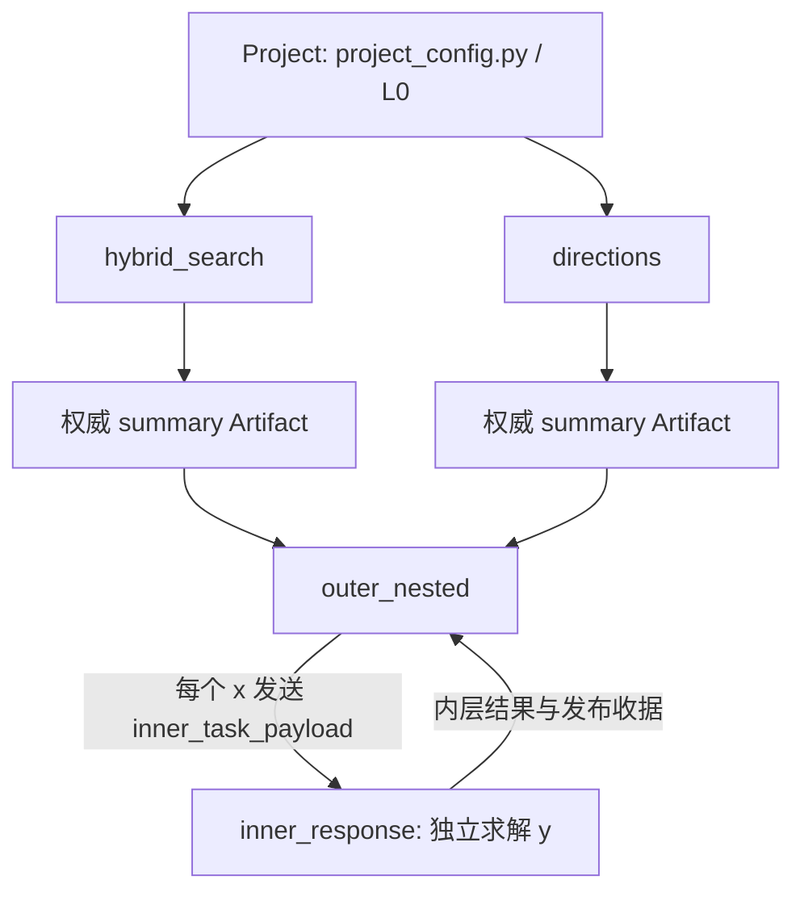
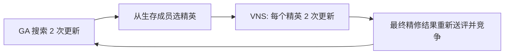

# 综合装配工作台：从一个完整 Case 到多 Case Project

这个 Project 用真实的小规模运行回答：组件分别写在哪里，怎样装配，候选怎样走，哪些地方可以替换，以及装配之后如何确认它真的生效。

建议先看主 Case 的 `build_solver.py`，再沿调用读组件。不要从 Catalog 的全部类名开始背。
完整逐层说明在 [装配讲解](ASSEMBLY_GUIDE_CN.md)，所有本地可执行代码逐文件收在
[源码读本](SOURCE_CODE_CN.md)。实际运行结果见 [RESULTS_CN.md](RESULTS_CN.md)。

## 1. 四个 Case 各负责什么

`hybrid_search` 是完整主 Case。用 GA 搜索一个带硬容量约束的两原料配方；
通过普通函数装配“交叉再变异”和“选择生存成员、发布精英池”；
VNS 从本轮精英开始精修，再把最终选择交回原来的 GA。重复两轮。
同时包含共享问题 Pipeline、自定义成员年龄 Unit、Bias、硬接纳、求值预算、检查点、观察与严格发布校验。

`directions` 展示多目标与算法结构之间的关系。MOEA/D 发布方向投影，
VNS 接方向视图，Pattern Search 接 VNS 的结果视图，最后由原 MOEA/D 重新比较和替换。
还提供随机抽方向和两个精修器并行的变体。它不加 Bias，因此 Pareto 档案仍可按本问题原始目标解释。

`outer_nested` 和 `inner_response` 展示真正的 Case 嵌套。外层搜索决策 x，
每次评分都会用正式 Case 请求启动一个独立的内层求解，内层搜索响应 y。
它们有不同 Problem、Solver、Unit、解池与运行身份，沿共享底座继承授权与调用血缘。

## 2. 先看三层编排图



默认 Project 的第一阶段让 H 和 D 真正并发运行；第二阶段在两个输入都已权威发布后执行 O。
另有 `dag` 分组，使用相同 Artifact 依赖推导就绪顺序。

主 Case 内部则是一个 Solver 下的局部算法编排：



这个环默认重复两轮。环里的 GA、VNS 持有自己的 Unit，复用同一个 Case 解池与评估控制面。
Case 内的 `multi` 是提案与任务汇合；Project 的 `parallel` 是独立 Case 的并发执行；
Problem 中 `CaseRuntimeContext.invoke` 是请求另一个完整 Case。三个位置不混用。

## 3. 最快的阅读与运行路线

在已安装本机开发版本的环境中，从 nsgablack 仓库根执行：

```powershell
python examples/cases/assembly_workbench/run_project.py --check --build-check
python examples/cases/assembly_workbench/run_and_report.py
```

第一条实际构建默认三个顶层 Case，输出实际 Problem、Pipeline、Adapter、Provider、Plugin 数量与生效资源。
它不运行搜索，不产生上游成果，所以构建检查不能替代第二条的真实 Artifact 交接。

第二条只调用正式 `execute_project`，然后校验身份、收据与下游输入，生成：

- `results/project_result.json`：完整正式 Project 返回值。
- `results/summary.json`：每个顶层 Case 的提交、求值、实际组件、授权与发布引用。
- `RESULTS_CN.md`：本次结果的中文阅读入口。
- `results/hybrid_search/trace.json`：主 Case 的每次提交、成员年龄、精英、修复、raw/selection。
- `results/directions/trace.json`：方向来源、冻结投影、父子视图、精修结果与 Pareto。
- `results/outer_nested/nested_report.json`：每次内层调用的身份、预算、授权、结果和 Artifact 收据。
- `.blackbase/`：正式 Project manifest、L0 与 Artifact 存储。

本地 trace 是教学观察。跨 Case 消费依靠带发布证明的 ArtifactBinding，不靠文件名。
如果结果与 trace 的运行身份不同，报告入口拒绝拼出一份混合结果。

只看一个装配场景时：

```powershell
python examples/cases/assembly_workbench/run_project.py --group hybrid
python examples/cases/assembly_workbench/run_project.py --group provider
python examples/cases/assembly_workbench/run_project.py --group directions
python examples/cases/assembly_workbench/run_project.py --group random_directions
python examples/cases/assembly_workbench/run_project.py --group parallel_refiners
python examples/cases/assembly_workbench/run_project.py --group nested
python examples/cases/assembly_workbench/run_project.py --group inner
python examples/cases/assembly_workbench/run_project.py --group dag
```

`nested` 单独运行时没有两个上游 Artifact，会明确标记 builtin 基线来源；
它仍通过 Project L0 和正式内层请求执行。默认完整流程才展示上游 Artifact 注入。
`provider` 分组使用与主 Case 相同的候选、Bias 与硬接纳，改走等价向量化 Provider 求值；默认完整流程使用 Problem 路径。
要为这些变体同时生成核对报告，运行 `run_and_report.py --group <组名>`。
单独 run_project 只执行 Project；若它覆盖了某个 Case 的 trace，旧汇总的 --report-only 会拒绝混入这个新运行。

从各 Case 检查入口也能看到实际装配：

```powershell
python examples/cases/assembly_workbench/cases/hybrid_search/run_solver.py --check
python examples/cases/assembly_workbench/cases/directions/run_solver.py --check
python examples/cases/assembly_workbench/cases/outer_nested/run_solver.py --check
python examples/cases/assembly_workbench/cases/inner_response/run_solver.py --check
```

## 4. 目录怎么对上框架概念

```text
assembly_workbench/
  project_config.py          # Project 串行、并行、DAG、输入 Artifact、唯一 L0
  run_project.py             # 正式 Project CLI 的薄入口
  run_and_report.py          # 正式执行后只读核对、生成报告
  README.md                  # 从这里开始
  ASSEMBLY_GUIDE_CN.md        # 逐组件、逐数据流、逐种改法
  SOURCE_CODE_CN.md           # 本 Project 代码读本
  RESULTS_CN.md              # 已运行结果
  cases/
    __init__.py
    hybrid_search/
      .case
      config.py              # 本例参数
      build_solver.py        # 唯一规范装配入口
      run_solver.py          # 标准 Case CLI
      build_trainer.py       # 薄别名
      run_trainer.py         # 薄别名
      problem/               # 目标与约束
      pipeline/              # 候选处理、问题修复、Unit builder 定义
      adapter/               # 算法行为函数与局部编排
      bias/                  # 候选软评分
      evaluation/            # 可选等价 Provider
      plugins/               # 观察和发布校验
      runtime/               # 本例资源职责说明
      solver/                # 控制面落点；主例复用 ComposableSolver
      catalog/entries/       # 自定义组件的可发现声明
    directions/              # 相同脚手架形状，装配不同
    outer_nested/            # 外层 Problem + 正式 Case 边界包装
    inner_response/          # 接收条件 payload 的独立 Case
```

空的语义目录表示此 Case 不需要本地实现，例如 directions 不写 Bias。
共同的求解、存储、事务和资源实现继续来自 nsgablack / BlackBase 包，不复制到每个 Case。

## 5. 看装配时先抓这五个文件

1. [主 Case build_solver](cases/hybrid_search/build_solver.py)：Problem、Pipeline、Adapter、Bias、接纳、Controller 与 Plugin 在哪里汇合。
2. [主 Case 行为编排](cases/hybrid_search/adapter/composition.py)：两个算法实例如何被重复调用、池任务怎样声明来源与返回。
3. [主 Case 普通变化／选择函数](cases/hybrid_search/adapter/operations.py)：交叉变异顺序、Pool.chosen 和精英 inject。
4. [方向 Case 编排](cases/directions/adapter/composition.py)：按实例选择投影视图、替换精修算法、串行与并行变体。
5. [Project 配置](project_config.py)：独立 Case 的执行顺序、上游 Artifact、资源授权。

再按疑问读 Unit、Problem 和运行报告。每个本地组件的完整实现都在源码读本中；
它们是真实文件内容，不是另一套伪代码实现。

## 6. 主 Case 已经把哪些装配位置跑通

- Problem：原始配方成本与硬容量约束。
- Pipeline：初始化、VNS 所用的上下文变异、共享问题 repair。
- Unit：继承 PopulationUnit，声明成员年龄并自动随成员变更对齐。
- Adapter：GA 与 VNS；完整变化函数、生存选择函数、两轮 serial/repeat、返回竞争。
- Pool：初始版本、精确成员引用、精英普通集合、最终精修视图、同次成员与副池提交。
- Bias：比例均衡软偏好；raw 成本和选择分数同时可见。
- Acceptance：只读 raw violation 的可行性门。
- Evaluation：默认 Problem 路径；可选等价向量化 Provider 路径。
- Controller：总求值预算。
- Plugin：检查点、提交观察、正式 finalization veto。
- Snapshot／Authority：原控制面拥有提交；报告核对 Pool 与权威引用。
- Catalog／Doctor：自定义组件可发现，实际构建纳入检查。

directions 补充多目标、Pareto、MOEA/D 分解、按实例抽方向、投影视图的子视图与精修器互换；
两个 nested Case 补充标准输入 payload、内外层不同 Problem、独立解池、权威 Artifact 和 L0 血缘。

本例不把所有可选后端都装上。外部数据库、GPU、远程 Provider、ML Trainer、A*/MOA* 的路径 Unit、
Provider 活状态槽位和严格联合 UnitRepair 有各自接入要求，本 Project 没有声称实际运行它们。
这些边界和后续入口在详细讲解末尾列出。

## 7. 建议怎样用它判断“装配是否舒服”

先独立修改一个点，例如只改 GA 的交叉／变异次序，或只把 fine 精修器换掉。
检查改变是否局限于对应组件和装配参数；Problem、共享 Pipeline、运行入口应继续表达原来的含义。

再试两种组合改变：把 directions 的两层精修改成并行；把 Project 的两阶段改成 DAG。
观察改变的是调度与输入来源，还是被迫修改算法内部、候选身份或底层事务。

最后读真实运行结果：新组件有没有出现在实际组件清单里、任务输入是不是预期池、
raw 是否仍完整、返回的是最终解还是历史提案、是否增加了预期之外的求值。
这些问题比“可以 import 多少个类”更能暴露装配体验。

## 8. 验证入口

```powershell
python -m nsgablack project doctor --path examples/cases/assembly_workbench --strict --build --catalog-audit --profile framework-core --format json
python -m pytest tests/test_assembly_workbench_hybrid.py tests/test_assembly_workbench_directions.py tests/test_assembly_workbench_nested.py tests/test_assembly_workbench_project.py -q
```

具体通过数、实际运行规模与边界以本次 RESULTS_CN.md 和详细讲解的验证记录为准。
这是装配与交接验收，小问题上的一次运行不能证明算法性能优越性。
